{/* Source: Intercom article 10489271 - https://oloid.help/en/articles/10489271-devicelock-app-how-to-create-and-configure-devicelock-endpoint-template-in-tenant-admin-portal */}
{/* Generated by intercom_to_mintlify.py - re-running overwrites this file. */}

## Introduction

The DeviceLock Endpoint Template in the Tenant Admin Portal allows admin to create and manage standardized configurations for DeviceLock endpoints, including access controls, logging preferences, integrations, and health alerts.

## Prerequisite

You must have a Tenant Admin Account.

## Steps to Create Endpoint Template

1. Log in to the **Tenant Admin Portal**.
2. On the homepage, select **Endpoint** from the left menu panel.

   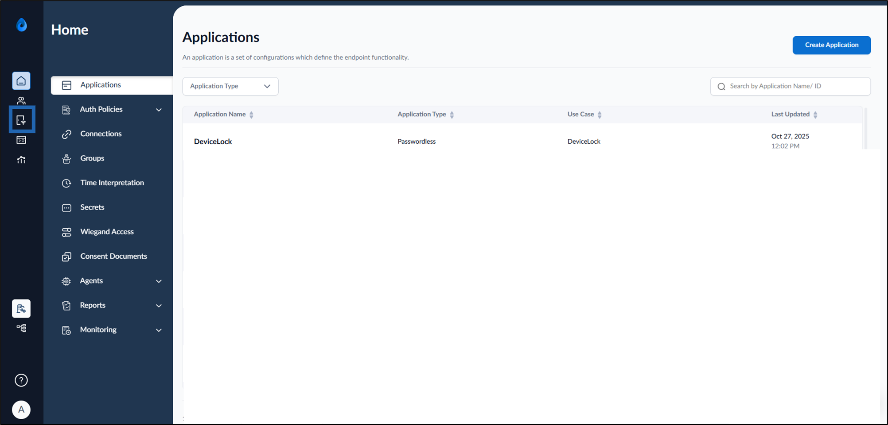

   The **Endpoints** page is displayed.
3. Click **Endpoint Templates** from the top right.

   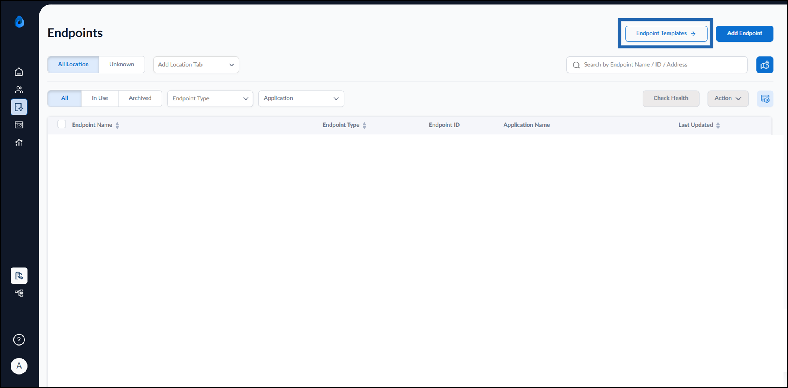

   The **Endpoints Templates** page is displayed.
4. Click **Create Template** from the top right.

   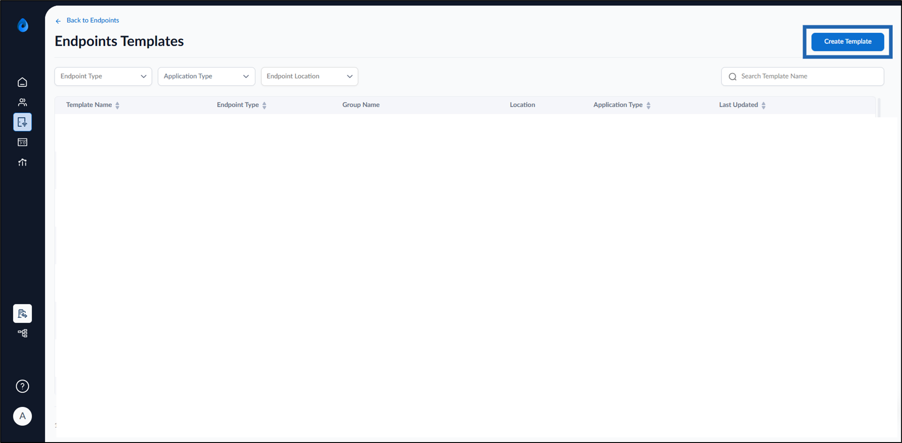

   The **Create New Template** pop-up box is displayed.
5. Do the following:
   1. Enter **Template Name**.
   2. Select **Passwordless** in **Application type** from the dropdown list.
   3. Select **DeviceLock** for **Endpoint Type** from the dropdown list.
   4. Click **Create**.

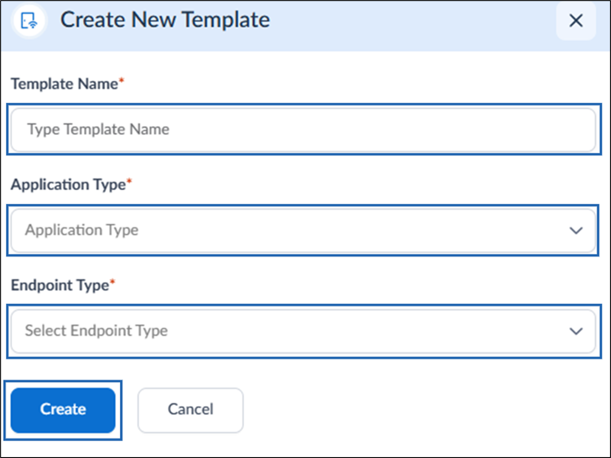

The DeviceLock endpoint template is created and listed in Endpoint Template page.

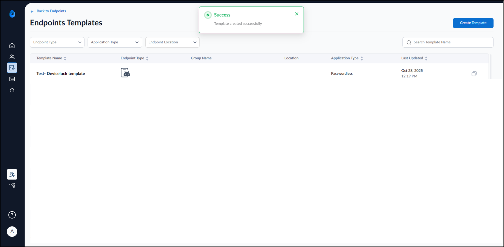

## Steps to Configure Endpoint Template

1. Select **DeviceLock endpoint** name to configure.

   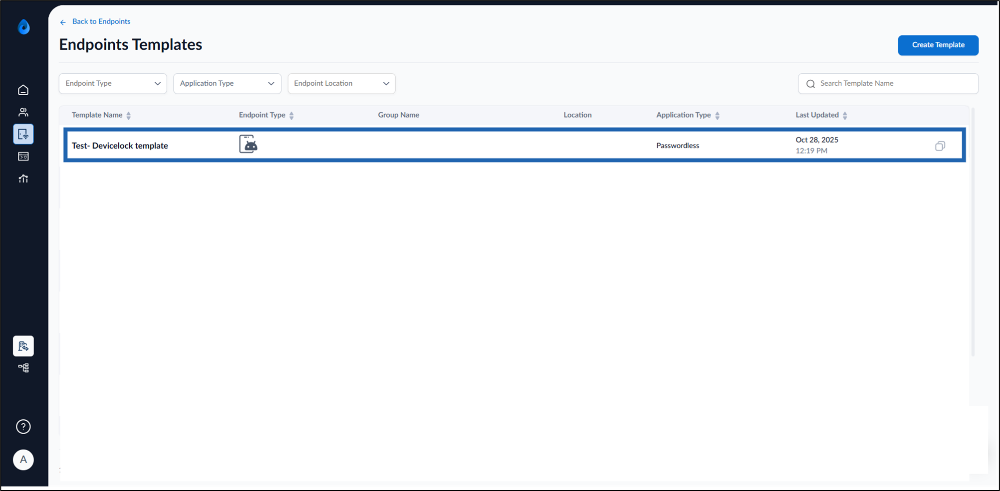

   The **Template Details** page is displayed.

   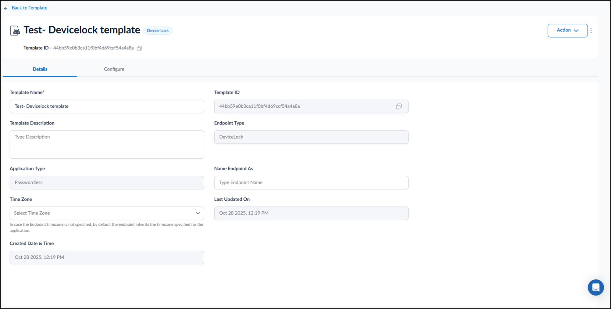

2. Configure the following tabs:
   1. [Details tab](#configure-details-tab)
   2. [Configure tab](#setup-configure-tab)

### Configure Details Tab

1. Edit **Template Name** (If required).
2. Enter **Template Description**. (Optional)
3. Enter name in **Name Endpoint As** text field. (Optional)
4. Select **Time Zone** from the dropdown list. (Optional)
5. Click **Save**.

   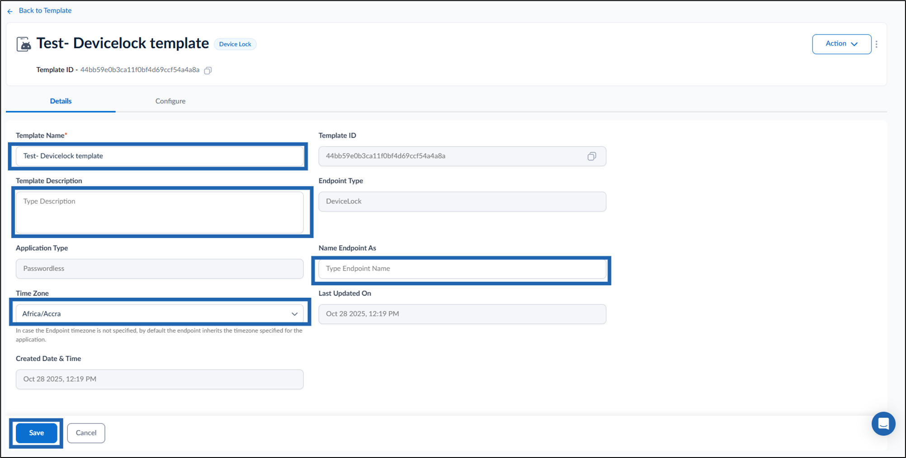

   The Details tab is configured successfully.

   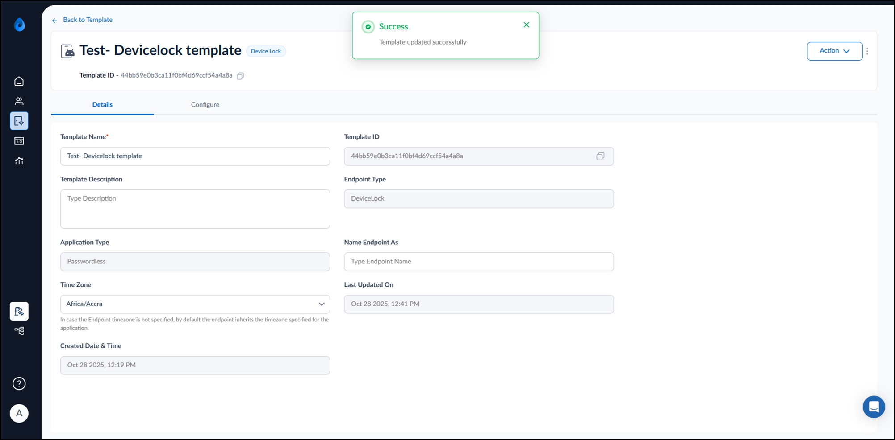

### Setup Configure Tab

Go to configure tab and do the following:

[Endpoint Setting](#endpoint-setting)

[Groups](#groups)

[Integration](#integration)

[Health Setup](#health-setup)

#### Endpoint Setting

1. Turn on **Use Endpoint in Admin Mode Only** toggleto disable user's access control.
2. Turn on **Capture Location** toggle to activate the location capture on the endpoint for every transaction.

   <Note>
     **Note:** Enable the location permission of the device to make **Capture Location** feature functional.
   </Note>

3. Turn on **Generate Debug Logs** toggle to activate log generation for endpoint until disabled.

Click **Save**.

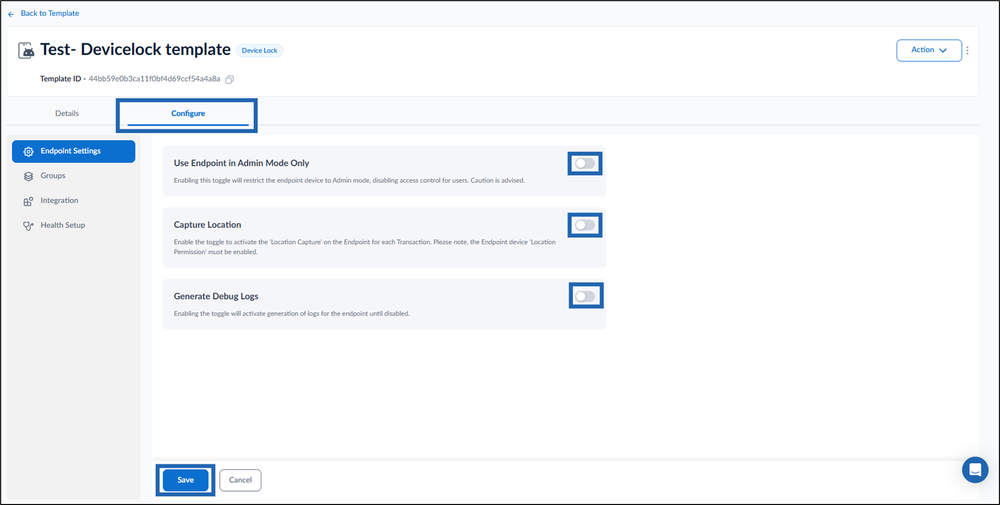

The Endpoint setting is configured successfully.

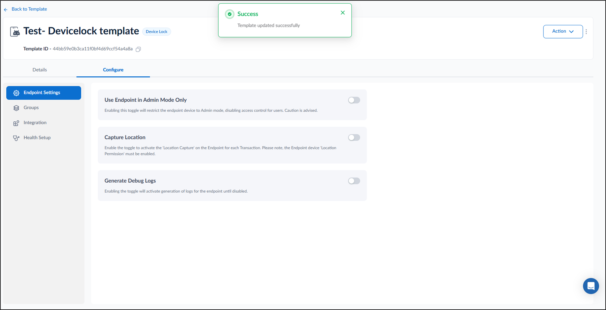

#### Groups

1. Select **Groups** option from left menu panel > click **Add Group**.

   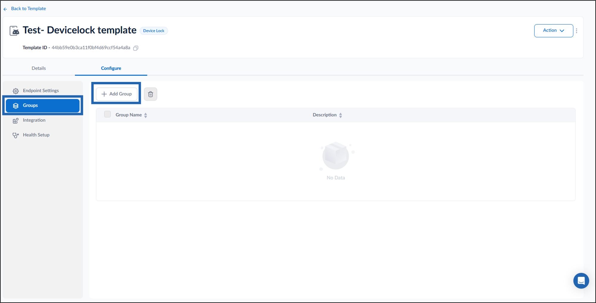

2. The **Add Group** pop-up box is displayed.
3. Select **Group(s)** from the dropdown list.
4. Click **Add**.

   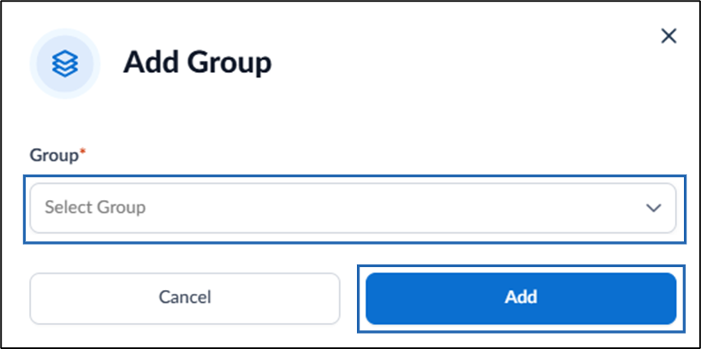

The group is added successfully.

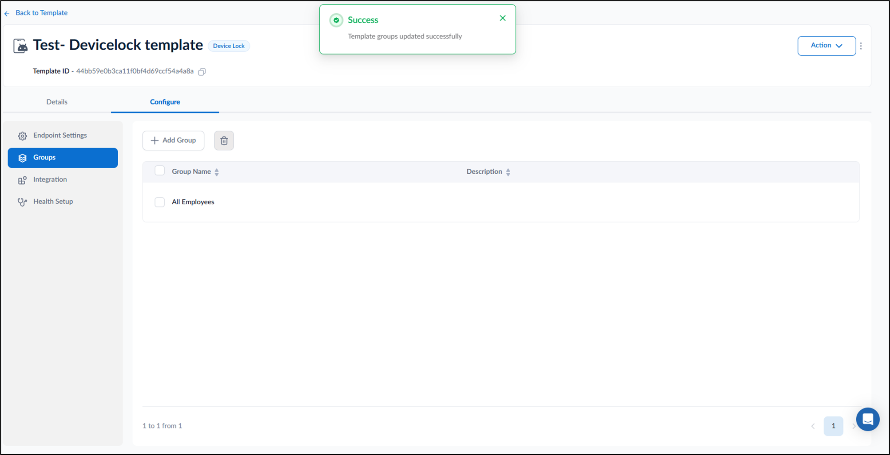

#### Integration

You can enable those **Integrations** which are requiredto perform local actions or on-premises processing.

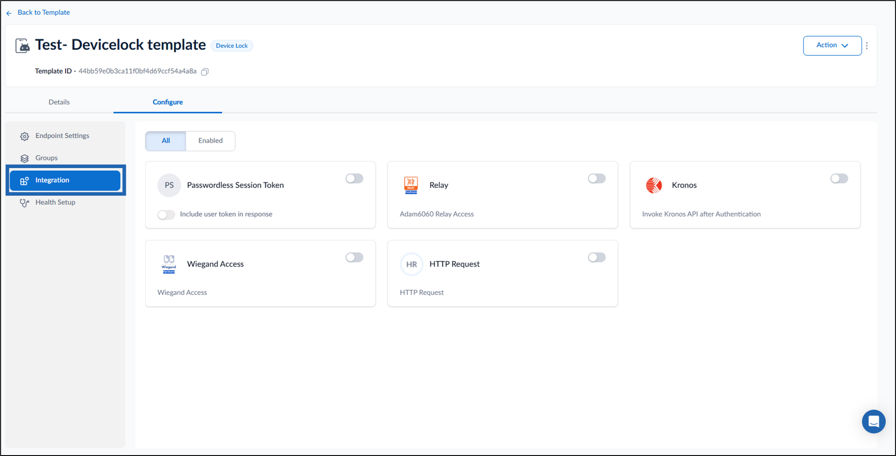

#### Health Setup

1. Turn on **Enable Health Alerts** toggle to get endpoint health notification. (Optional)
2. Enter Email ID to whom you want to share the health alerts in **Add recipients for Endpoint health Alerts** fields. (Optional)
3. Set **alert email frequency** in hours and minutes.
4. Click **Save**.
5. Enter **Server Name**.
6. Enter URL in **Add URL that needs to be monitored**.

Click **Add**.

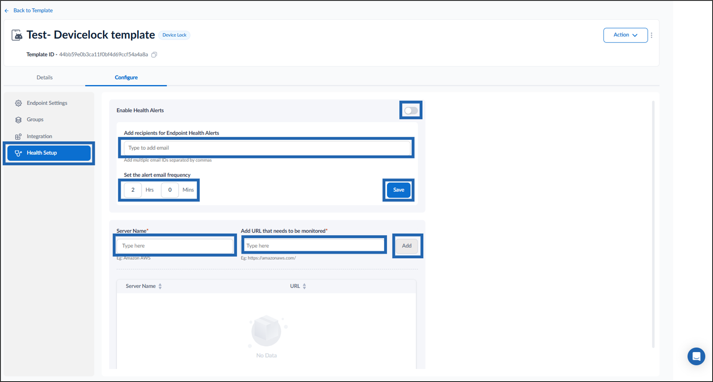

You have successfully configured health setup.

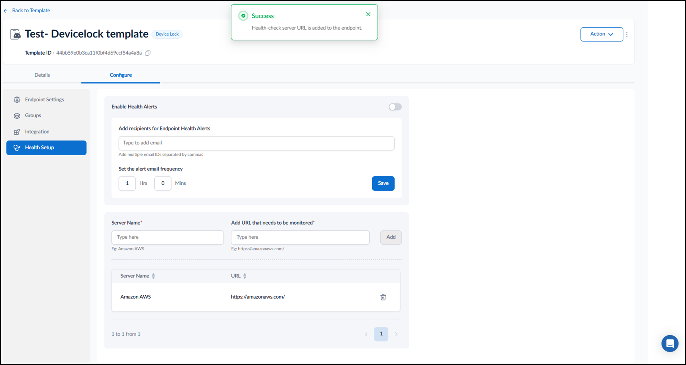
