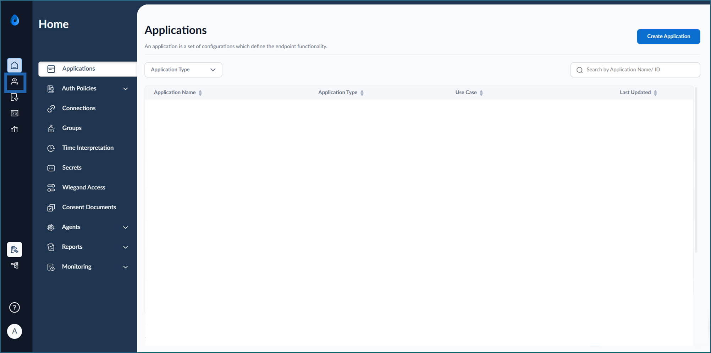
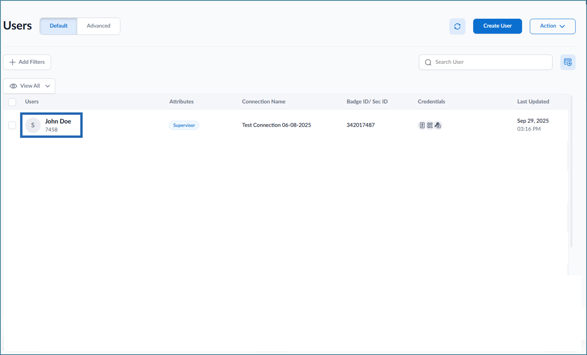
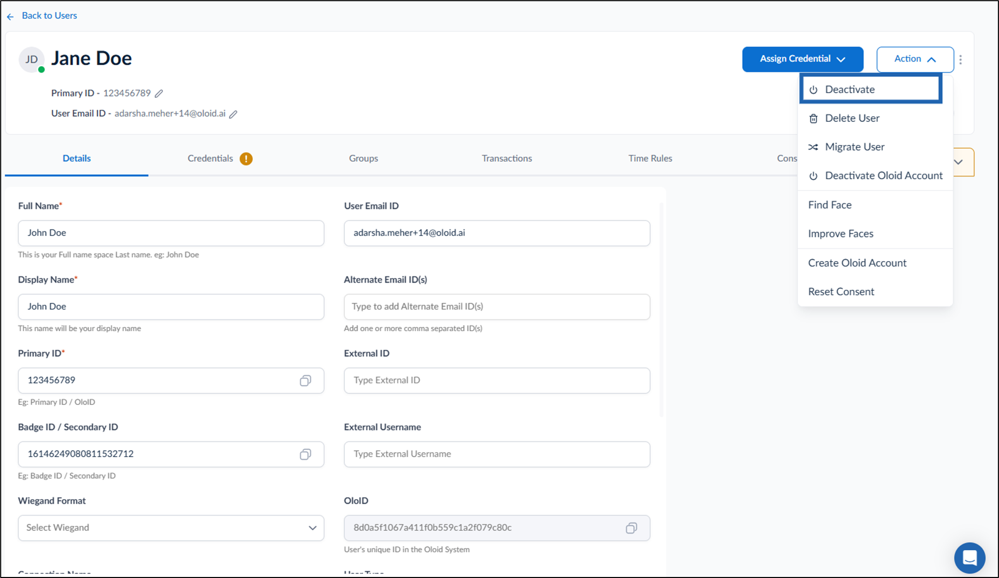
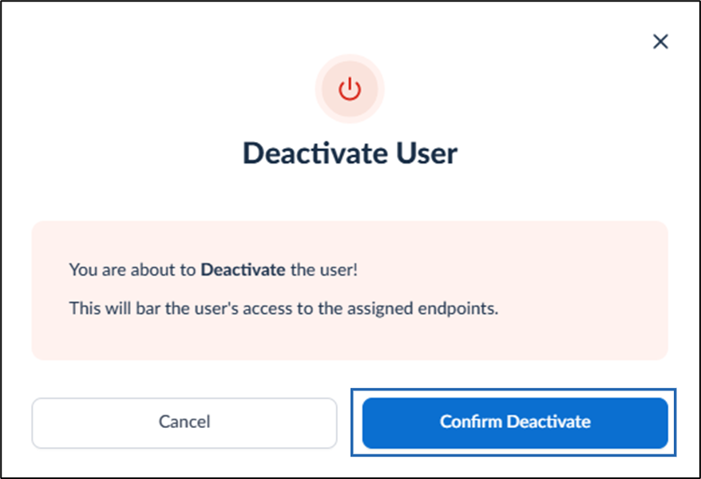
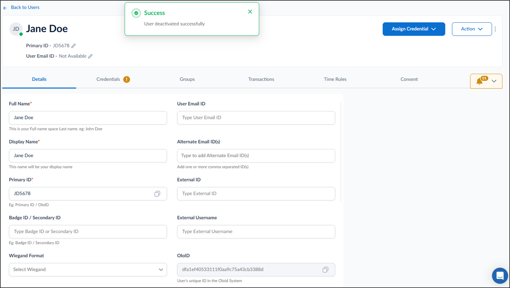
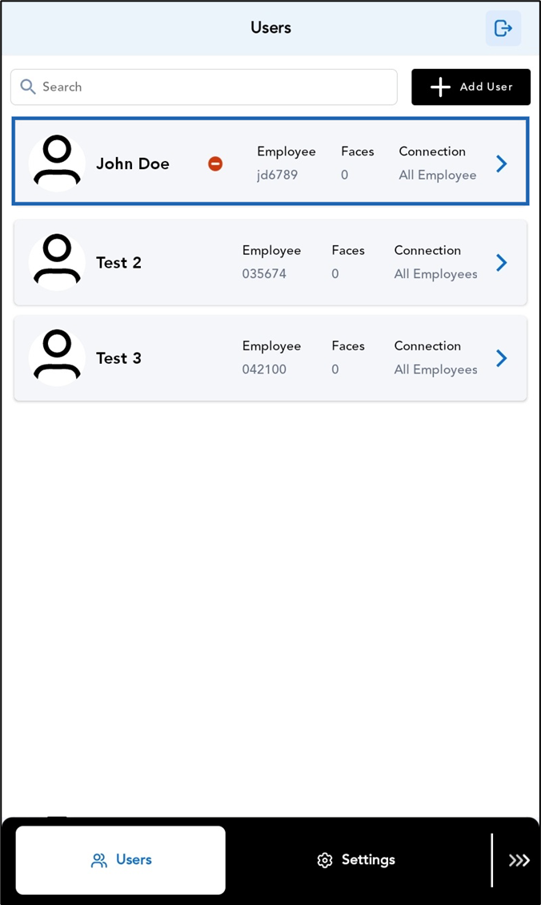
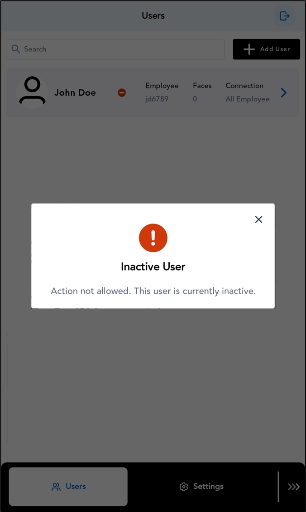

{/* Source: Intercom article 12569918 - https://oloid.help/en/articles/12569918-devicelock-app-how-to-deactivate-user-s-for-devicelock-application-in-the-tenant-admin-portal */}
{/* Generated by intercom_to_mintlify.py - re-running overwrites this file. */}

## Introduction

The Tenant Admin Portal allows admins to manage user access for the DeviceLock application. If a user no longer needs access or must be temporarily restricted, admins can deactivate their account. Deactivation instantly revokes the user’s access to the DeviceLock app while securely retaining their account information for future reactivation.

## Prerequisites

- You must have a Tenant Admin account.
- The user must be registered in the Tenant Admin Portal.

## Steps to Deactivate User

1. Log in to the **Tenant Admin Portal**.
2. On the home page of the portal, click **Directory** on the left menu panel.

   

   The **Users** page is displayed.
3. Click Username to edit.

   

   The user details page is displayed.
4. On the top-right, go to **Action** > **Deactivate**.

   

   The **Deactivate User** pop-up box is displayed.
5. Click **Confirm Deactivate**.

   

   The user is deactivated successfully.

   

   Below are the preview screens from the DeviceLock App showing the list of users and the ‘Deactivate User’ pop-up that appears after selecting a deactivated user.
   - Users list (home screen)

- Inactive User pop-up box

  
