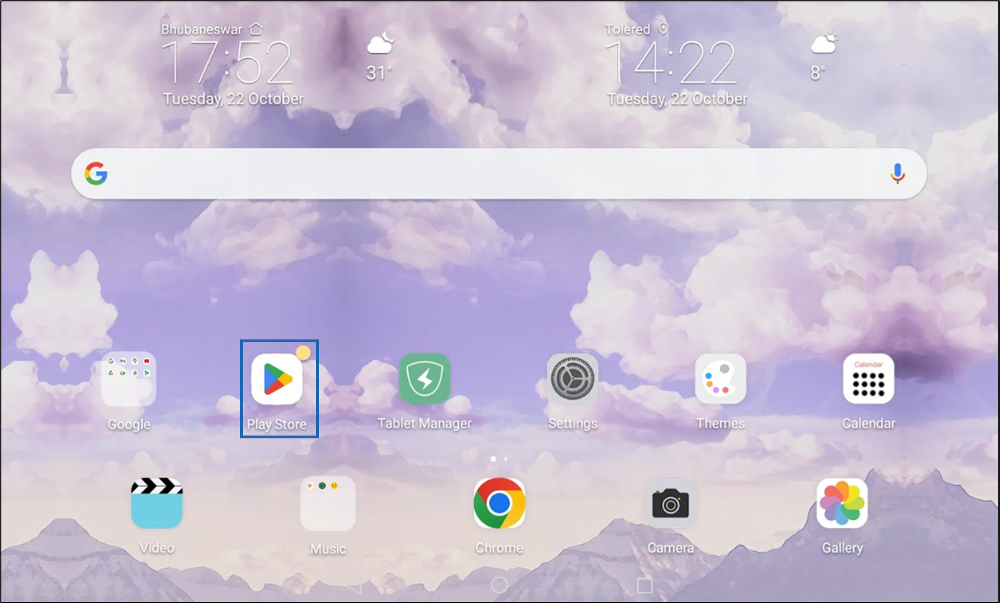
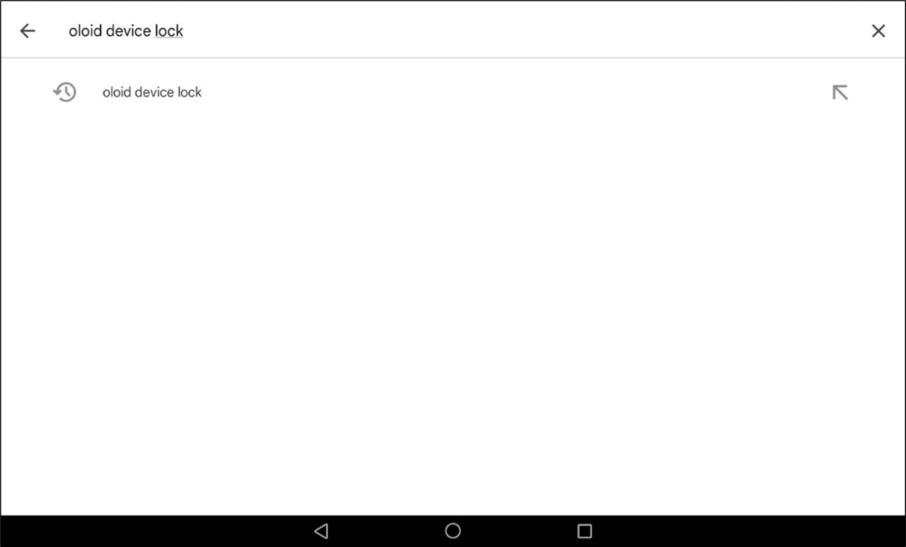
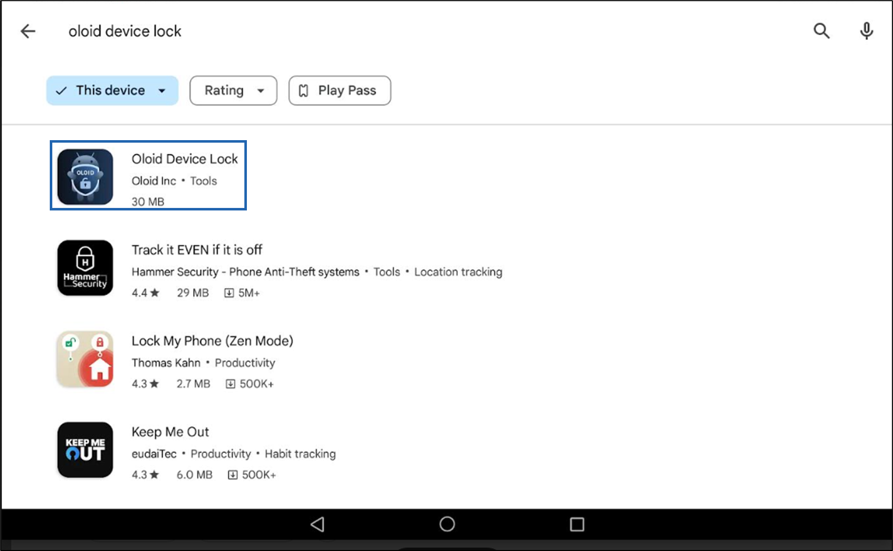
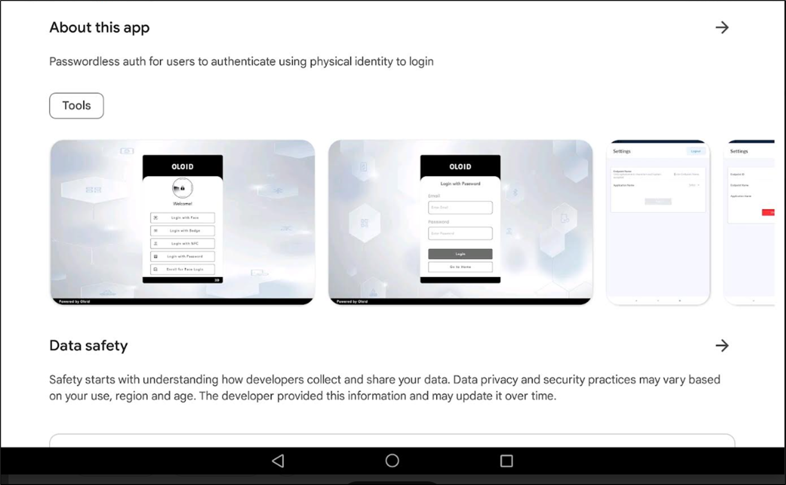
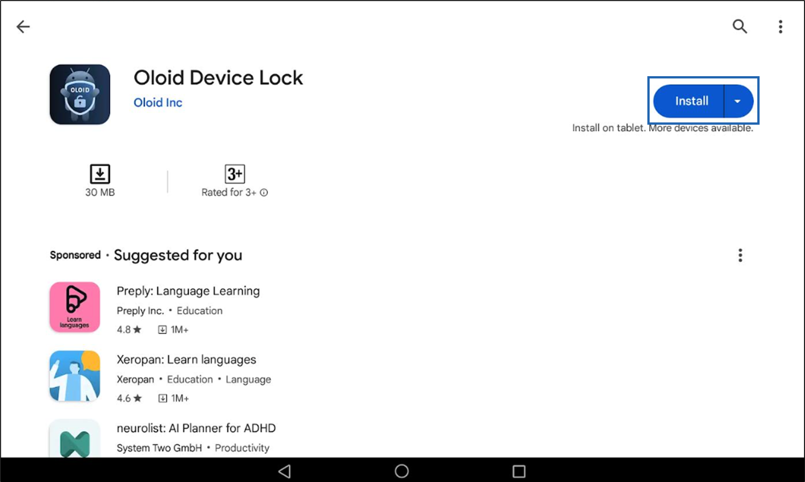

{/* Source: Intercom article 10062644 - https://oloid.help/en/articles/10062644-devicelock-app-how-to-download-devicelock-app */}
{/* Generated by intercom_to_mintlify.py - re-running overwrites this file. */}

## Introduction

This document provides step-by-step instructions to download and install the **DeviceLock** application from the Google Play Store on an Android device.

## Prerequisite

- Make sure you have a stable internet connection.
- You have access to the **Google Play Store** on the Android device.

## Steps to Download DeviceLock App

1. Locate the **Play Store** on your home screen and tap on it to launch the application.

   

2. Tap on the **Search** icon located at the bottom right corner of the screen.
   The Search bar is displayed.
3. In the search bar at the top of the screen, type **Oloid Device Lock** and tap on the search result.

   

4. Select **Oloid Device Lock** app.

   

5. Review the app's details, ratings, and user reviews to make sure it's the correct app you want to download.

   

Tap the **Install** button located next to the **Oloid Device Lock** app icon.

The **DeviceLock** app is installed successfully on the Android device.

Once the installation is complete, launch the **Oloid Device Lock** app to open.
