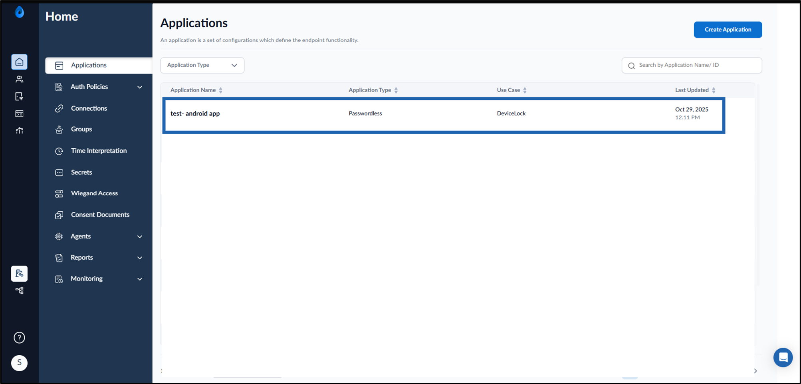
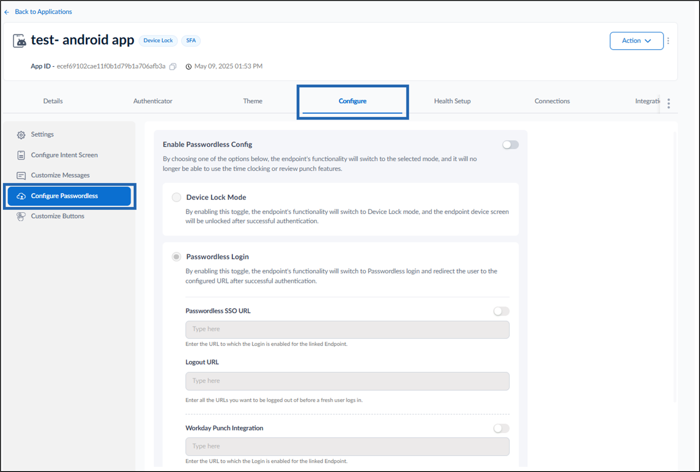
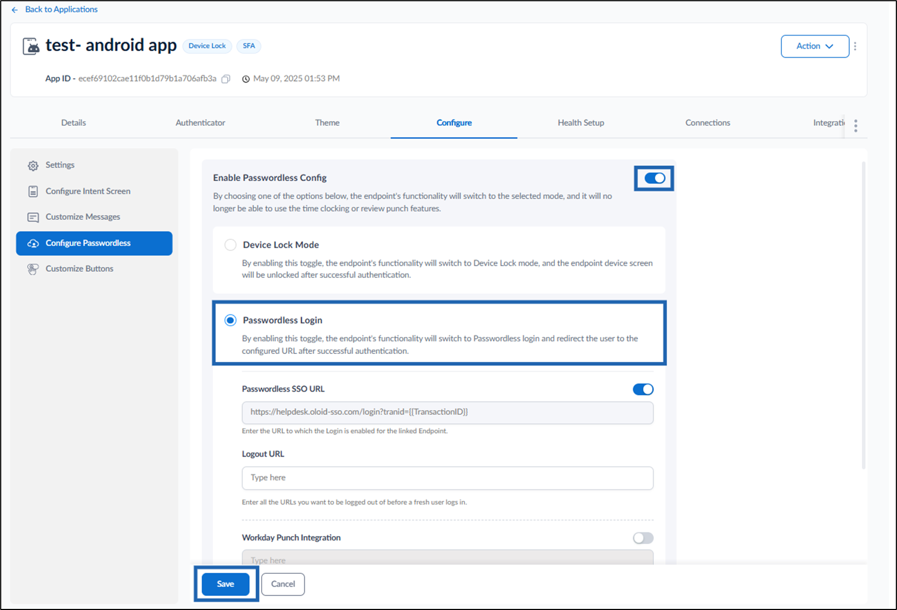
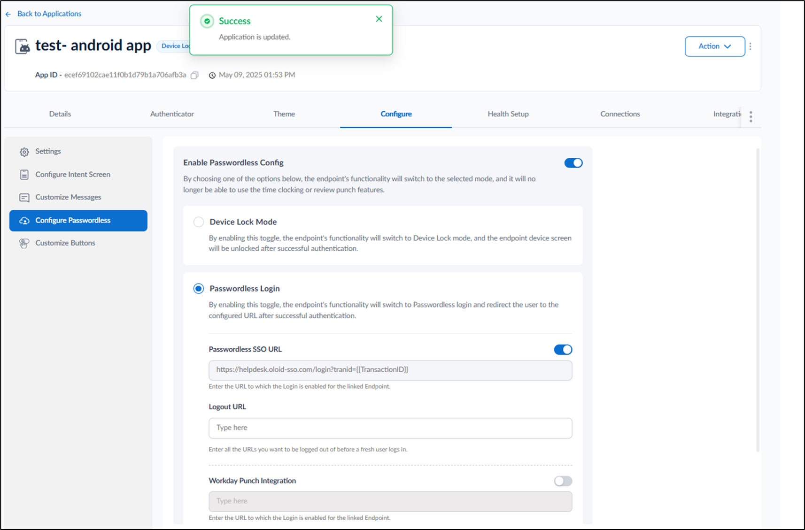

{/* Source: Intercom article 11513914 - https://oloid.help/en/articles/11513914-devicelock-app-how-to-enable-passwordless-login-for-devicelock-app-in-the-tenant-admin-portal */}
{/* Generated by intercom_to_mintlify.py - re-running overwrites this file. */}

## Introduction

The **Passwordless Login** feature in the **Oloid Tenant Admin Portal** allows admin to enable secure, password-free authentication for users. When enabled, the endpoint switches to passwordless mode and redirects users to the configured URL after successful authentication.

## Prerequisite

You must have **Admin access** to the **Tenant Admin Portal**.

## Steps to Enable Passwordless Login

1. Log in to the **Tenant Admin Portal**.
2. On the homepage of the portal, click the preferred application from the application list.

   

   The application detail page is displayed.
3. Go to **Configure** tab > click **Configure Passwordless** from the left menu panel.

   

Turn on **Enable Passwordless Config** toggle > select **Passwordless Login** > click **Save**.

<Note>
  **Note:** The Passwordless SSO URL toggle automatically turns on after you select Passwordless Login.
</Note>

The Passwordless Login is enabled successfully.

