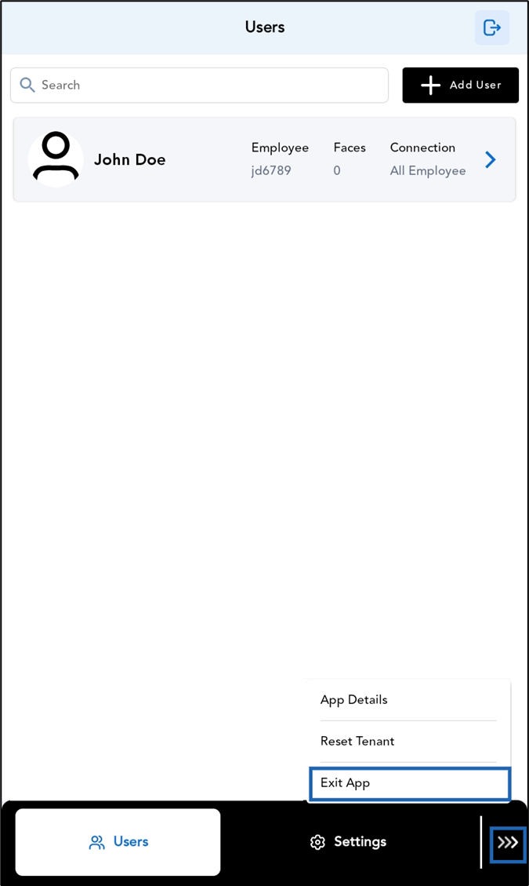
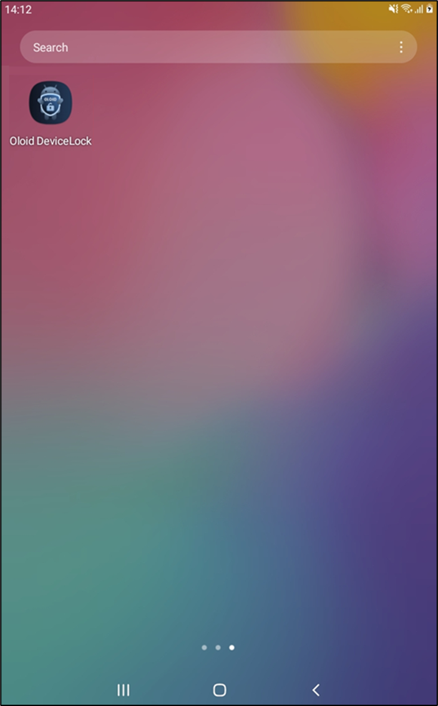

{/* Source: Intercom article 11484484 - https://oloid.help/en/articles/11484484-devicelock-app-how-to-exit-the-oloid-devicelock-app-in-admin-mode */}
{/* Generated by intercom_to_mintlify.py - re-running overwrites this file. */}

## Introduction

The exitfeature in the **Oloid DeviceLock App** allows admin to safely close the application while in **Admin Mode**. When the app is exited, the admin is automatically logged out and returned to the device home screen.

## Prerequisite

You must have **Tenant Admin access** to the **Oloid Tenant Admin Portal**.

## Steps to Exit the DeviceLock Application

1. Launch **Oloid DeviceLock App** on your device.

   

   The welcome screen is displayed.
2. Log in to Admin mode in **DeviceLock** App. For more details refer [How to log in to admin mode in DeviceLock App](/platforms/android/devicelock/devicelock-app-how-to-log-in-to-admin-mode).

Tap **More option** icon () on bottom-right side of the screen> Tap **Exit App**.

<Note>
  **Note:** By Tapping **Exit App**, you will be logged out and redirected to the **home** screen of the device.
</Note>

The Oloid DeviceLock App exited successfully.

