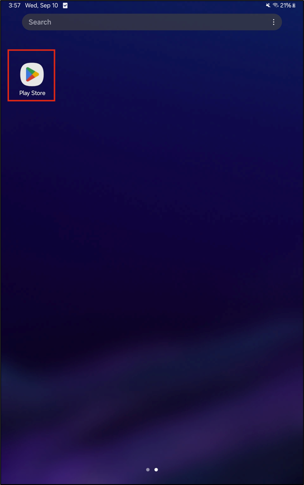
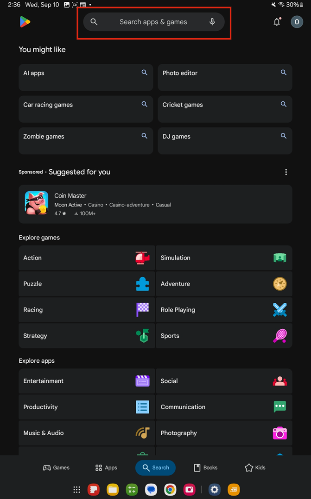
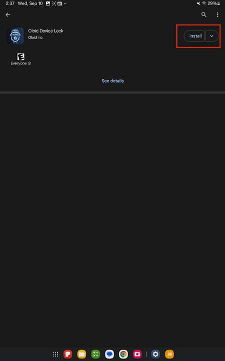
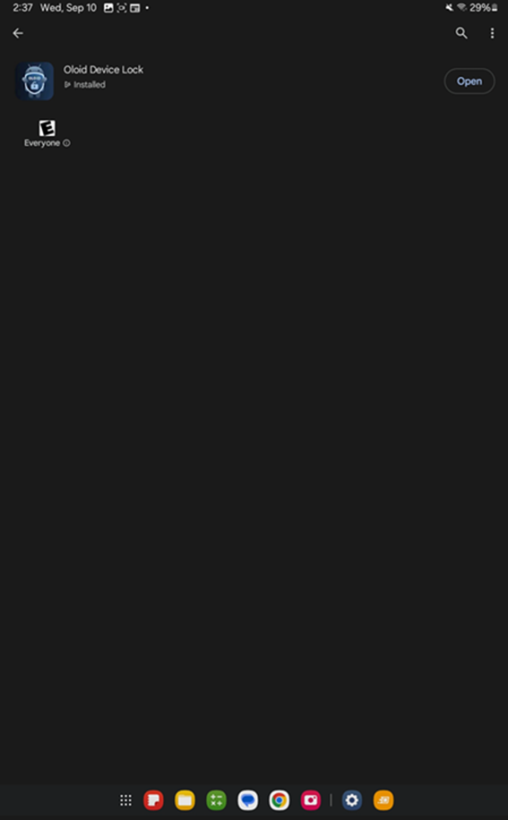

{/* Source: Intercom article 8679116 - https://oloid.help/en/articles/8679116-devicelock-app-how-to-install-oloid-devicelock-app */}
{/* Generated by intercom_to_mintlify.py - re-running overwrites this file. */}

## Introduction

Oloid DeviceLock is an Android application designed to provide secure, passwordless access to devices and applications. It enables organizations to replace traditional passwords with modern authentication methods such as facial recognition, NFC/ID, badges, QR codes, or PINs. DeviceLock is particularly useful for shared devices, ensuring quick and secure logins for multiple users while maintaining enterprise-level security and compliance.

## Prerequisite

- You must have an **Android device** that meets the required specifications. To know about required specification, refer to [Hardware requirement for Oloid DeviceLock installation](/platforms/windows/windows-login/devicelock-app-hardware-and-software-requirements).
- You must have a **stable internet connection** on the device.

## Steps to install Oloid DeviceLock App

1. Locate the **Google Play Store** on your Android home screen > launch the **Google Play Store** App.

   

2. Tap on the **Search** icon > enter **Oloid DeviceLock**.

   

3. Tap **Install** to begin the installation.

   

   The Oloid DeviceLock App is installed successfully.

   
