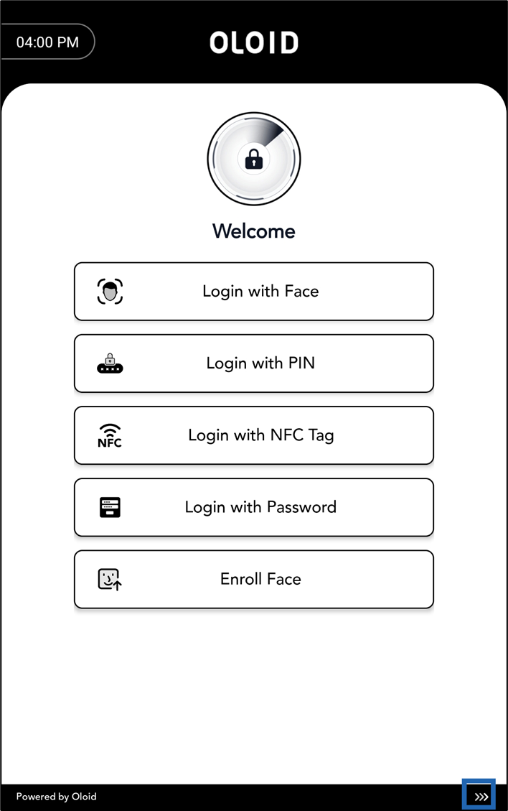
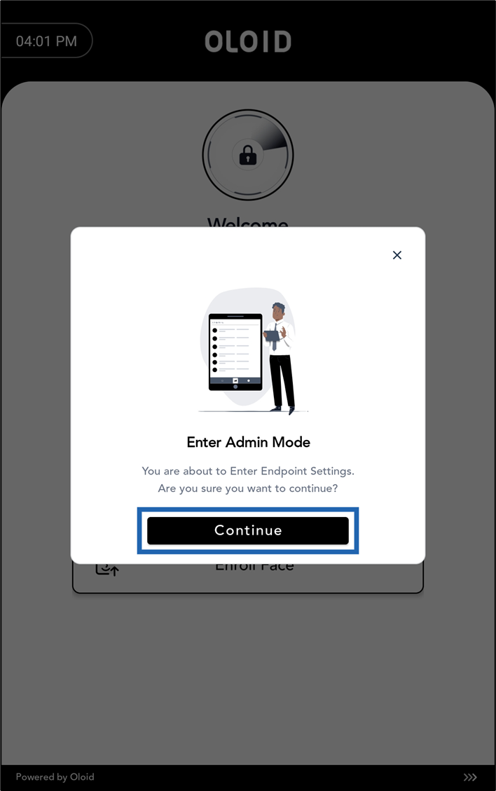
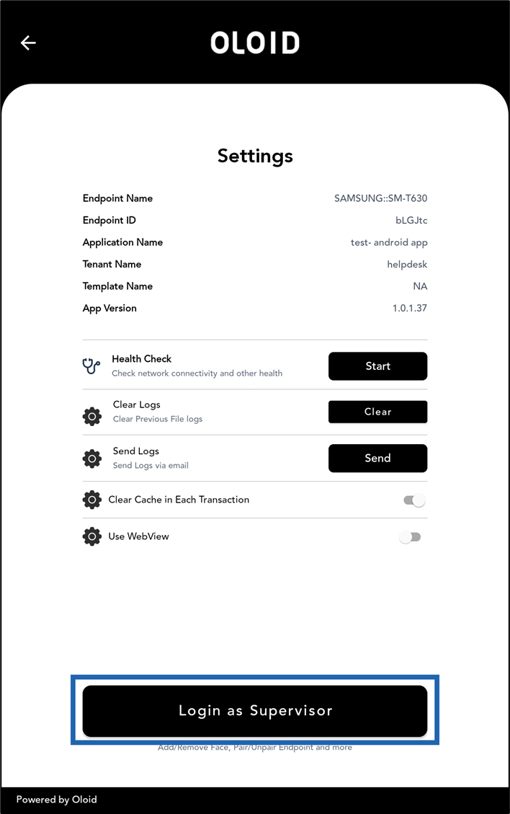
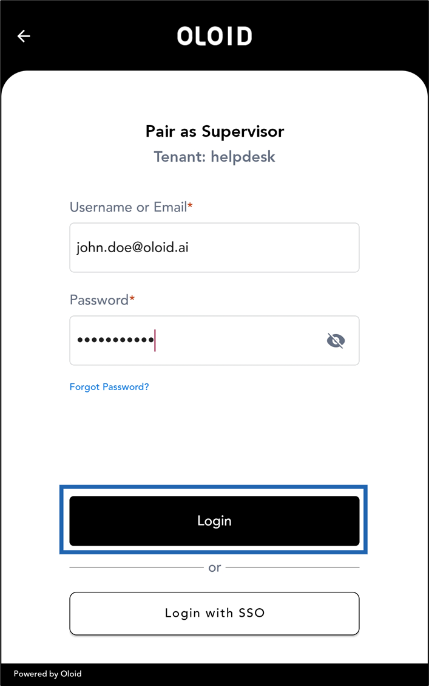
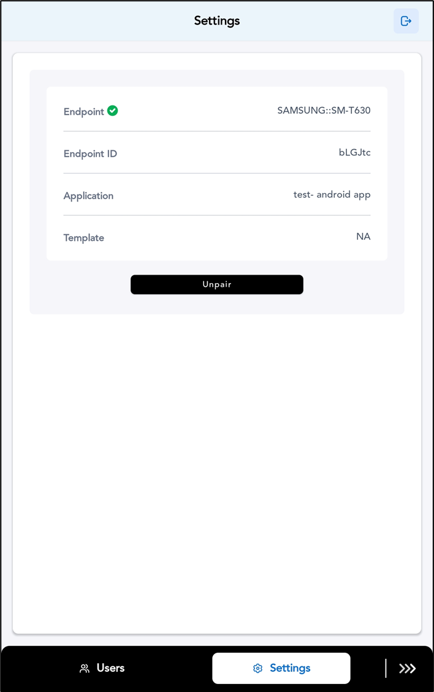

{/* Source: Intercom article 10353022 - https://oloid.help/en/articles/10353022-devicelock-app-how-to-log-in-to-admin-mode */}
{/* Generated by intercom_to_mintlify.py - re-running overwrites this file. */}

## Introduction

The **Admin Mode** in the Oloid DeviceLock app allows the Tenant Admin or Supervisor to access advanced settings and manage application configurations securely.

## Prerequisite

You must pair your endpoint with the Oloid DeviceLock app. To pair refer [How to pair a DeviceLock endpoint](/platforms/android/devicelock/devicelock-app-ways-to-pair-an-endpoint).

<Note>
  **Note:** After pairing the endpoint using either the *"Auto-Pair"* or *"Auto-Pair using Config File"* option, you can tap **Continue with Admin** on the success screen to log in as Admin. If Endpoint is paired you can follow the below steps.
</Note>

## Steps to log in to admin mode

1. Launch Oloid DeviceLock app.

   

   The Welcome screen is displayed.
2. Do one of the following:
   1. Tap more option (  ) on the bottom right side of the screen.
      or
   2. Double tap on the screen.

      

      The Enter Admin pop-up box is displayed.
3. Tap **Continue**.

   

   The Setting page is displayed.
4. Tap **Login as Supervisor**.

   

   The Pair as Supervisor screen is displayed.
5. Do the following:
   1. Enter **Username** or **Email ID** in the text field.
   2. Enter **Password**.
   3. Tap **Login**.

You have logged in to Oloid DeviceLock in Admin mode successfully.

