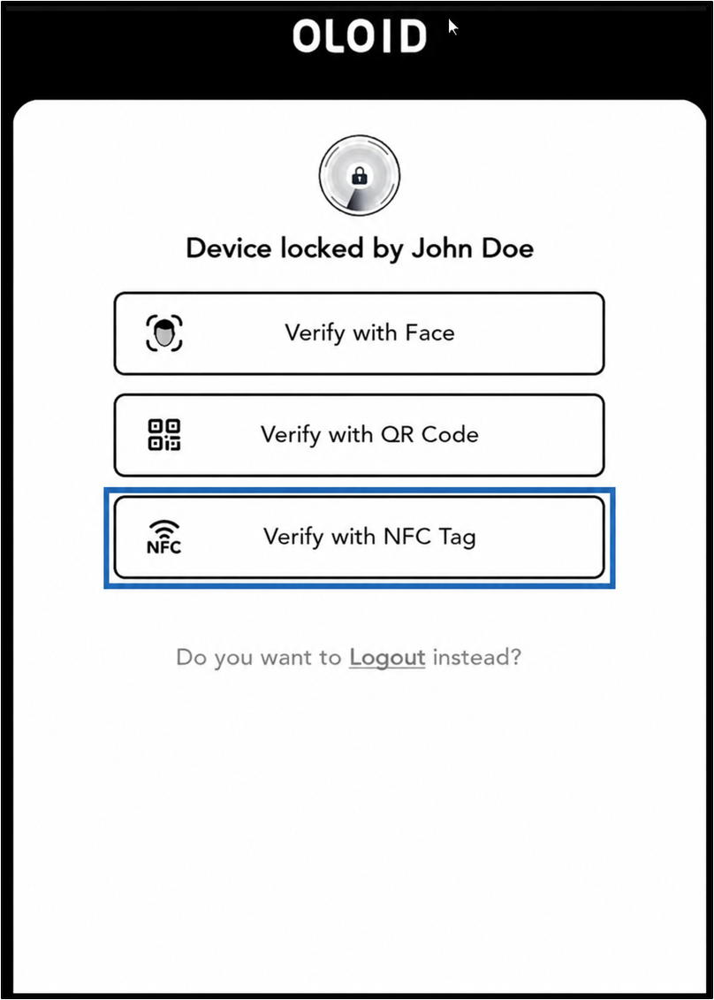
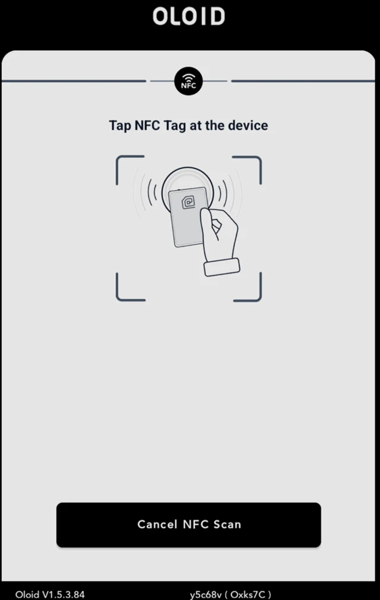
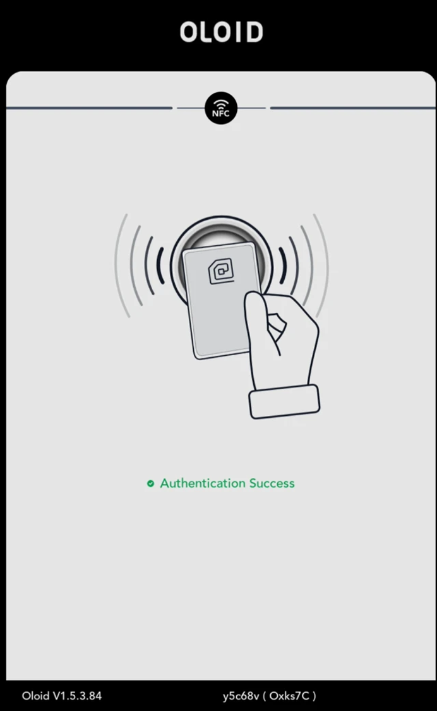

{/* Source: Intercom article 18243003 - https://oloid.help/en/articles/18243003-devicelock-app-how-to-log-in-with-an-nfc-tag-using-offline-nfc */}
{/* Generated by intercom_to_mintlify.py - re-running overwrites this file. */}

## Introduction

This document provides instructions to log in to the Oloid DeviceLock app using your NFC tag, even when the device has a slow or no internet connection.

With offline NFC, the device verifies your NFC tag on the device itself instead of through the cloud. This allows you to log in and continue working at sites where the network is slow, unreliable or unavailable, such as remote locations, warehouses and field sites.

## Prerequisites

- You must have an NFC tag registered to you.
- The device must have an NFC reader, either built into the device or attached as an external reader.

## Steps to Log In Using Your NFC Tag

This section helps you log in to the DeviceLock device using your NFC tag.

<Note>
  **Note:** You can follow these steps whether the device is online or offline.
</Note>

1. Press the **Power** button or tap the screen on your device.

   <Note>
     **Note:** The Device Lock app is displayed.
   </Note>

2. Tap **Verify with NFC**.

   <Note>
     **Note:** You will only see the authentication methods (Face, QR Code and NFC Tag) enabled for you. Button names may vary based on configuration. Contact [Support](mailto:Support@oloid.ai) if no authentication method appears.
   </Note>

   

   The **Tap NFC Tag at the Device** screen is displayed.
3. Tap the NFC tag to the reader.

   <Note>
     **Note:** Hold your NFC tag against the NFC reader until the device responds.
   </Note>

   

   <Note>
     **Note:** On devices with built-in NFC, such as Zebra devices, hold the tag against the device's NFC area. The position of the NFC area differs by device model. On many Zebra devices, it is on the back of the device and is marked with the NFC symbol.
   </Note>

   You have logged in successfully.

   

## Features Available After Log-In

After you log in, you can use one or more of the following features, depending on how your organization has set up DeviceLock.

| Feature | Description |
| --- | --- |
| **Web Application** | Open the website or web application set up for your role. |
| **Time Clock** | Punch in at the start of your shift and punch out at the end. |
| **Vault** | log in to work applications using the passwords saved for you in the Vault. |
| **Kiosk Mode** | Unlock the device and use the applications approved for it. |

<Note>
  **Note:** Offline NFC allows you to log in without a network connection. However, features that depend on the network, such as loading a website, may not work until the connection is restored.
</Note>

---

##### Related Document

[DeviceLock App - How to Configure Offline NFC for DeviceLock App in the Tenant Admin Portal](/platforms/android/devicelock/devicelock-app-how-to-configure-offline-nfc-for-devicelock-app-in-the)
