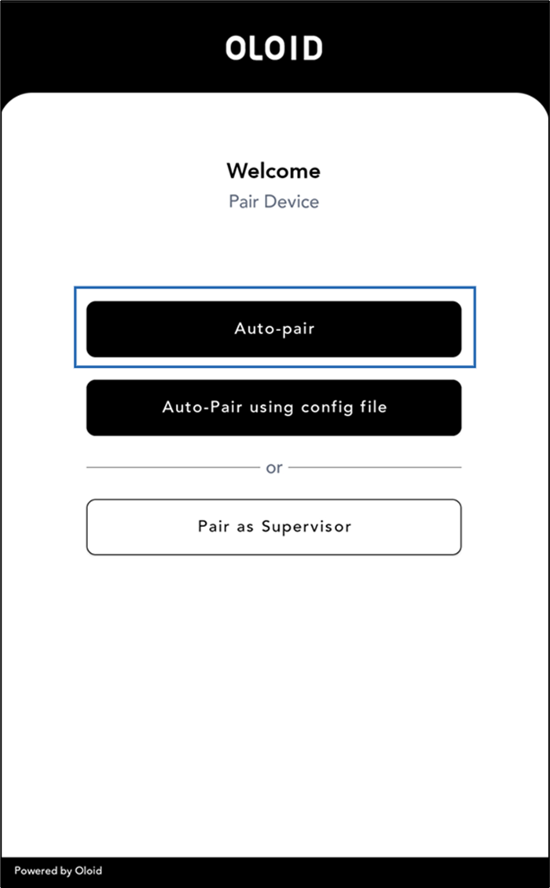
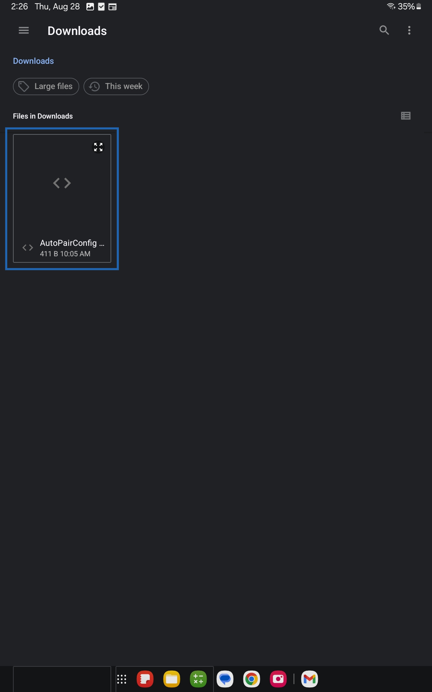
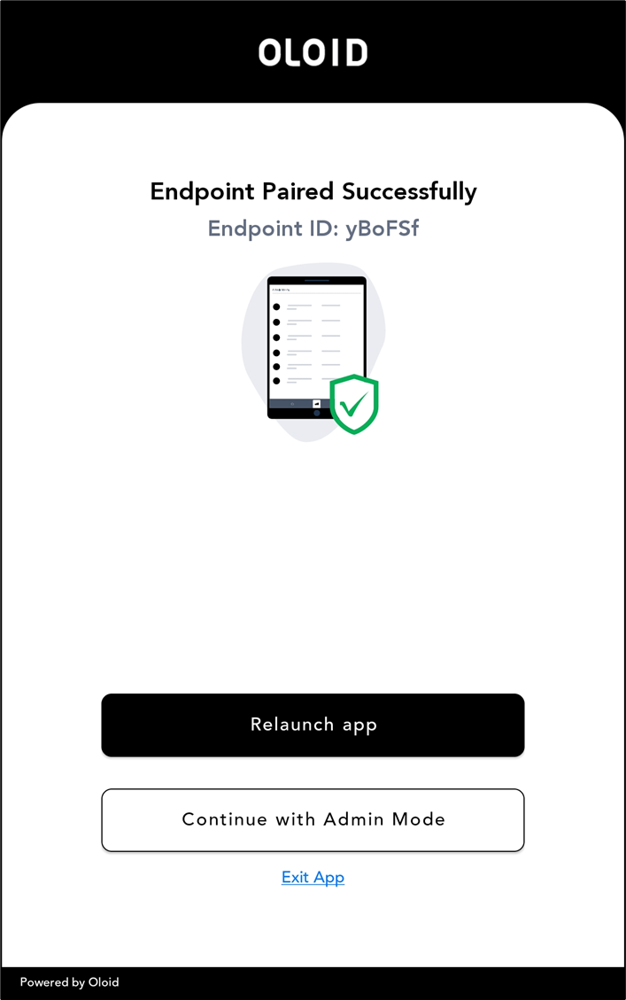

{/* Source: Intercom article 12164310 - https://oloid.help/en/articles/12164310-devicelock-app-how-to-pair-devicelock-app-using-auto-pair-option */}
{/* Generated by intercom_to_mintlify.py - re-running overwrites this file. */}

## Introduction

The Oloid DeviceLock app supports **Auto-Pair** option, which allows the admin to quickly pair devices without manual entry or setup. By uploading the pre-generated **AutoPairConfig.json** file, the app automatically applies the required configuration and pairs the device with the designated endpoint. This method simplifies deployment, reduces errors, and ensures a seamless pairing experience.

## Prerequisites

- You must generate Auto-Pair config file. To generate refer [How to generate Auto-Pair config file for Oloid DeviceLock App in the Tenant Admin Portal](/platforms/android/devicelock/devicelock-app-how-to-update-auto-pair-config-file-for-oloid).
- The Auto-Pair config file must be saved in the local directory of the Android device to be paired.

## Steps to pair DeviceLock App

1. Launch **DeviceLock app**.

   

   The Welcome screen is displayed.
2. Tap **Auto-Pair**.

   

   The **local file selection** screen is displayed.
3. Browse the location of the downloaded file.
4. Tap **AutoPairConfig.json** file**.**

   

   The Endpoint is paired successfully.

   
