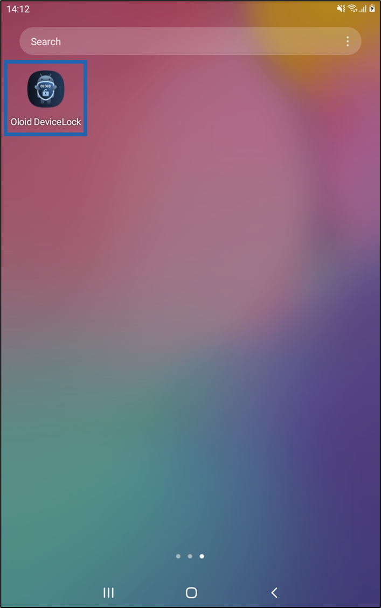
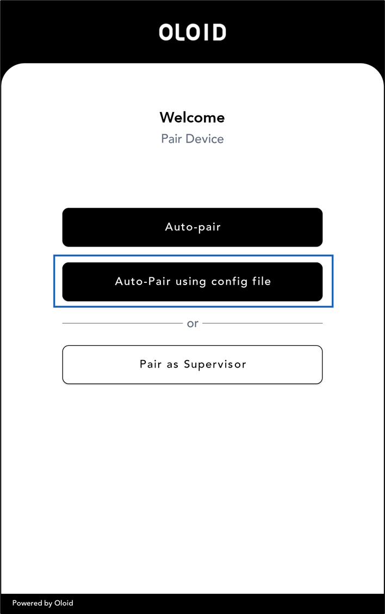
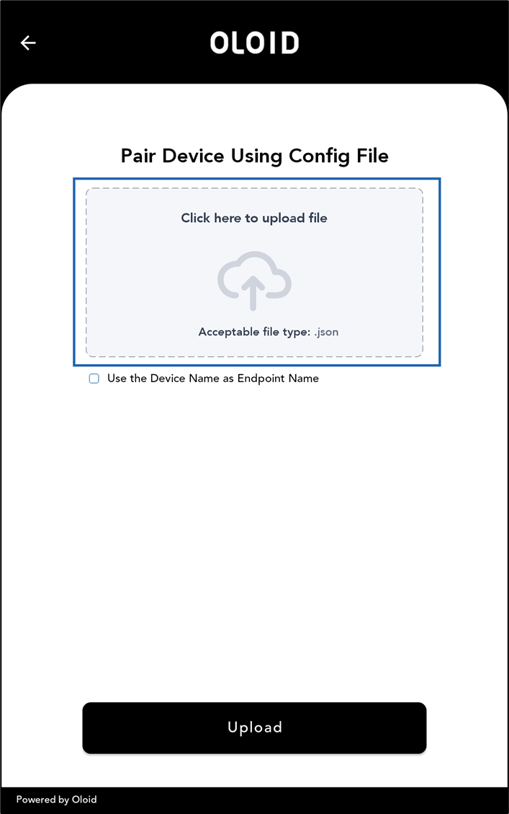
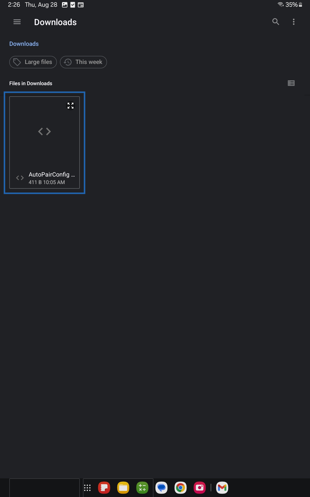
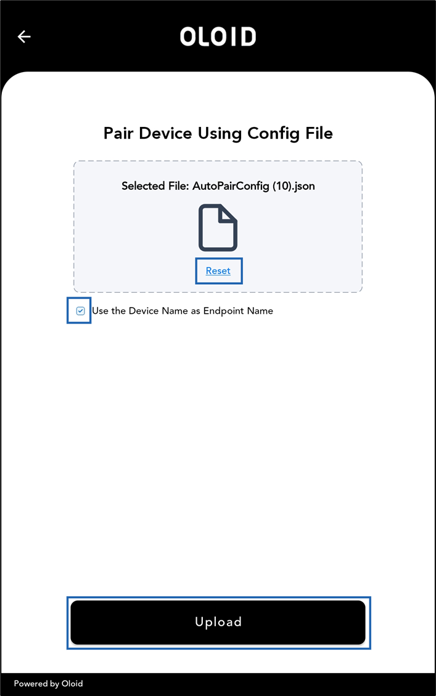
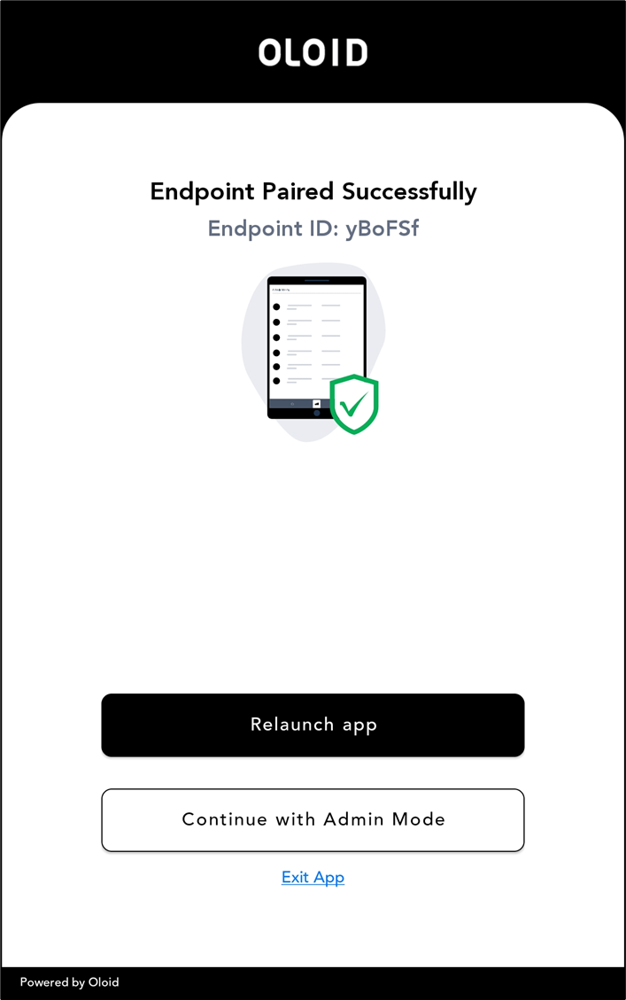

{/* Source: Intercom article 12114460 - https://oloid.help/en/articles/12114460-devicelock-app-how-to-pair-devicelock-app-using-the-auto-pair-using-config-file-option */}
{/* Generated by intercom_to_mintlify.py - re-running overwrites this file. */}

## Introduction

The Oloid DeviceLock app supports **Auto-Pair** using **Config File** option, which allows the admin to quickly pair devices without manual entry or setup. By uploading the pre-generated **AutoPairConfig.json** file, the app automatically applies the required configuration and pairs the device with the designated endpoint. This method simplifies deployment, reduces errors, and ensures a seamless pairing experience.

## Prerequisites

- You must generate Auto-Pair config file. To generate refer [How to generate Auto-Pair config file for Oloid DeviceLock App in the Tenant Admin Portal](/platforms/android/devicelock/devicelock-app-how-to-update-auto-pair-config-file-for-oloid).
- The Auto-Pair config file must be saved in the local directory of the Android device to be paired.

## Steps to pair DeviceLock

1. Launch **DeviceLock app**.

   

   The Welcome screen is displayed.
2. Tap **Auto-Pair using config file**.

   

   The Pair Device using Config File screen is displayed.
3. Tap **Click here to upload file**.

   <Note>
     **Note:** Only **.json** file format is supported for the Auto-Pair configuration.
   </Note>

   

   The **local file selection screen** is displayed.
4. Browse the location of the downloaded file.
5. Tap **AutoPairConfig.json.**

   

   The Pair Device using Config File screen is displayed.
6. Select **Use the Device Name as Endpoint Name** to show the device name as endpoints name. (optional).

   <Note>
     **Note:** You can tap **Reset** to upload the file again.
   </Note>

7. Tap **Upload** to successfully upload the file and pair the endpoint.

   

   The Endpoint is paired successfully.

   
