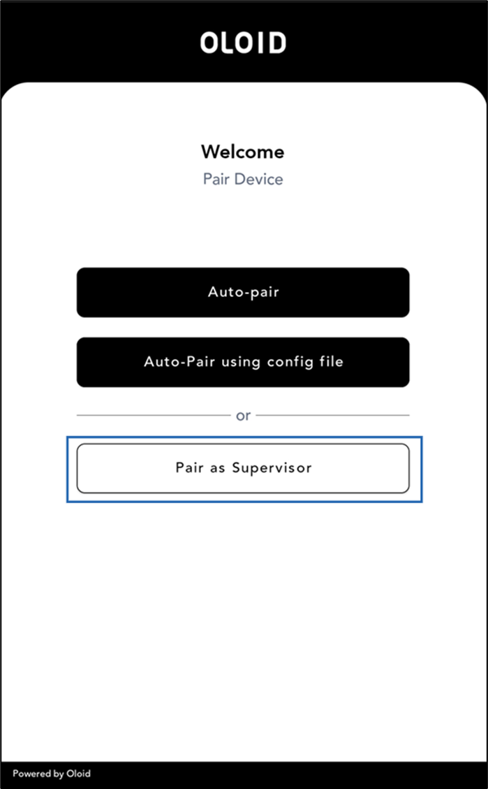
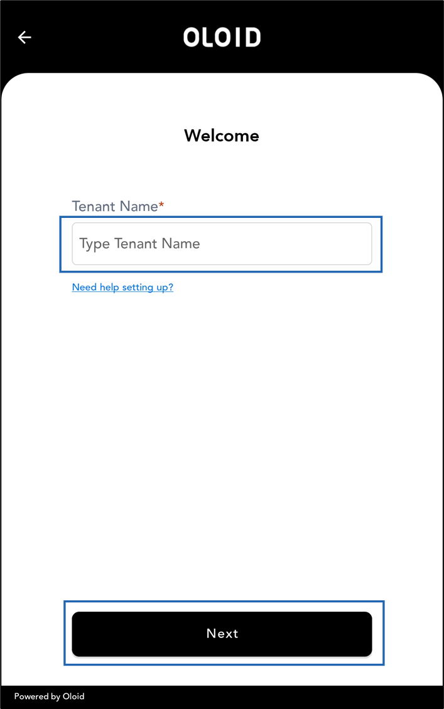
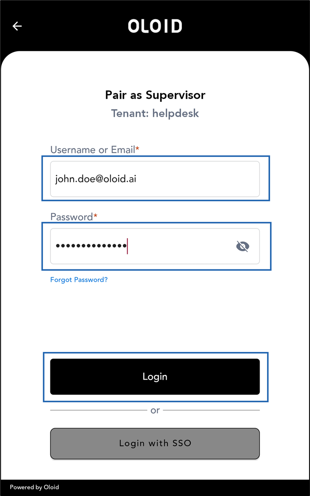
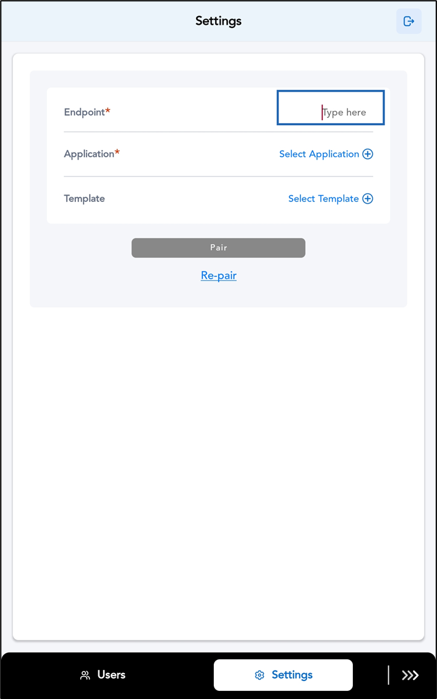
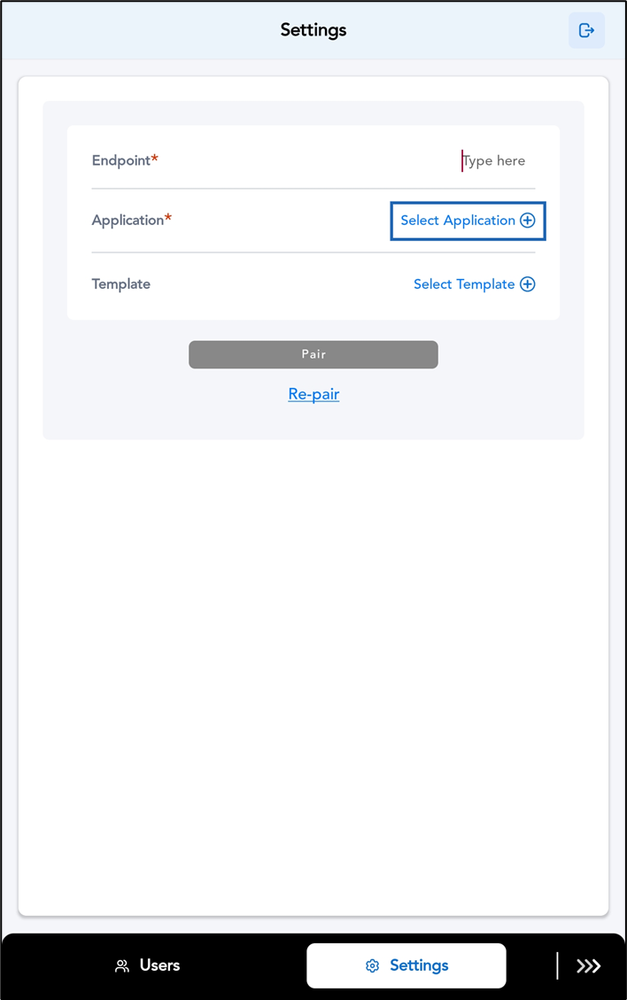
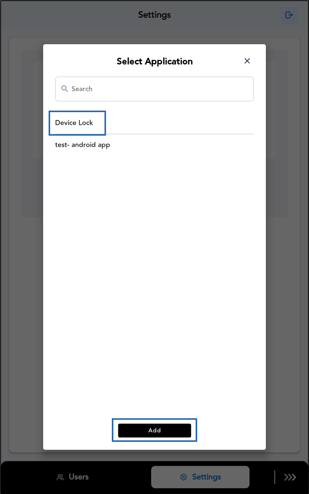
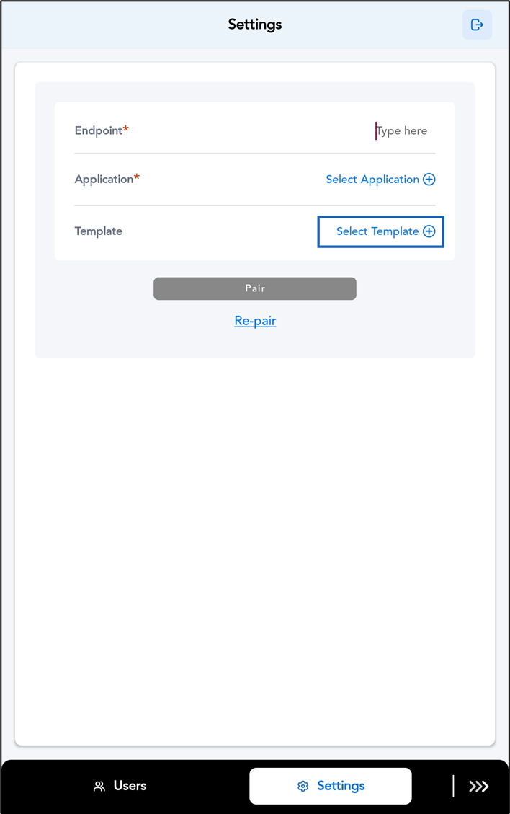
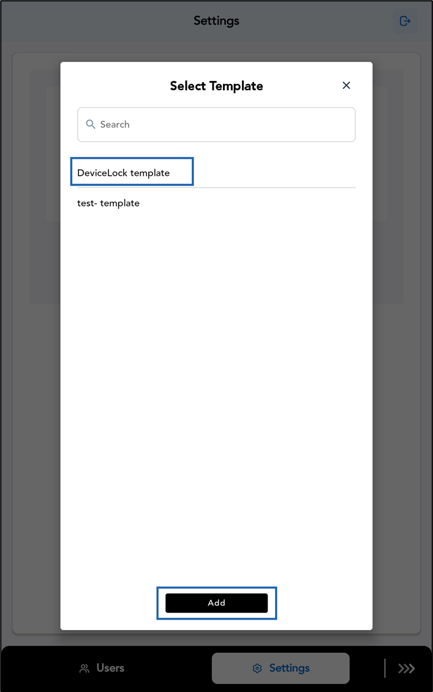
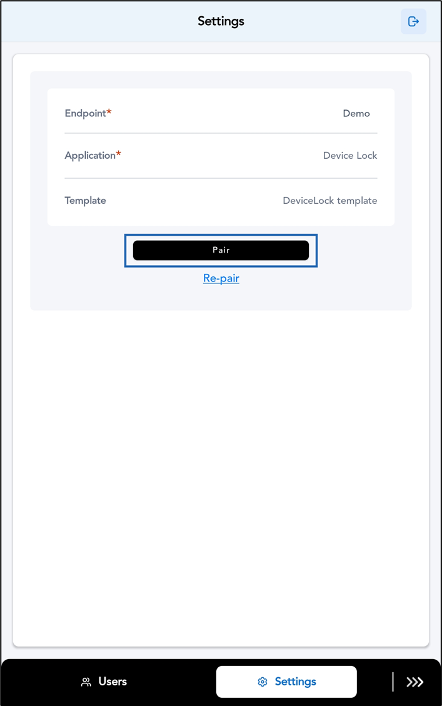
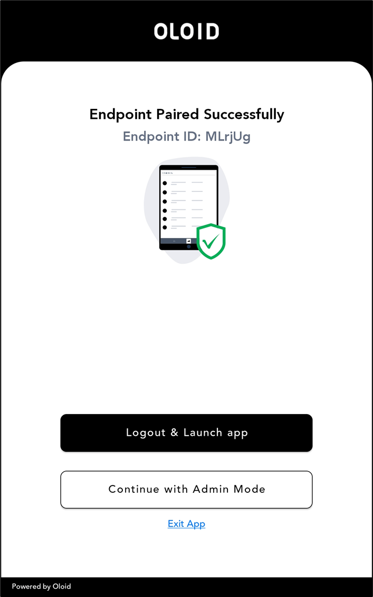

{/* Source: Intercom article 10323332 - https://oloid.help/en/articles/10323332-devicelock-app-how-to-pair-oloid-devicelock-app-using-pair-as-supervisor-option */}
{/* Generated by intercom_to_mintlify.py - re-running overwrites this file. */}

## Introduction

The **Pair as Supervisor** option in the Oloid DeviceLock App allows Supervisors to set up and manage endpoints securely within their assigned tenant. By pairing as a supervisor, you can configure the device, assign applications, and optionally apply templates to ensure proper usage and compliance. This process ensures that endpoints are linked to the correct tenant environment and are ready for secure operation.

## Prerequisite

You must have a Supervisor/Tenant Admin account.

## Steps to pair as Supervisor

1. Launch **Devicelock App**.

   

   The **Welcome** screen is displayed.
2. Tap **Pair as Supervisor**.

   

3. Enter **Tenant Name**.
4. Tap **Next**.

   

   The **Pair as Supervisor** screen is displayed.
5. Do the following:
   1. Enter **Username** or **Email**.
   2. Enter **Password**.
   3. Tap **Login**.

      

      The **Settings** screen is displayed.
6. Do the following:
   1. Enter **Endpoint** name.

      

   2. Tap **Select Application**.

      

      The Select Application pop-up box is displayed.
   3. Tap the preferred application.
   4. Tap **Add**.

      

   5. Tap **Select Template**. (optional)

      

      The **Select Template** pop-up box is displayed.
   6. Tap the preferred template.
   7. Tap **Add**.

      

   8. Tap **Pair**.

      

      The Endpoint is paired successfully.

      
