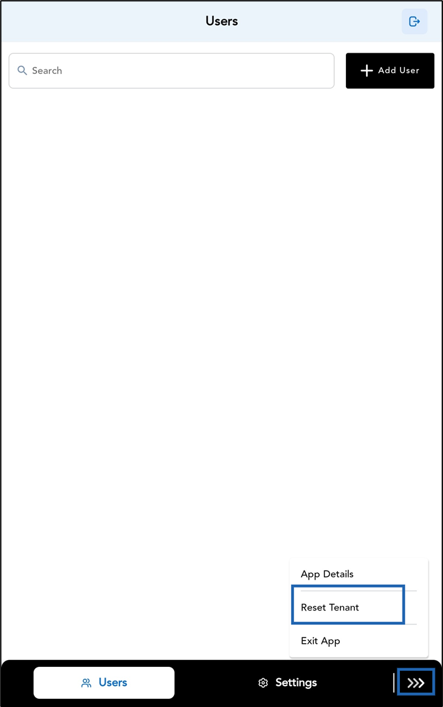
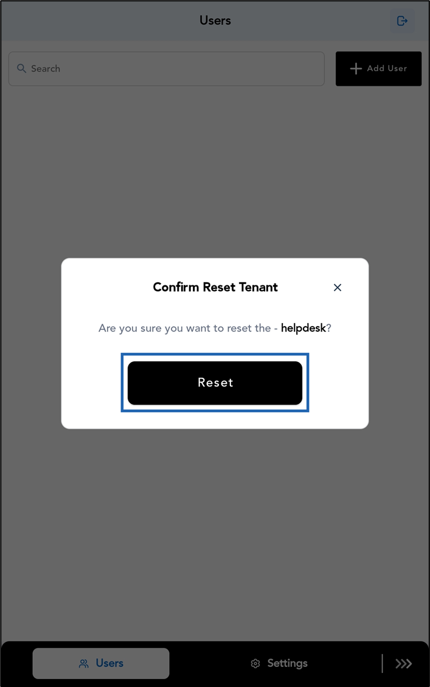
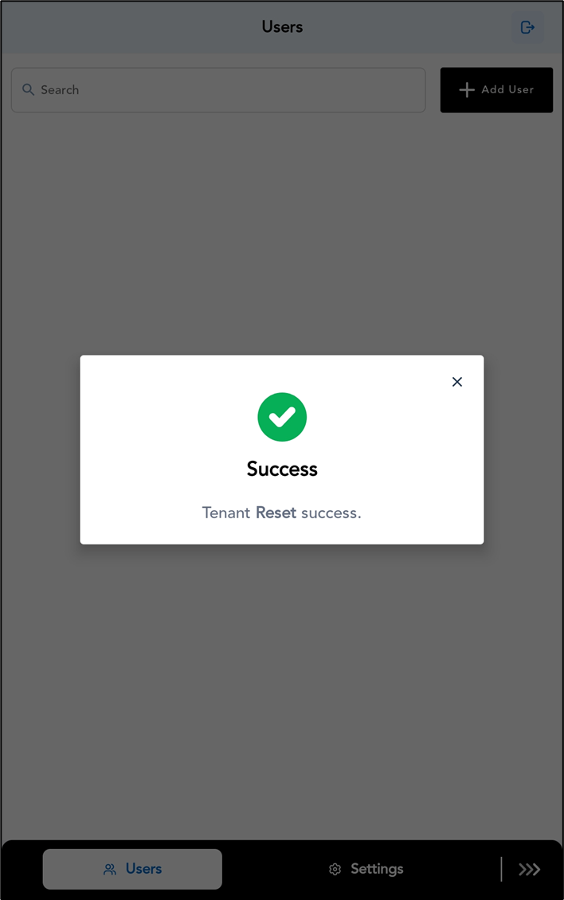

{/* Source: Intercom article 10473240 - https://oloid.help/en/articles/10473240-devicelock-app-how-to-reset-tenant */}
{/* Generated by intercom_to_mintlify.py - re-running overwrites this file. */}

## Introduction

A tenant in Oloid DeviceLock App is a dedicated space with its own users, devices, and configurations. Resetting a tenant clears all existing data and settings, allowing you to start over.

## Prerequisite

You must pair DeviceLock endpoint. For more details refer: [Oloid DeviceLock - How to pair an endpoint](/platforms/android/devicelock/devicelock-app-ways-to-pair-an-endpoint).

## Steps to Reset Tenant

1. Launch **Oloid DeviceLock App** on your device.

   

2. Log in to the Admin Mode in **Oloid DeviceLock** App. For more details, refer this [Oloid DeviceLock App - How to log in to admin mode](/platforms/android/devicelock/devicelock-app-how-to-log-in-to-admin-mode)
3. On the bottom right, select More Options  icon > tap **Reset Tenant**.

   

   The confirmation pop-up box is displayed.

Tap **Reset**.

The tenant reset successfully.

