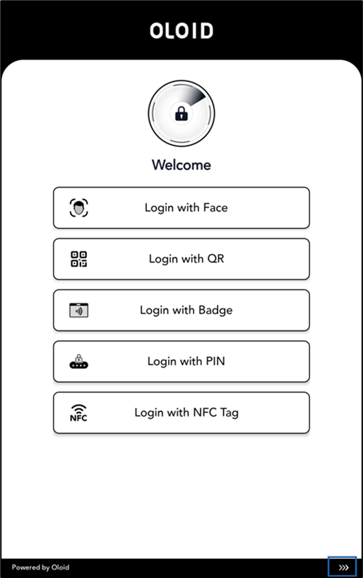
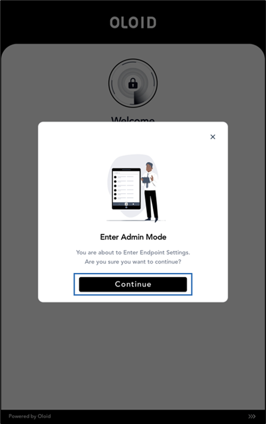
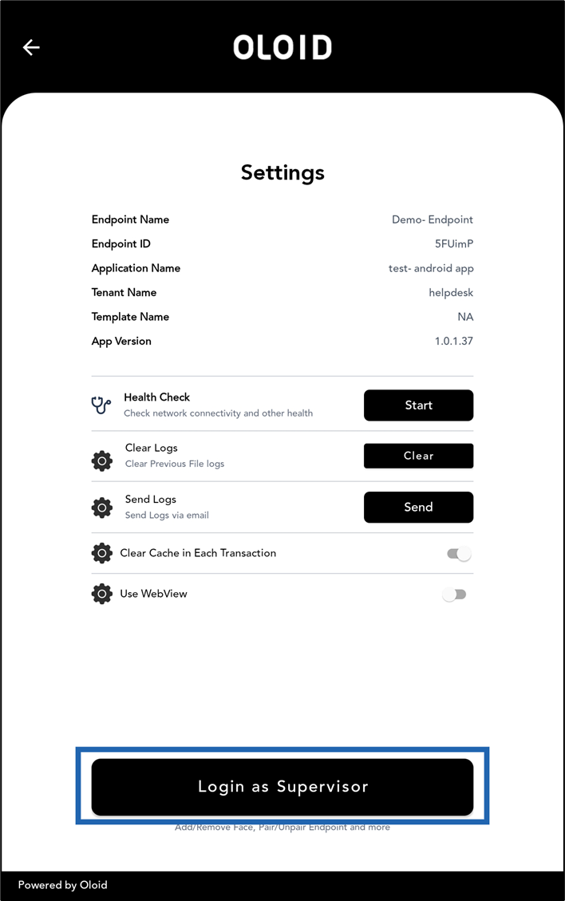
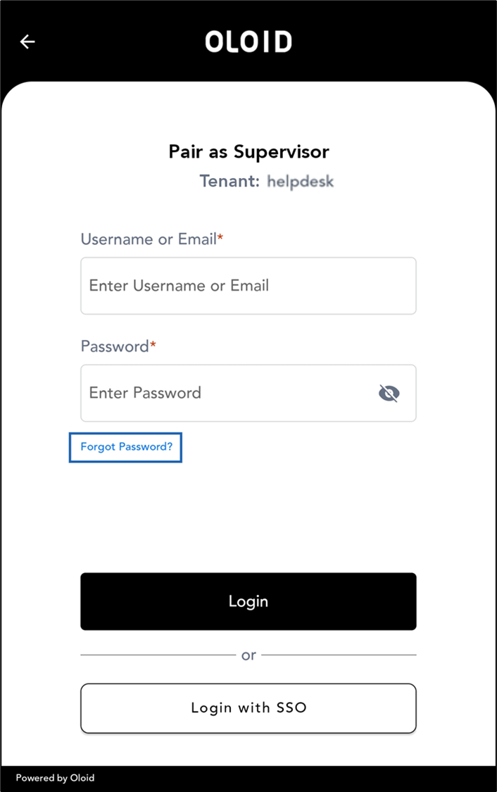
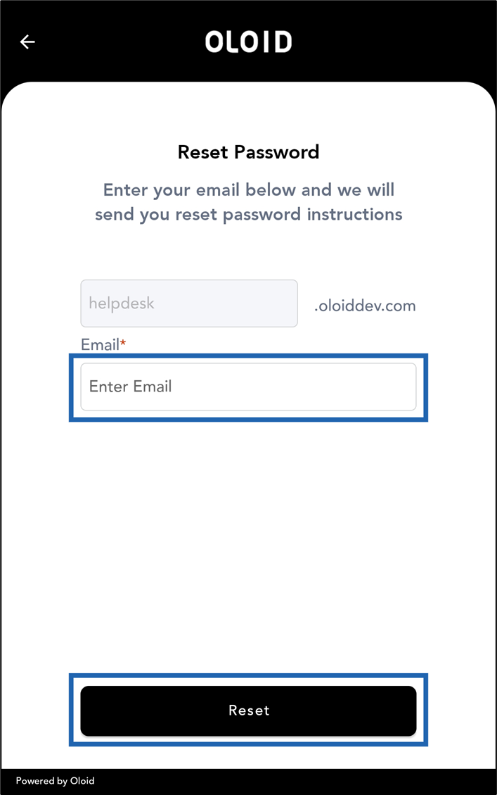
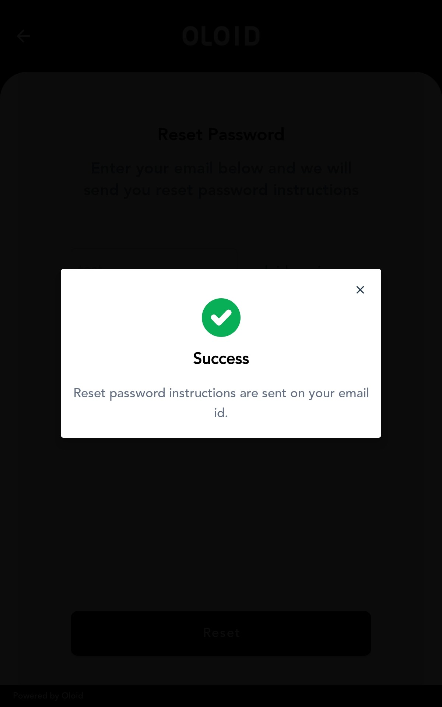
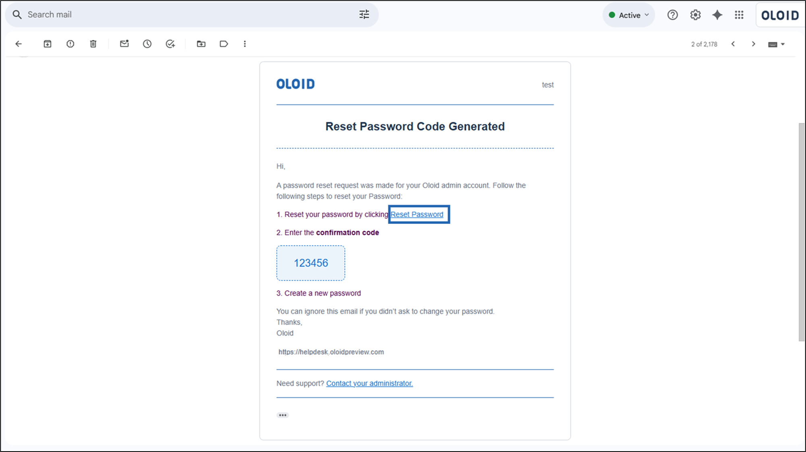
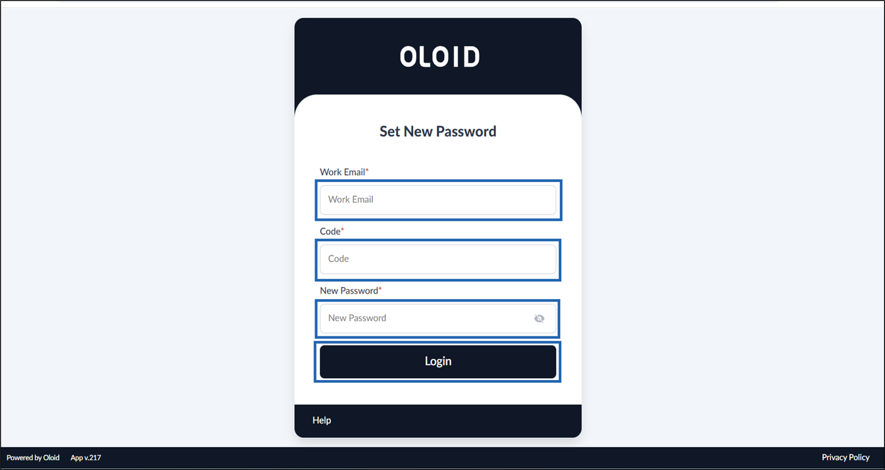
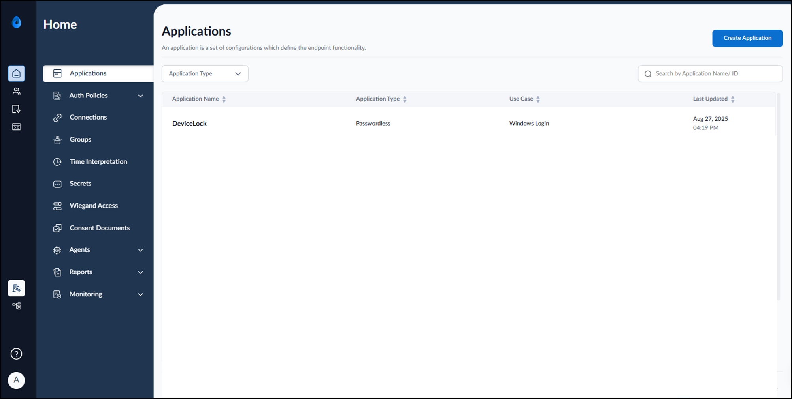

{/* Source: Intercom article 12106226 - https://oloid.help/en/articles/12106226-devicelock-app-how-to-reset-the-admin-password */}
{/* Generated by intercom_to_mintlify.py - re-running overwrites this file. */}

## Introduction

The Oloid DeviceLock App allows Admin and Supervisors to securely reset their password using the **Forgot Password** option. This feature helps restore access to the app by sending a confirmation code to the registered email address.

## Steps to reset Admin Password

1. Launch DeviceLock app.

   

   The Welcome screen is displayed.
2. Click **More option** icon () on bottom-right side of the screen.

   

   The **Enter Admin Mode** pop-up box is displayed.
3. On the **Enter Admin Mode** pop-up box, tap **Continue**.

   

   The setting page is displayed.
4. Tap **Login as Supervisor**.

   

   Pair as Supervisor screen is displayed.
5. Tap **Forgot Password**.

   

   Reset Password screen is displayed.
6. Enter Email ID > tap **Reset**.

   

   Reset Password instructions are sent to the registered email ID successfully.

   

7. Open your email account and go to the **inbox.**
8. Copy the **confirmation code** > click on the **Reset Password** link.

   

   The **Set New Password** page is displayed.
9. Enter **Work Email ID**.
10. Enter **Confirmation Code** in the **Code** field.
11. Enter **New Password**.
12. Click **Login.**

    

    The Password for Oloid DeviceLock is reset successfully.

    
