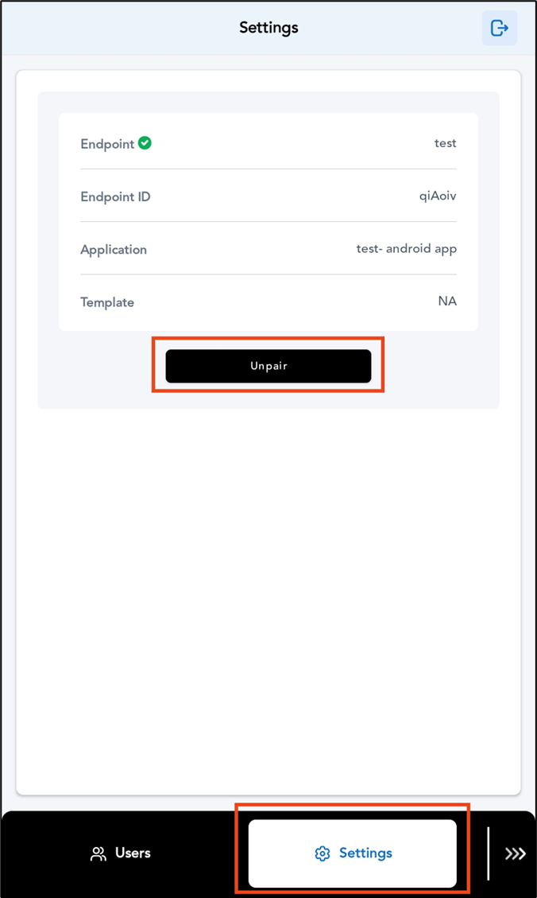
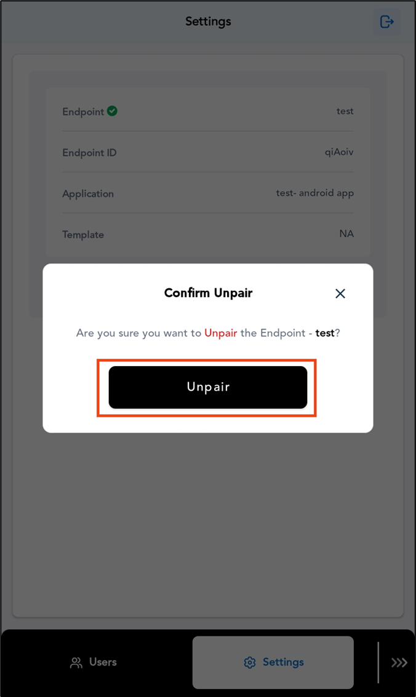
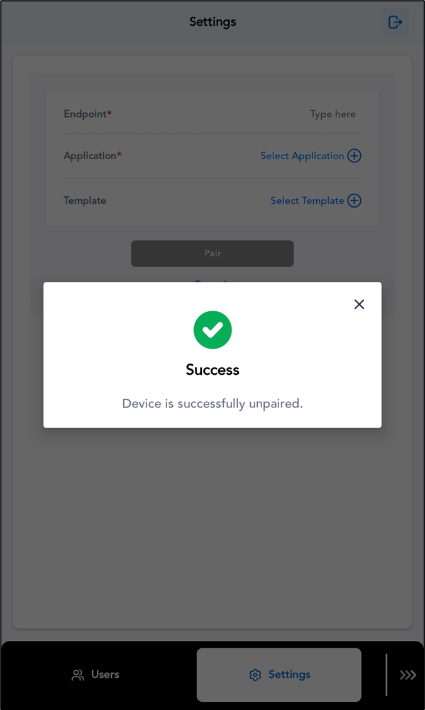

{/* Source: Intercom article 10329310 - https://oloid.help/en/articles/10329310-devicelock-app-how-to-unpair-an-endpoint */}
{/* Generated by intercom_to_mintlify.py - re-running overwrites this file. */}

## Introduction

The Unpair Endpoint feature in the Oloid DeviceLock App allows admins to disconnect an endpoint that is no longer in use or requires reconfiguration.

## Prerequisite

The Endpoint must be paired. To pair refer [How to pair a DeviceLock endpoint](/platforms/android/devicelock/devicelock-app-ways-to-pair-an-endpoint).

## Steps to Unpair Endpoint

1. Launch **Oloid DeviceLock App** on your device.

   

   The welcome screen is displayed.
2. Login to the Admin mode in **DeviceLock App.** To login refer[How to log in to admin mode in DeviceLock App](/platforms/android/devicelock/devicelock-app-how-to-log-in-to-admin-mode).
   The **Settings** screen is displayed.
3. Tap **Unpair**.

   

   The **Confirm Unpair** pop-up box is displayed.
4. Tap **Unpair**.

   

   The device is unpaired successfully.

   
