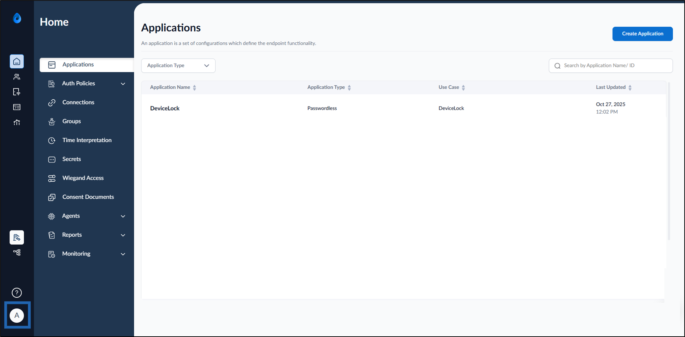
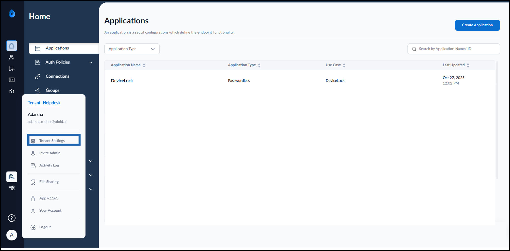
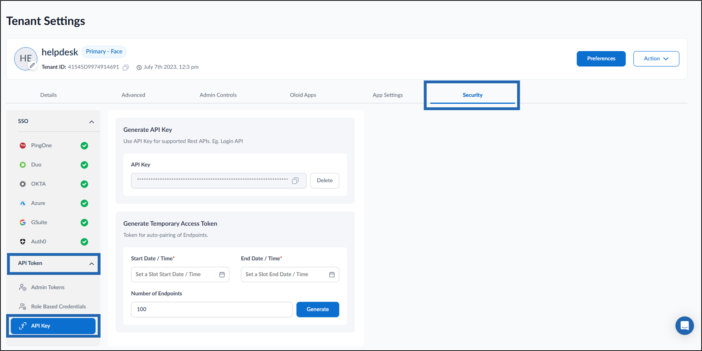
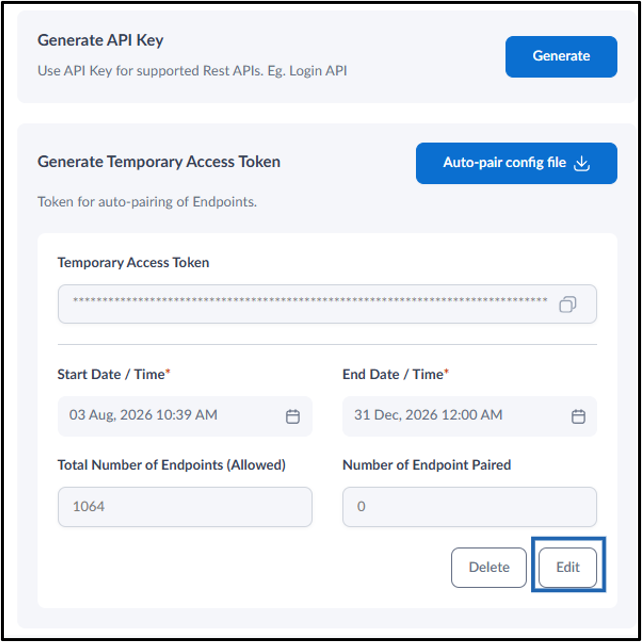
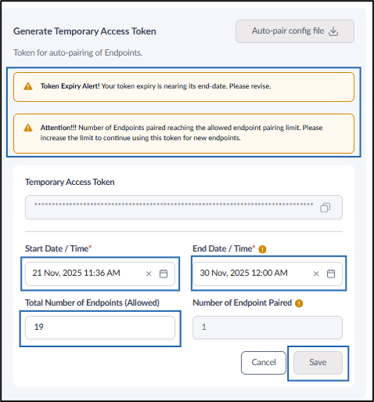
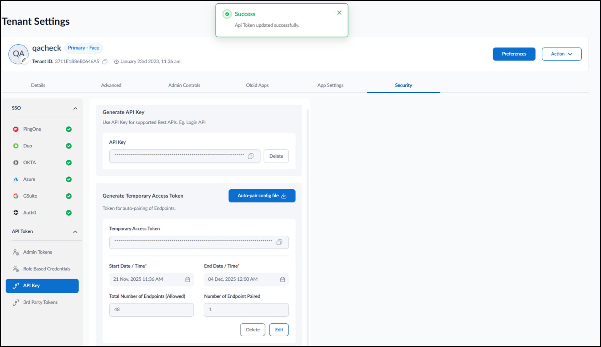
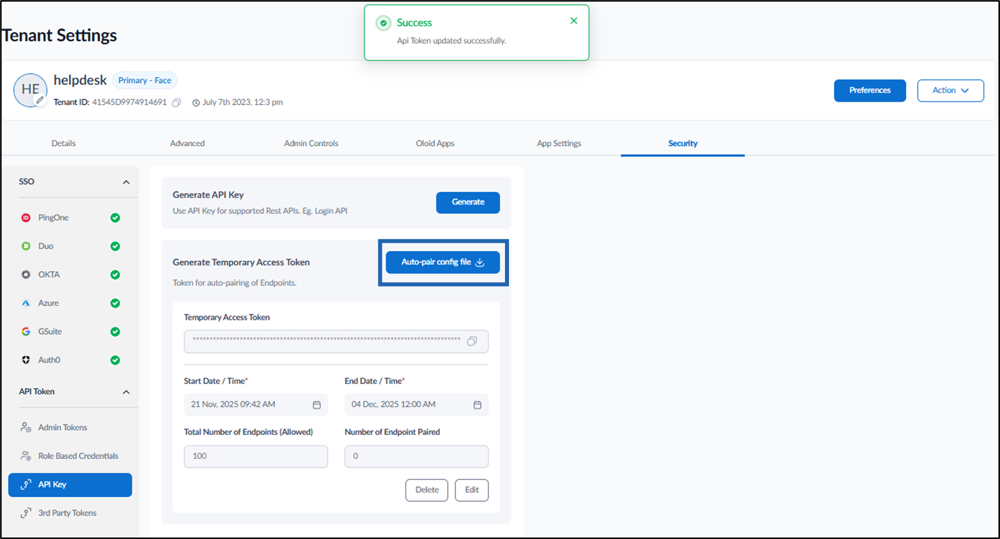
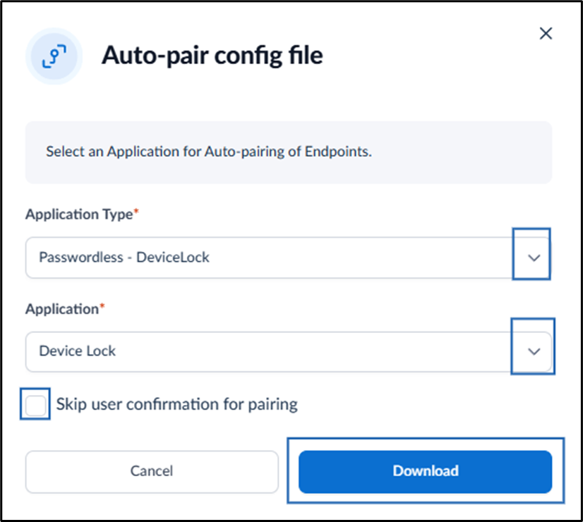

{/* Source: Intercom article 12105399 - https://oloid.help/en/articles/12105399-devicelock-app-how-to-update-auto-pair-config-file-for-oloid-devicelock-app-in-the-tenant-admin-portal */}
{/* Generated by intercom_to_mintlify.py - re-running overwrites this file. */}

## Introduction

The Tenant Admin Portal allows the admin to update an Auto-Pair configuration file that simplifies the process of pairing endpoints with the Oloid DeviceLock application. By updating this file, admins can securely define token validity, pairing rules, and endpoint limits, ensuring a seamless and controlled setup experience for end users.

## Prerequisite

You have **Admin access** to the **Tenant Admin Portal**.

## Steps to Update Auto-Pair config file

1. Log in to the **Tenant Admin Portal**.
2. On the homepage of the portal, click **user profile icon** on the bottom left corner of the menu panel.

   

   The user profile menu is displayed.
3. Click **Tenant Settings**.

   

   The **Tenant Settings** page is displayed.
4. Go to **Security** tab > **API Token** dropdown > **API Key**.

   

   The API key screen is displayed.
5. In the **Generate Temporary Access Token** section, click **Edit.**

   

6. Do the following:
   1. Select the **Start Date/Time** field.
      - To set the start date and time, click the date picker or select **Now**.
   2. Select the **End Date/Time** field.
      - Click the date picker, choose when the token will expire, and then click **OK**.

        <Note>
          **Note:**

          **Token Expiry Alert** appears when the Auto-pair configuration file is set to expire within the next 10 days.
        </Note>

   3. Specify **Total Number of Endpoints** (Allowed) that can be created with the generated config file.
      **Note:**
      1. Once the **Number of Endpoints Paired** reaches this limit, the configuration file cannot be used to pair additional endpoints. Increase the allowed limit to continue pairing new endpoints.
      2. If total number of Endpoints (Allowed) below 20, then an **Attention Alert** pop-up will display.
   4. Click **Save**.

      

      The **Generate Temporary Access Token** section is updated successfully.

      

7. Click **Auto-pair config file** download option.

   

   The Auto-pair config file pop-up box is displayed.
8. Do the following:
   1. Select **Application** as **Passwordless - DeviceLock** from **Application Type** drop-down list.
   2. From the **Select Application** drop-down list, select the application that you want the endpoints to pair with.
   3. Select **Skip user confirmation for pairing** option to auto-pair endpoints without requiring user confirmation (optional but recommended).
      - **If selected:** When the configuration file is uploaded to the endpoint, the system will pair automatically without prompting the user for confirmation.
      - **If not selected:** The system will display a confirmation pop-up to the user before completing the pairing process.
   4. Click **Download**.

The **Autopair Config file** is downloaded to the local device successfully.
