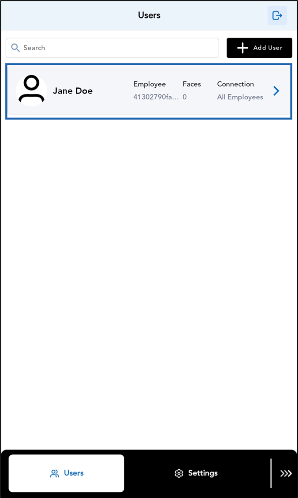
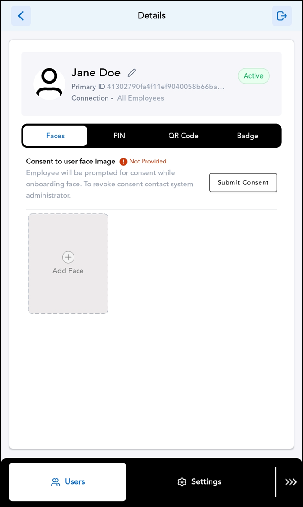

{/* Source: Intercom article 11495355 - https://oloid.help/en/articles/11495355-devicelock-app-how-to-view-user-details-in-oloid-devicelock-app */}
{/* Generated by intercom_to_mintlify.py - re-running overwrites this file. */}

## Introduction

The Oloid DeviceLock App allows admins to manage and monitor user access efficiently. By viewing user details, admins can verify user information such as name, credentials, and access status directly within the app. This feature helps ensure proper user management and quick troubleshooting when needed.

## Prerequisite

You must add the User. To add refer [How to add user in Oloid DeviceLock App](/platforms/android/devicelock/devicelock-app-how-to-add-user-in-oloid-devicelock-app).

## Steps to view user details

1. Launch **Oloid DeviceLock App** on your device.

   

2. Log in to the Admin Mode in **Oloid DeviceLock** App. For more details, refer this [How to log in to admin mode in DeviceLock App](/platforms/android/devicelock/devicelock-app-how-to-log-in-to-admin-mode).
   The User's screen is displayed.

Tap on the preferred User's profile.

The User's details is successfully viewed.

