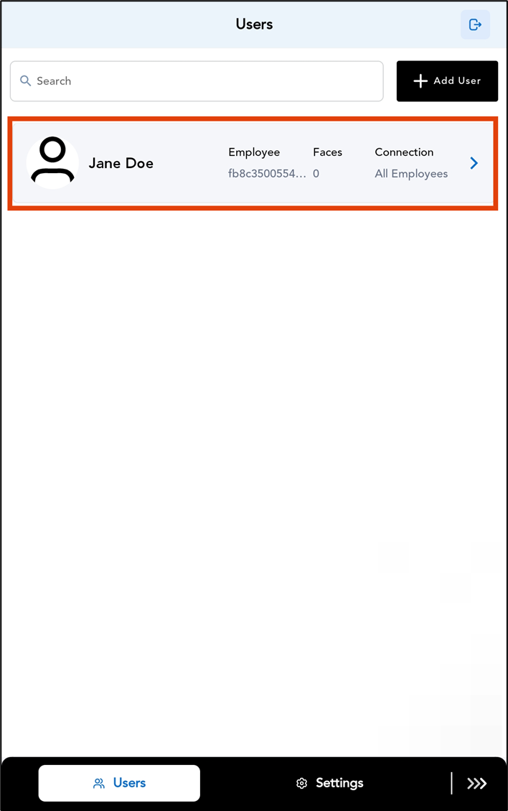
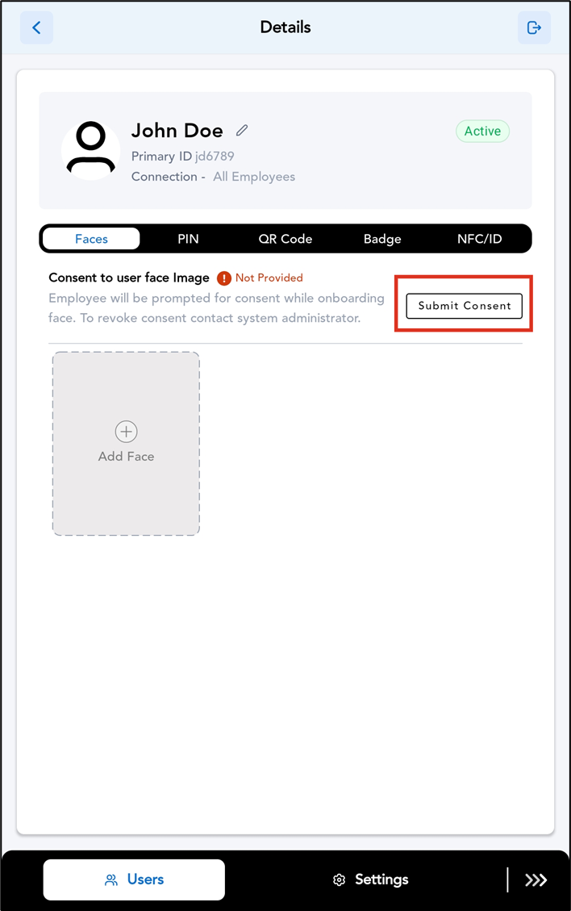
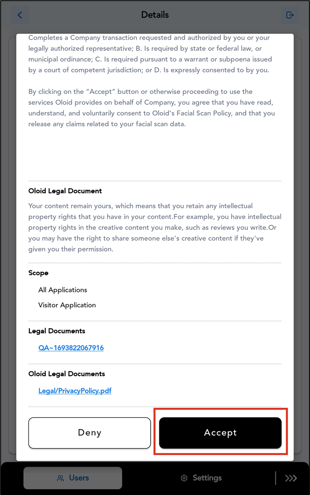
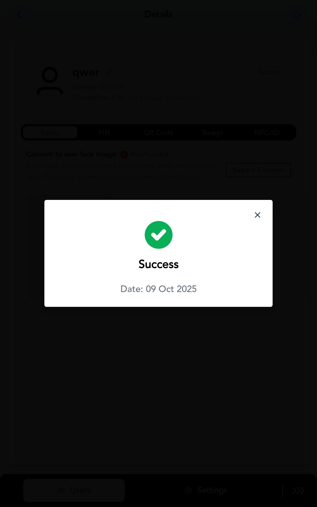
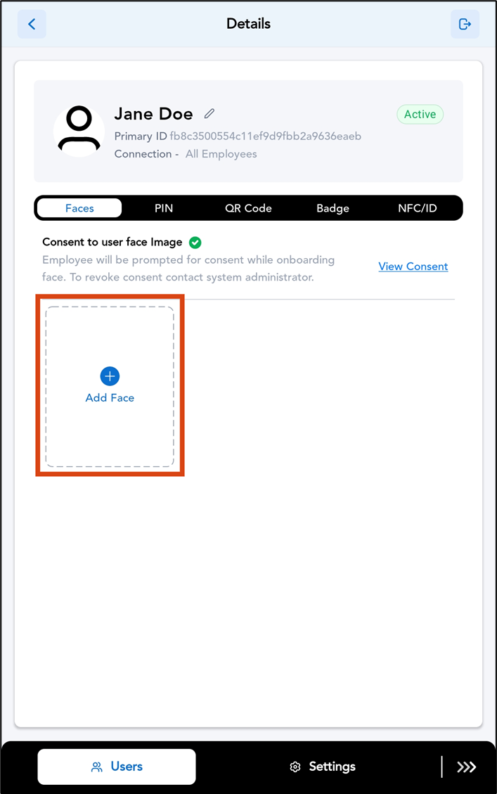
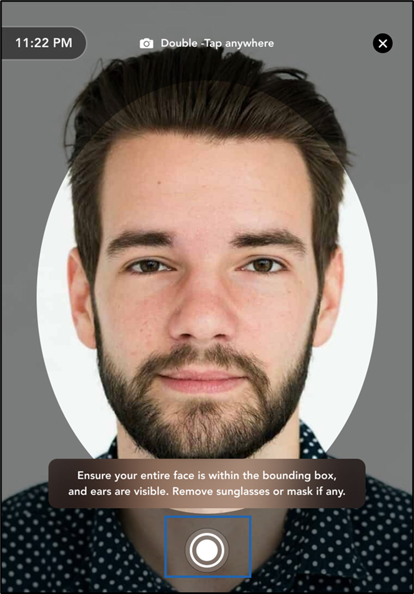
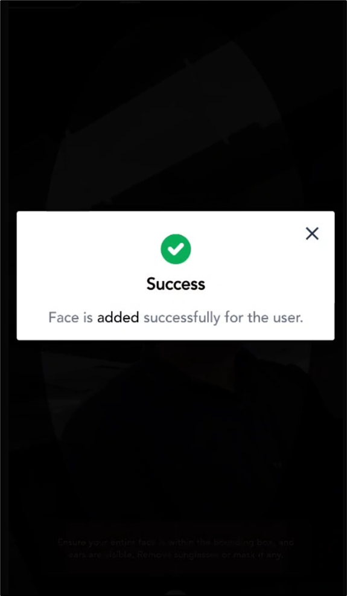

{/* Source: Intercom article 12156735 - https://oloid.help/en/articles/12156735-oloid-devicelock-app-how-to-add-face-for-users-in-the-devicelock-app-through-admin-mode */}
{/* Generated by intercom_to_mintlify.py - re-running overwrites this file. */}

## Introduction

This feature of Oloid DeviceLock app allows the user in tenant admin mode to add face using the app.

## Prerequisite

You must have Admin account to add a user.

## Steps to Add Face

1. Log in to the Admin mode in **DeviceLock App.** To log in refer[How to log in to admin mode in DeviceLock App](/platforms/android/devicelock/devicelock-app-how-to-log-in-to-admin-mode).
2. Go to **Users** tab > select the preferred user.

   

   The user details screen is displayed.
3. Tap **Submit Consent**.

   

   The user consent screen is displayed.
4. Tap **Accept**.

   

   The Consent is submitted successfully.

   

5. Tap **Add Face**.

   

To add a face, position your face in front of the camera and tap the **Capture** button.

<Note>
  **Note:** If you do not tap the **Capture** button, the app automatically captures your face after a few seconds.
</Note>

Face is added successfully.

