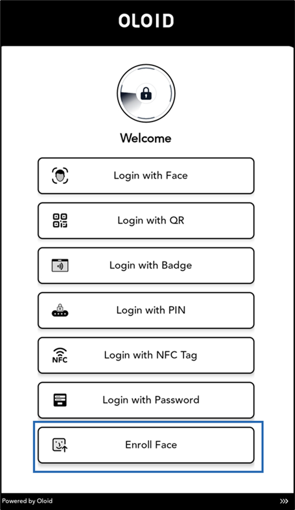
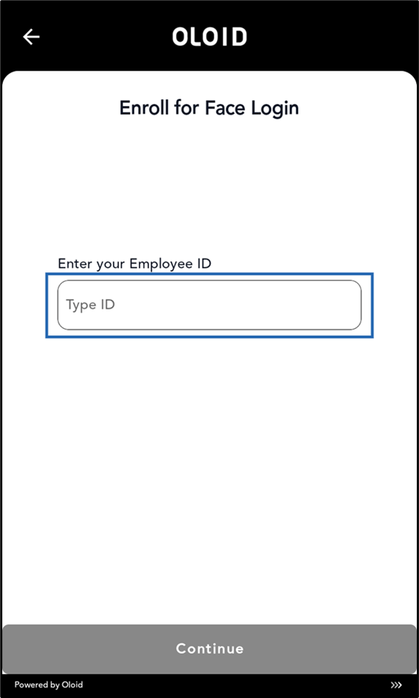
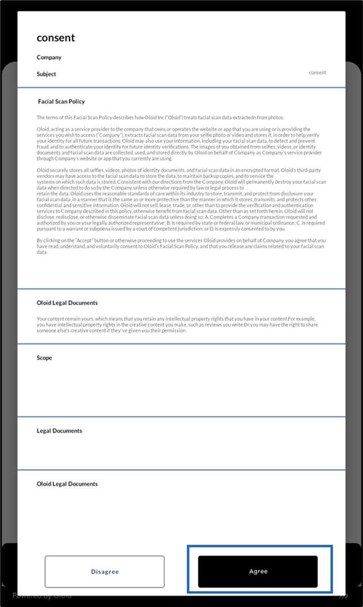
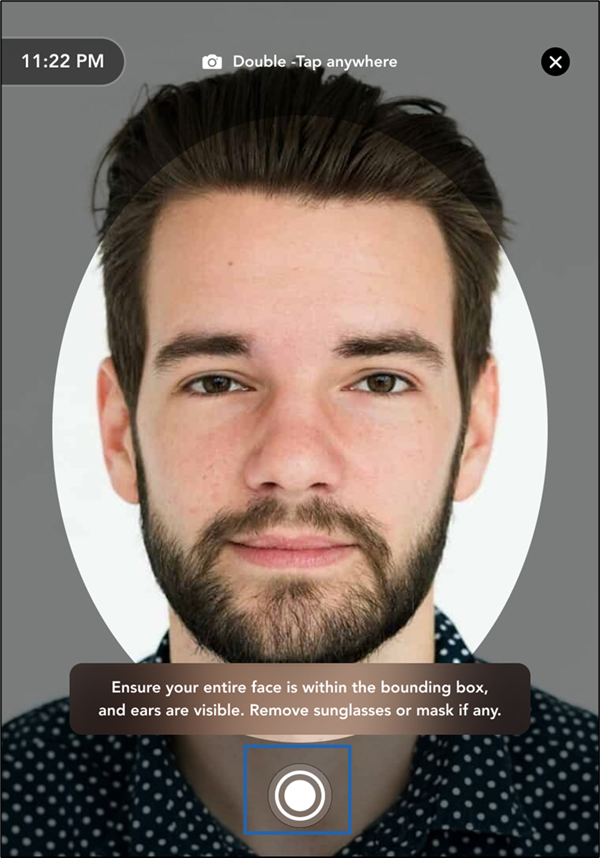
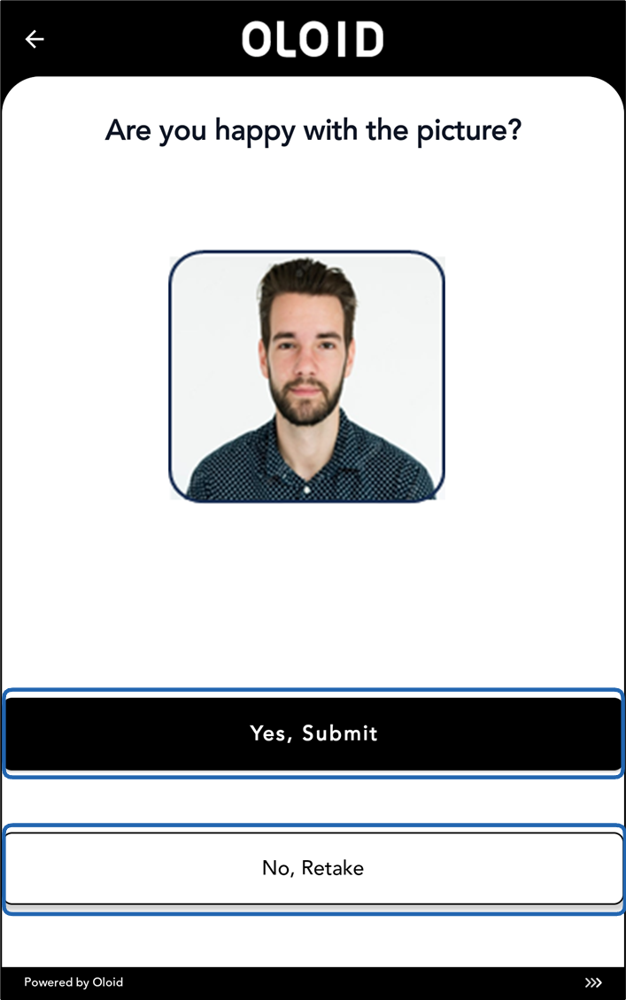
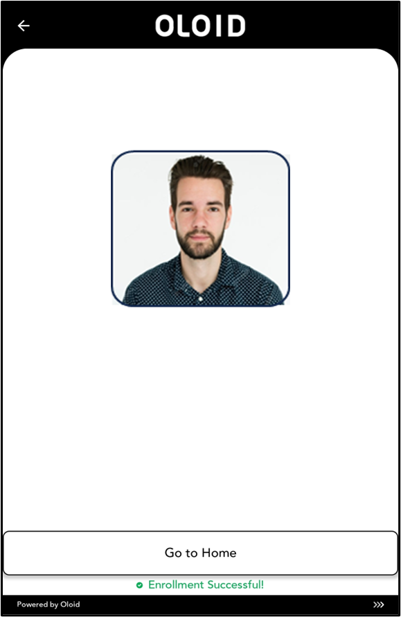

{/* Source: Intercom article 8707351 - https://oloid.help/en/articles/8707351-oloid-devicelock-app-how-to-enroll-face */}
{/* Generated by intercom_to_mintlify.py - re-running overwrites this file. */}

## Introduction

The **Enroll Face** feature in the Oloid DeviceLock App enables users to register their facial identity for secure, contactless access to Workforce or HRMS platforms such as Okta. During enrollment, the app captures the user’s facial image and verifies it against the reference image stored in the Oloid Portal.

## Prerequisite

The device camera is **functional and accessible** for face capture.

## Steps to Enroll Face

1. Unlock the device screen.

   <Note>
     **Note:** The Device Lock app is displayed automatically, as it always runs in Kiosk Mode.
   </Note>

2. On the preview screen tap **Enroll Face**.

   <Note>
     **Note:** You will only see the authentication methods (Face, Badge and NFC/ID) enabled for you. Button names may vary based on configuration. Contact [Support](mailto:Support@oloid.ai) if no authentication method appears.
   </Note>

   

   Enroll for Face Login page is displayed.
3. Enter your Employee ID (primary ID).

   

4. Tap **Continue**.
   TheConsentpage is displayed.

   <Note>
     **Note:** You need to provide your consent to proceed to next steps if consent is enabled for you.
   </Note>

5. Tap **Agree.**

   

   The Camera turns on.

   

6. Position your face in front of the camera and tap the **Capture** button to enroll your face.

   <Note>
     **Note:** If you do not tap the **Capture** button, the app automatically captures your face after a few seconds.
   </Note>

   

7. Do one of the following:
   1. Tap **Yes- Submit** to submit the image.
      The face is submitted successfully and is displayed on the details screen.
   2. Tap **No- Retake** to take the photo again.
      The camera turns on to retake the photo.

      <Note>
        **Note:** A maximum of five faces can be added.
      </Note>

Face is added to the Oloid portal.
