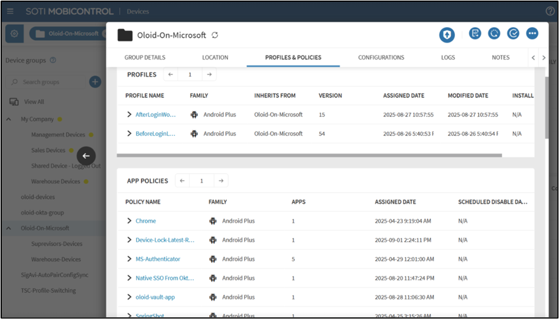
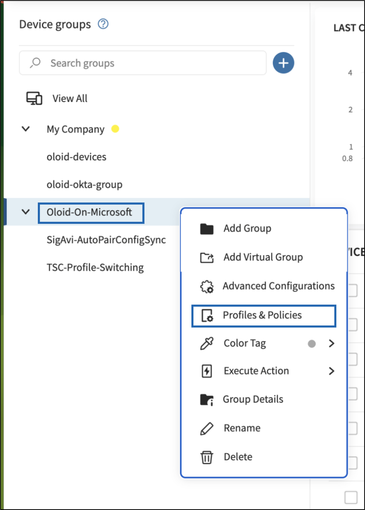
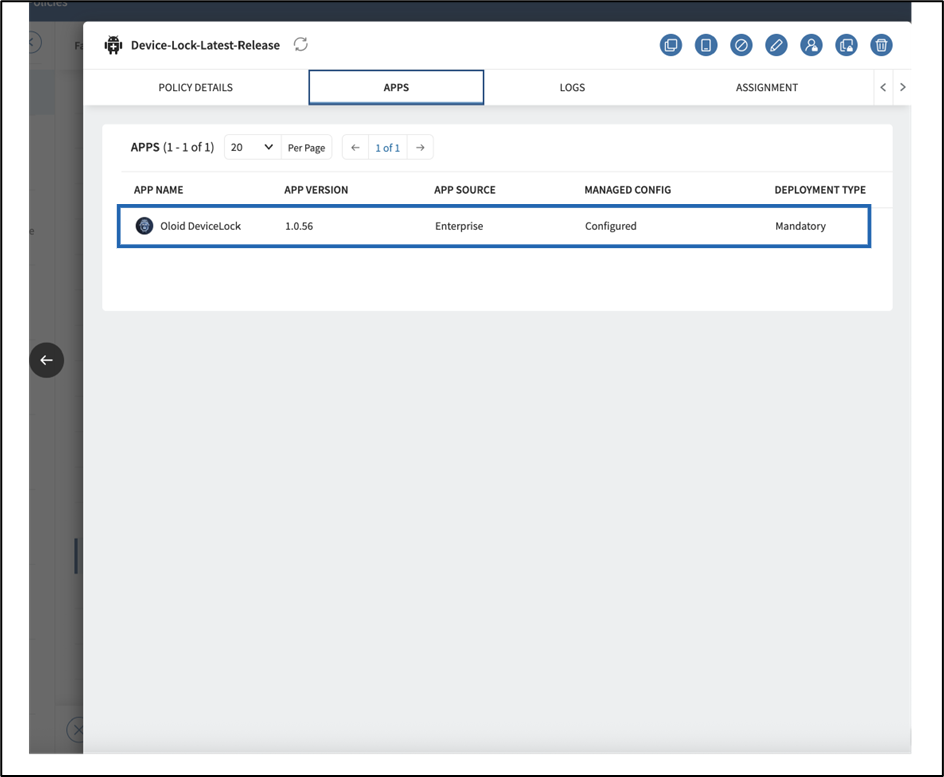
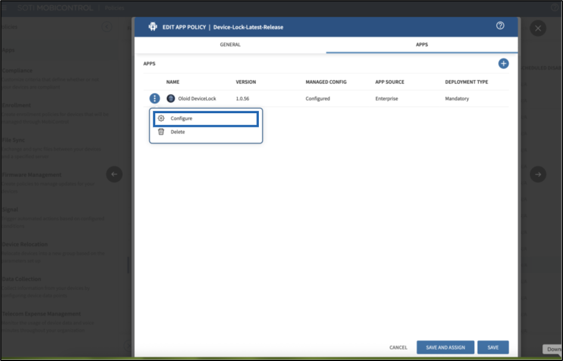
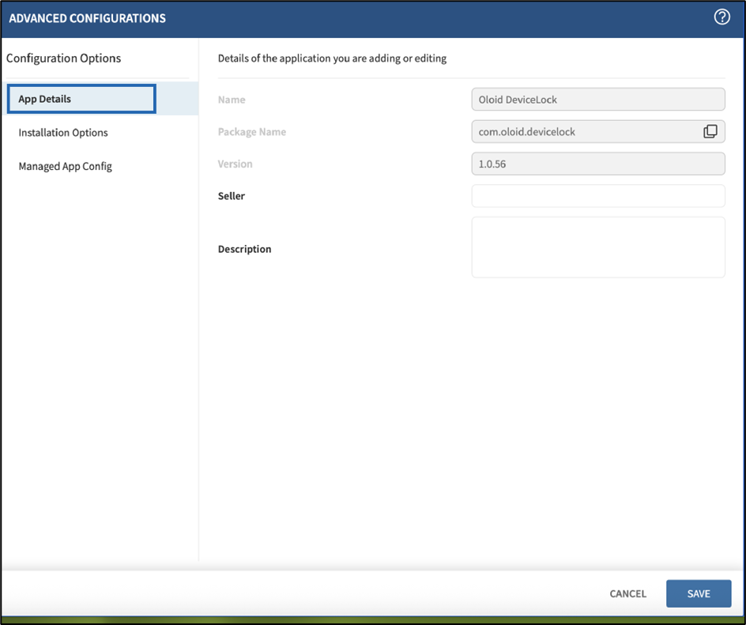
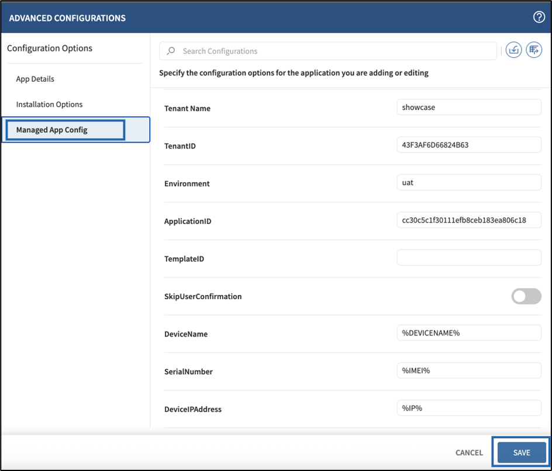

{/* Source: Intercom article 12117772 - https://oloid.help/en/articles/12117772-soti-mobicontrol-app-profile-policy-configuration-guide */}
{/* Generated by intercom_to_mintlify.py - re-running overwrites this file. */}

## Introduction

This guide provides step-by-step instructions to configure Managed App Configurations for the Oloid DeviceLock application within SOTI MobiControl.

## Steps to Configure Managed App Configurations

Follow the steps along with the screenshots provided.

### Step 1: Navigate to **Device Groups**

Go to the **Device Groups** section in SOTI MobiControl and select the relevant group (e.g., Oloid-On-Microsoft).

### Step 2: Open **Profiles & Policies**

Under the selected group, click on **Profiles & Policies** to view all assigned app policies.

### Step 3: Select the App Policy

Click on the desired app policy (e.g., Device-Lock-Latest-Release) to open its details.

### Step 4: Edit App Policy

Inside the policy, go to the **Apps** tab. Select the Oloid DeviceLock app and choose **Configure**.

### Step 5: App Details

Review the application details such as package name and version.

### Step 6: Managed App Config

Go to **Managed App Config** and fill in the configuration details required for auto pairing:

- **Tenant Name**
- **Tenant ID**
- **Environment**
- **Application ID**
- **Template ID**
- **Device Name** (auto-filled using `%DEVICENAME%`)
- **Serial Number** (auto-filled using `%IMEI%`)
- **Device IP Address** (auto-filled using `%IP%`)

### Step 7: Click **Sa**ve

The configuration is saved successfully.
