{/* Source: Intercom article 15585377 - https://oloid.help/en/articles/15585377-devicelock-how-to-configure-a-qr-code-scanner-using-zebra-datawedge-application-on-zebra-device */}
{/* Generated by intercom_to_mintlify.py - re-running overwrites this file. */}

## Introduction

This document provides instructions to configure a QR code scanner in the Zebra DataWedge application for use with the Oloid DeviceLock application.

<Note>
  **Note:** This configuration is supported **only on Zebra Android devices** that use the **Zebra DataWedge** application. It is not applicable to non-Zebra devices.
</Note>

## Prerequisites

- A **Zebra Android device** with the **Zebra DataWedge** application installed.
- The **Oloid DeviceLock** application is installed on the Zebra device.
- The **DataWedge** service is enabled and running.

## Steps to Configure QR Code Scanner for Data Wedge Application

1. Launch the **DataWedge** application.
   The **DataWedge** application page is displayed.
2. Tap the **Menu** (three dots) icon.

   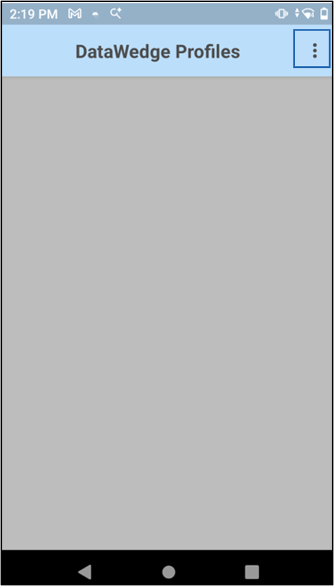

   The pop-up box is displayed.
3. Select **New Profile**.

   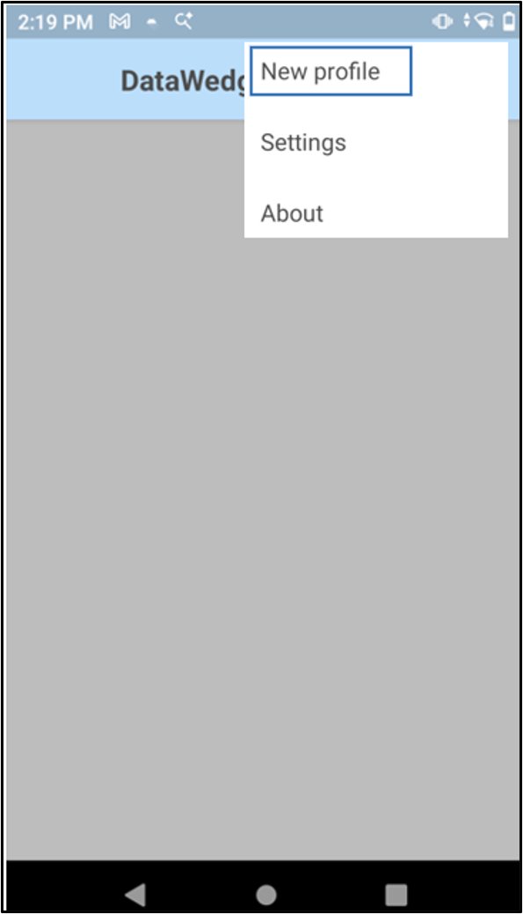

   The **New Profile** pop-up box is displayed.
4. Enter the **Profile Name** > tap **OK**.

   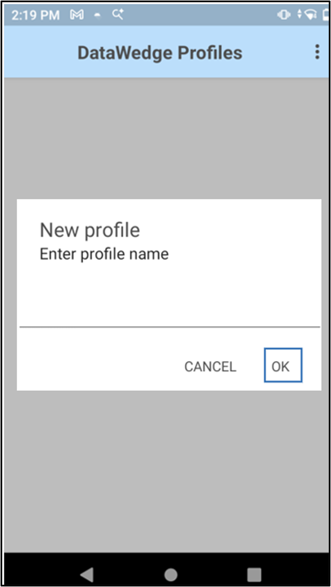

   The Profile name is listed on the DataWedge Profiles home screen.
5. Tap the **Profile Name**.

   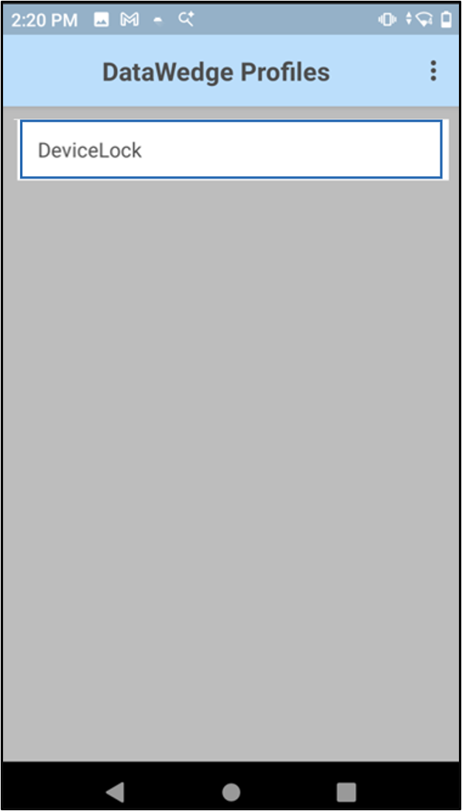

   The Profile details screen is displayed.
6. Tap **Associated apps**.

   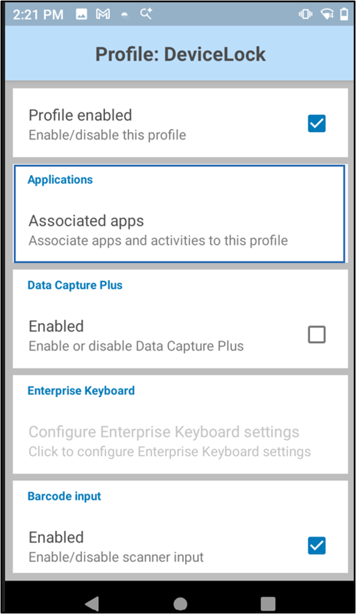

   The Profile **associations** screen is displayed.
7. Tap the **Menu (Three dots) icon** at the top right corner of the screen.

   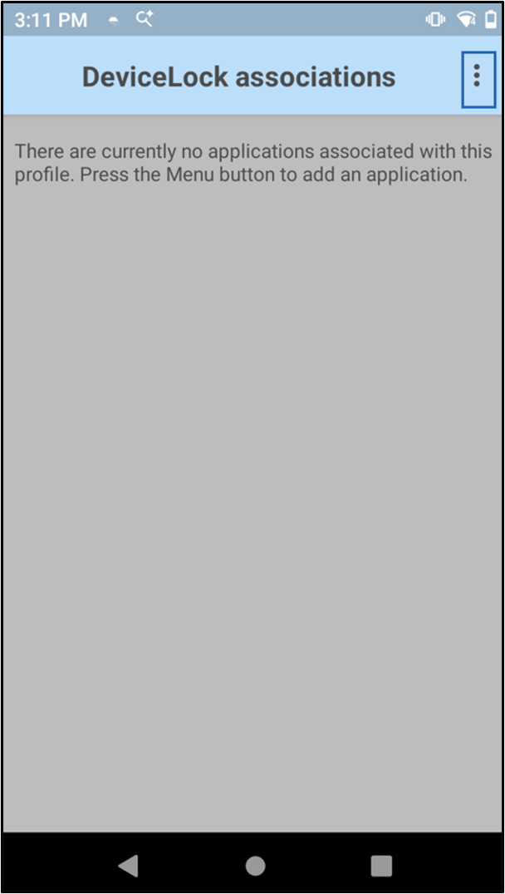

   The **New app/activity** pop-up box is displayed.
8. Select **New app/activity**.

   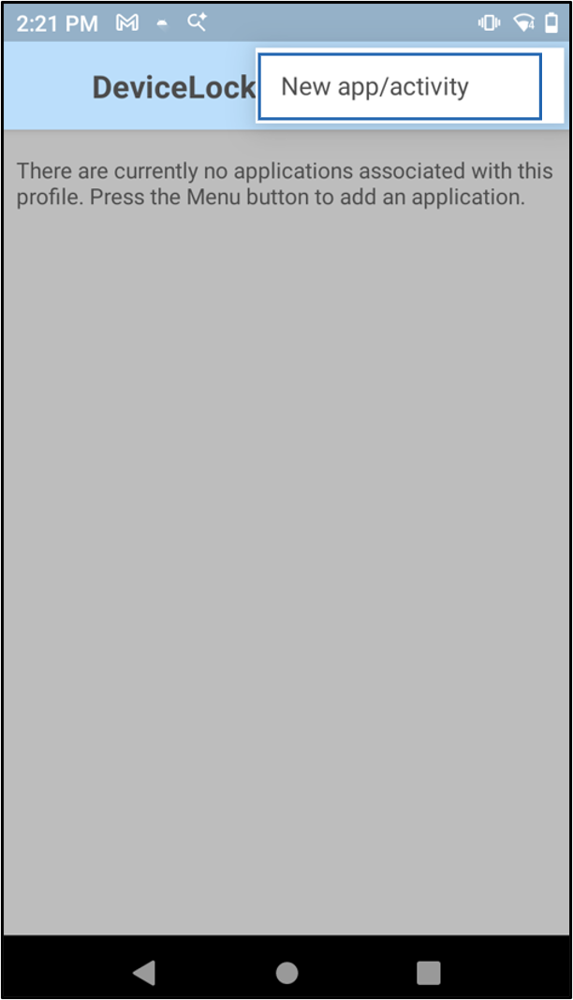

   The List of Apps are displayed.
9. Select the app.

   <Note>
     **Note:** Select **com.oloid.devicelock**.
   </Note>

   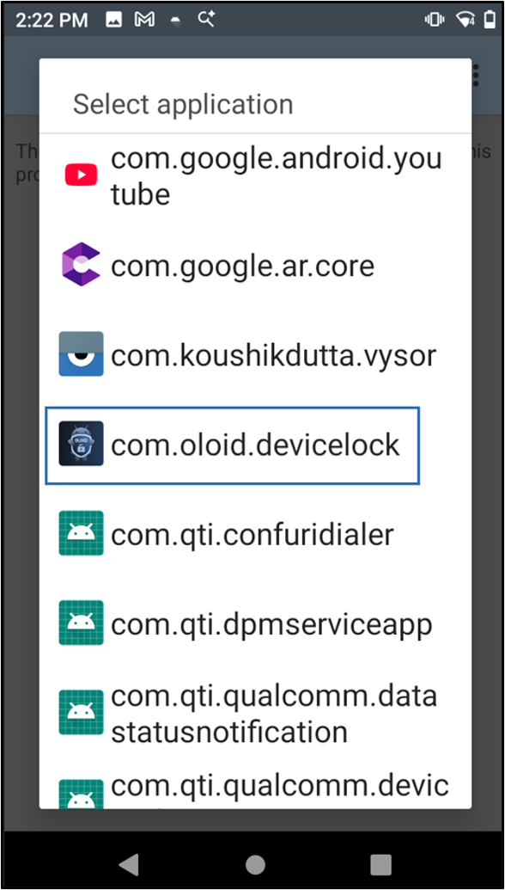

   The **select activity** pop-up box is displayed.
10. Select the **asterisk (*)** to associate it with all activities.

    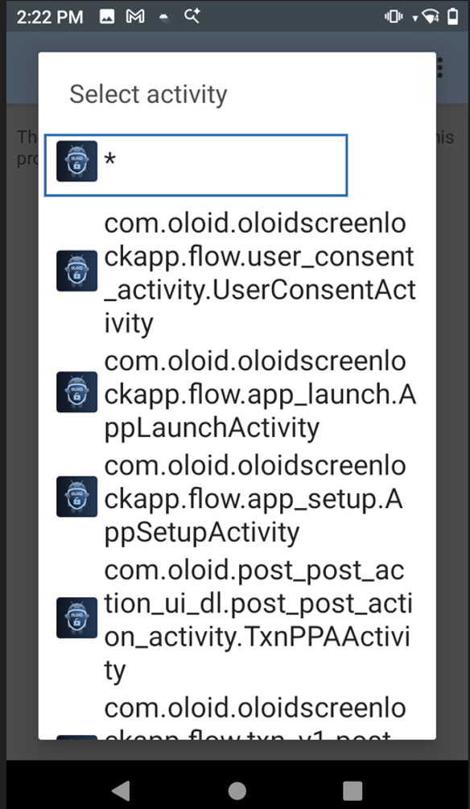

    The app is selected and listed on the Profile associations screen.

    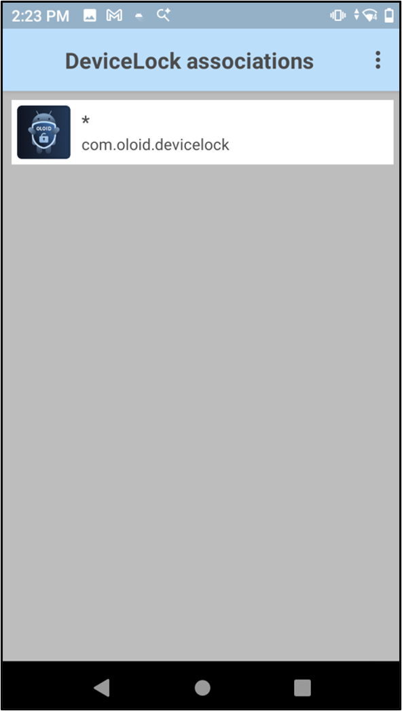

11. Go back to the Profile page.
    The Profile page is displayed and do the following:
    1. Ensure the **Enabled** checkbox is checked for Barcode input.

       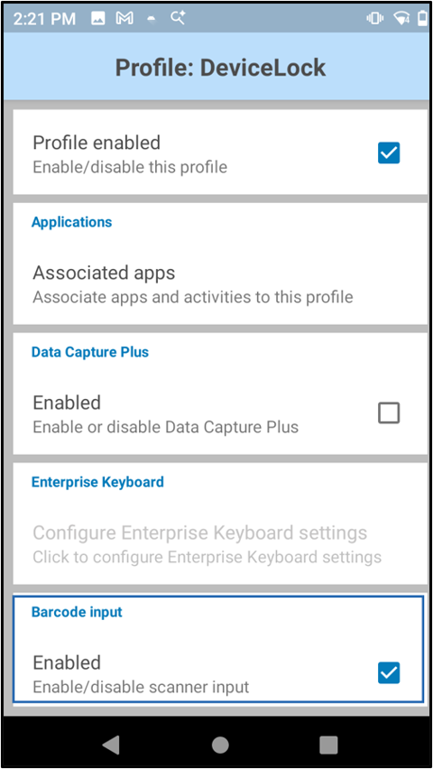

    2. Ensure the Enabled checkbox is UNCHECKED for Keystroke output to prevent scanner data from being injected as text.

       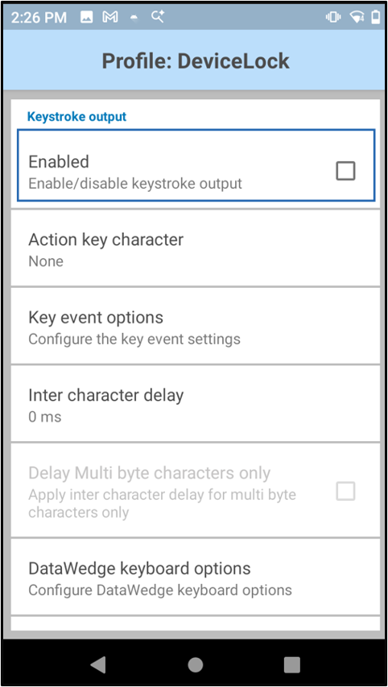

    3. Go to **Intent Output** section and do the following.
       1. Select the **Enabled** checkbox.

          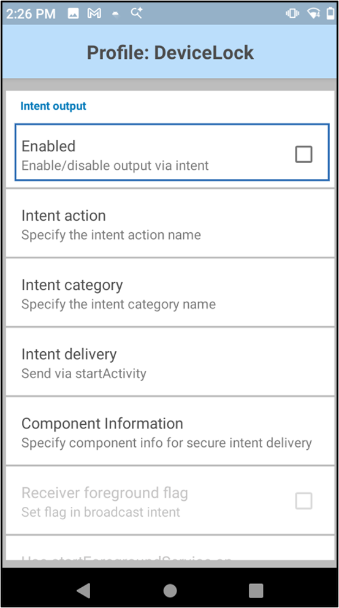

       2. Tap **Intent action**.

          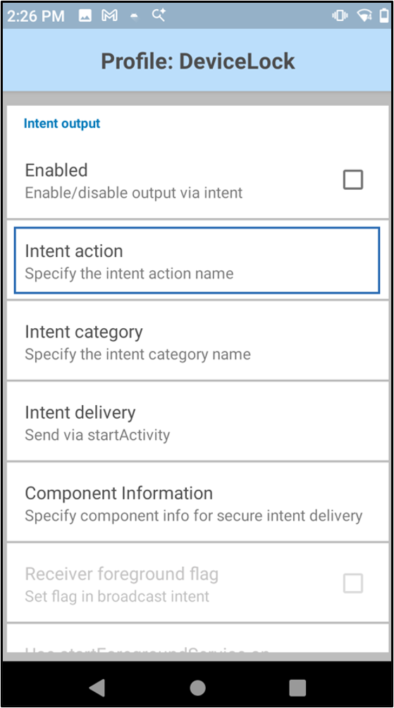

          The **Enter intent action name** is displayed.
       3. Enter the intent action name > tap **OK**.

          <Note>
            **Note:** Ensure the Intent Action name must be **com.devicelock.QR_CODE_SCAN_ACTION**.
          </Note>

          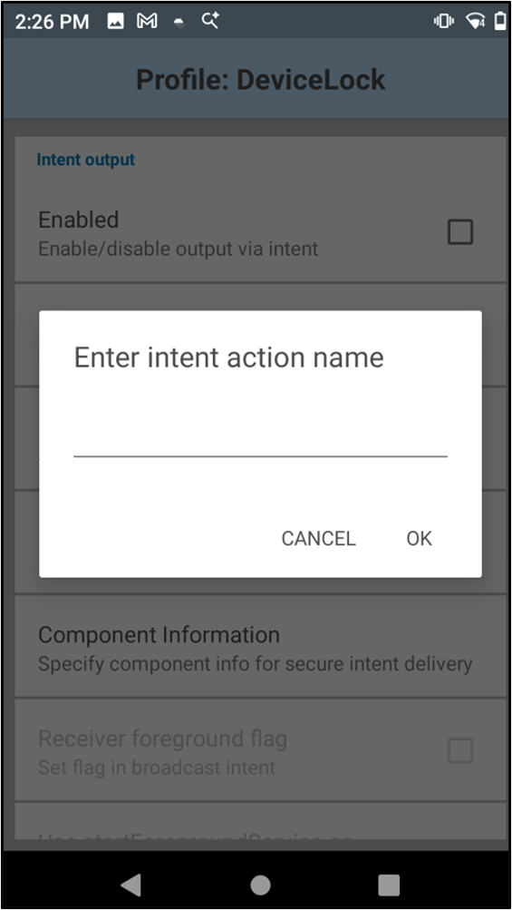

       4. Tap **Intent Delivery**.

          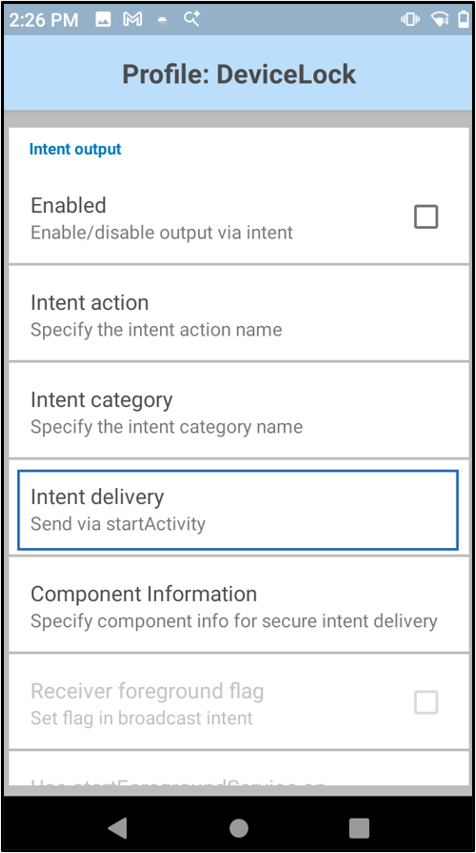

          The **Choose mechanism** pop-up box is displayed.
       5. Tap **Broadcast intent**.

          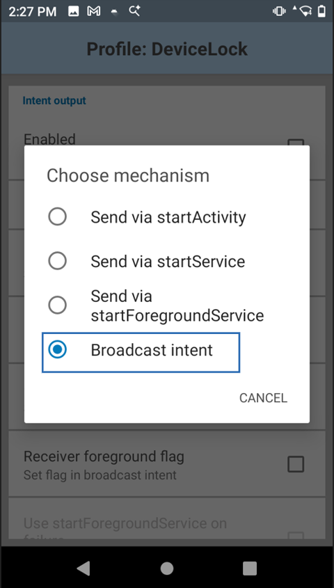

The QR Code Scanner for Data Wedge Applications is successfully configured.
