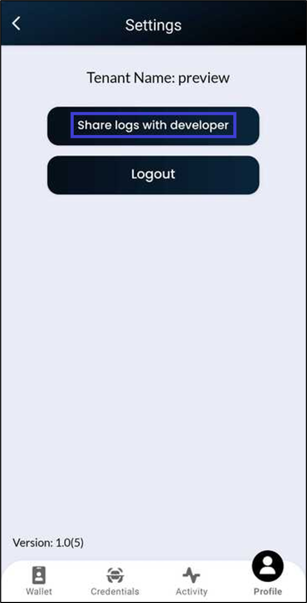

{/* Source: Intercom article 9316986 - https://oloid.help/en/articles/9316986-how-to-send-logs-to-the-developer-in-oloid-cloudkey-app */}
{/* Generated by intercom_to_mintlify.py - re-running overwrites this file. */}

To share logs with developer:

1. Launch the **OLOID CloudKey app.**
2. Log in using your registered email ID.

   

   The **Wallet** screen with a list of doors is displayed.

   

3. Tap on the **Profile tab** at the bottom right of the screen.

   

4. Scroll down to the bottom of the screen and tap **Settings**.

   

   The **Settings** screen is displayed.
5. On the Settings screen, tap **Share logs with developer**.

   

   The logs are uploaded and shared with the developer.
