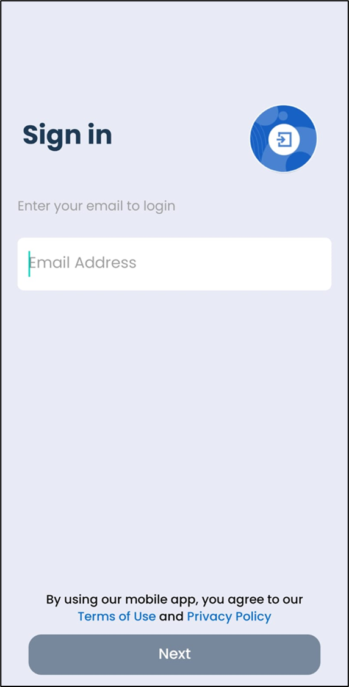
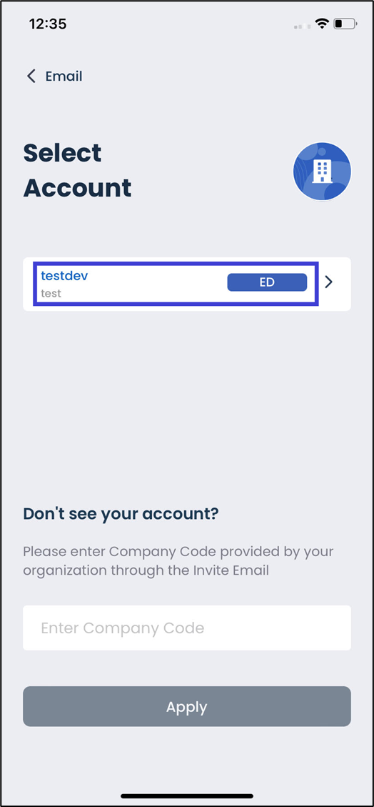
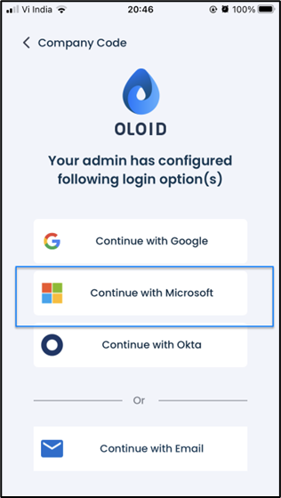
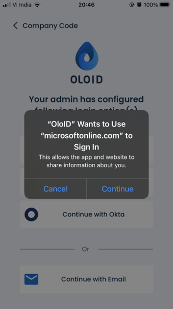
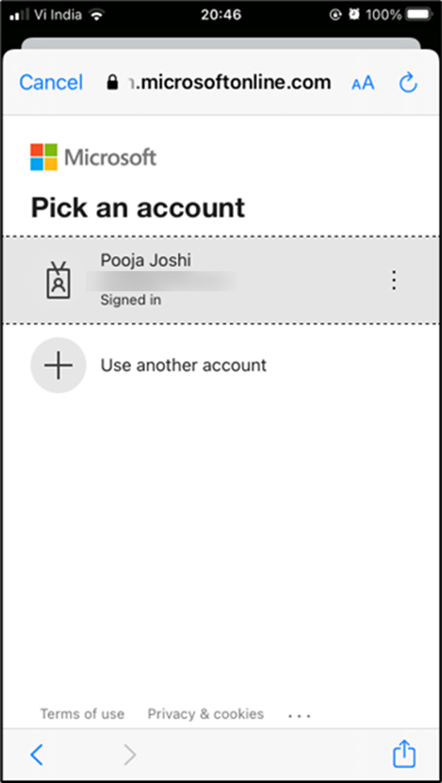

{/* Source: Intercom article 9310861 - https://oloid.help/en/articles/9310861-log-in-to-oloid-cloudkey-app-with-azure */}
{/* Generated by intercom_to_mintlify.py - re-running overwrites this file. */}

## Introduction

This document provides instructions to log in to the **OloID CloudKey App** using **Azure**.

## Pre-requisite

- The App user should have a verified **Microsoft (Azure)** email account.
- The App user should be an Oloid user. For more information on this, please **contact your admin.**

## OloID CloudKey App Login using Azure

To log in to the **OloID CloudKey App** using **Azure**, follow the below steps:

1. Launch the **OloID CloudKey App**. (If App is not present, download the app from **App Store** / **Play Store**).
2. Enter the **Microsoft email ID** in the **Sign in** screen and click **Next**.

   

3. Select a specific **Account** from the tenant list**.**

   

   Tap the desired account to proceed further.
4. Click **Continue with Microsoft**.

   

5. Click **Continue** when **OloID CloudKey** App prompts for permission to use the Microsoft account for logging in to the app.

   

   The account is listed on the screen.
6. Click on the account.

   <Note>
     **Note:** If you have multiple accounts listed, select the same email ID entered in step 2 above.
   </Note>

   

7. Enter your credentials to successfully log in.
