{/* Source: Intercom article 9310637 - https://oloid.help/en/articles/9310637-oloid-cloudkey-app-installation-and-login */}
{/* Generated by intercom_to_mintlify.py - re-running overwrites this file. */}

OloID CloudKey app provides an easy contactless way to authenticate and provide secure access over your mobile. With the app, you can easily unlock the door with a tap.

OloID CloudKey app is compatible with all mobile devices. Below is a condensed list of compatible devices.

- Android phones with OS 6 and above
- iPhone with OS 12 and above

**Pre-requisite**: You should have a valid OloID account.

## Installation Procedure

1. Go to **App Store** or **Play Store** and download **OloID CloudKey App.**
2. Install the application and upon successful installation, open the app.
3. Click **Get Started**.

   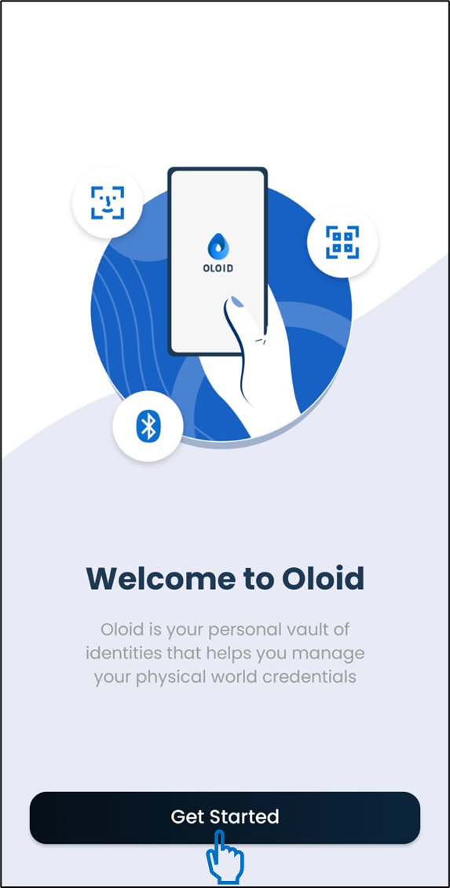

4. Enter **Email ID** and Click **Next** on the **Sign In** screen.

   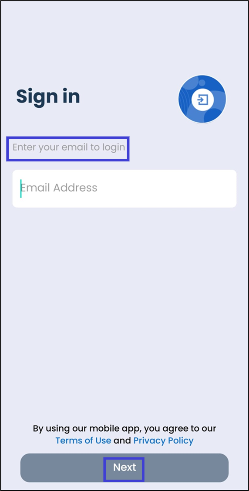

5. Enter **Company Code** and click **Apply**.

   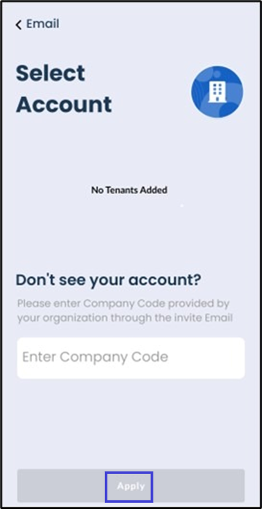

   The Tenant is listed on the screen.

   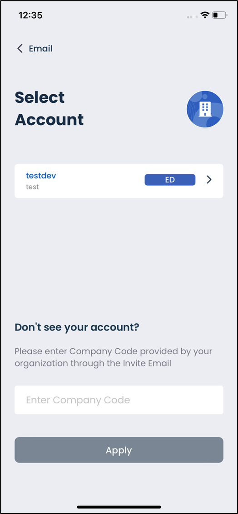

6. Tap on the **Tenant** and click **Apply**.

   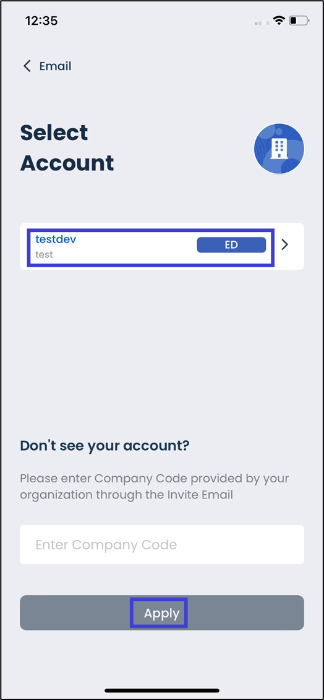

7. Enter your registered email id and click **Next**.

   <Note>
     **Note:** You can also use SSO login.
   </Note>

   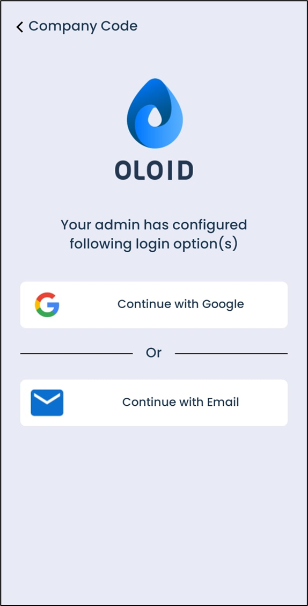

   A 6-digit code is sent to the registered email.
8. Enter the **6-digit code** and tap **Next** to successfully log in.

   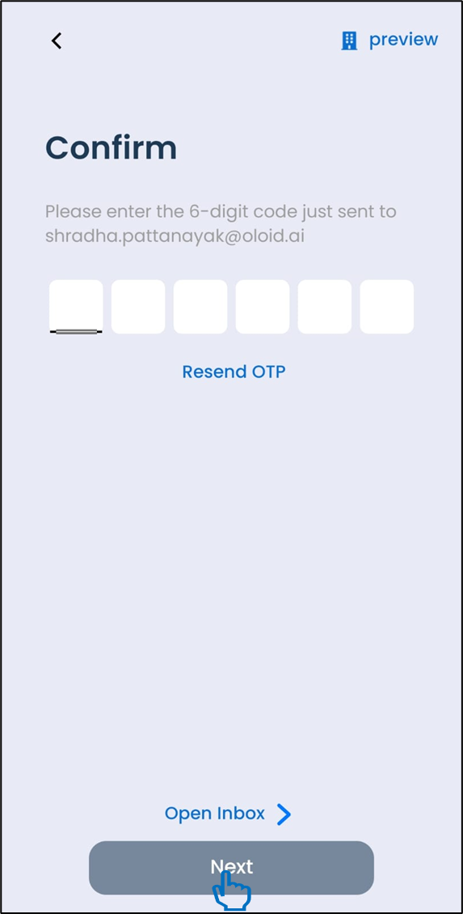

9. Click **Continue** when OloID CloudKey App prompts for Bluetooth, location, and push notification permissions.

   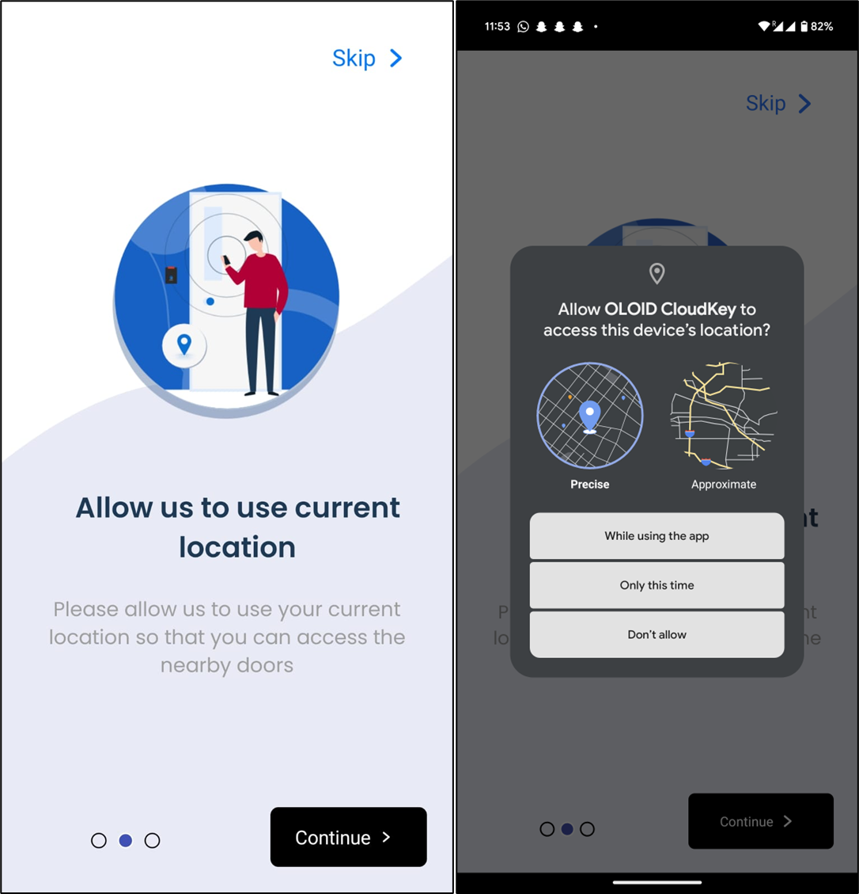

   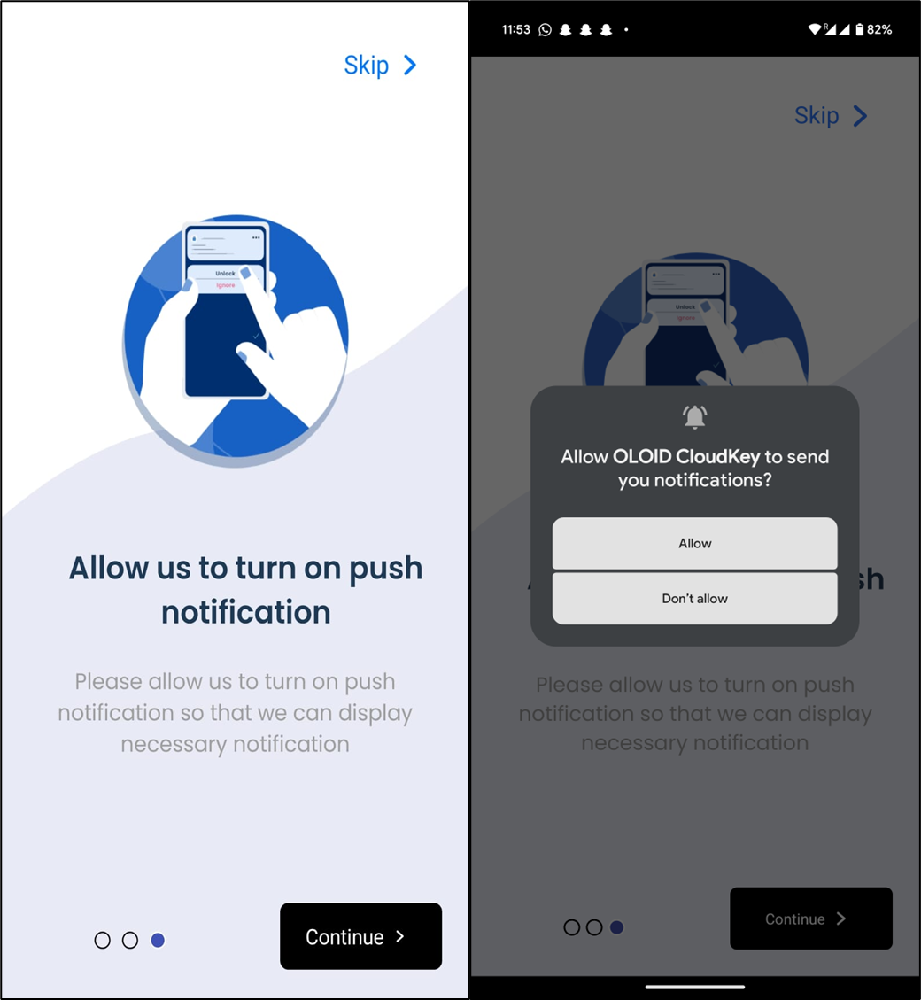

   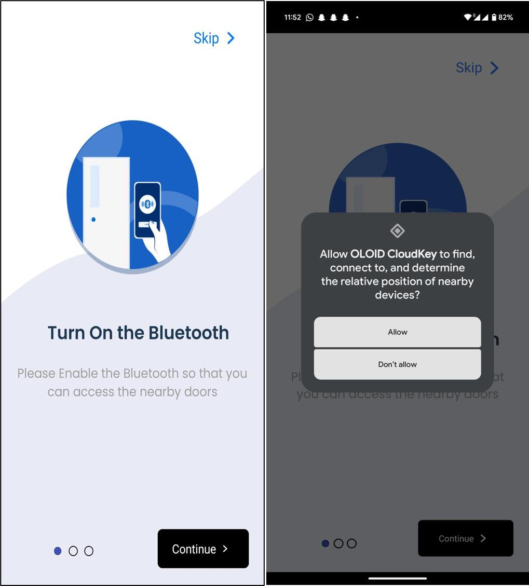

   The Welcome screen is displayed.

   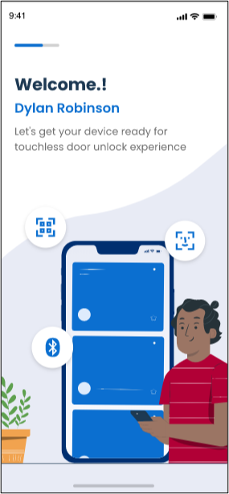

   The **Wallet** screen is displayed.

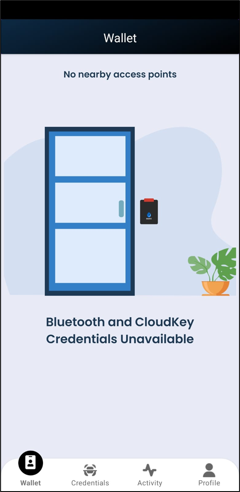
