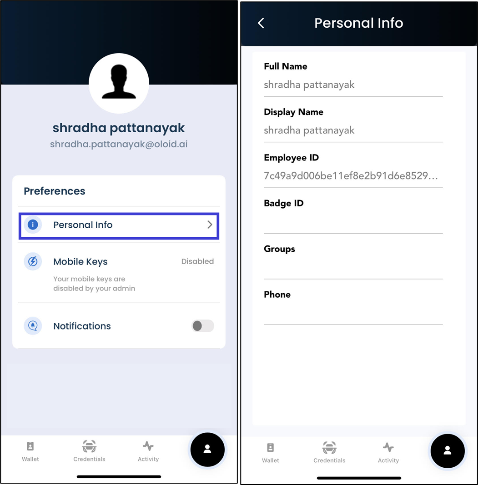
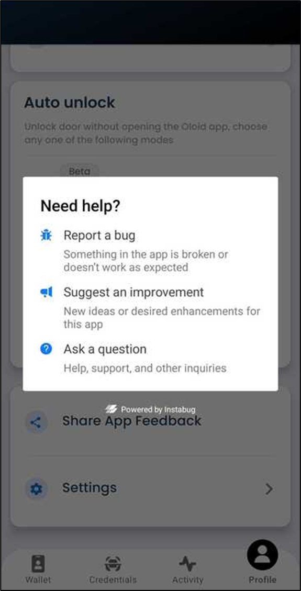
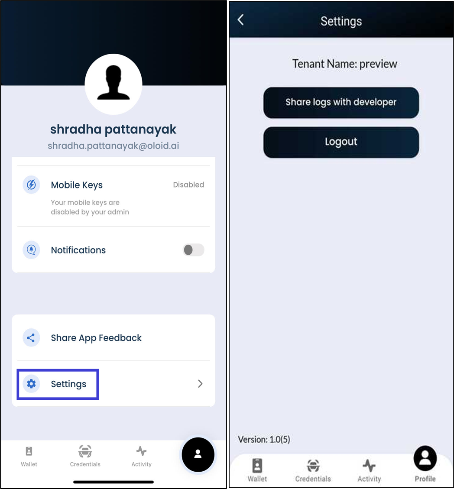

{/* Source: Intercom article 9310881 - https://oloid.help/en/articles/9310881-using-the-oloid-cloudkey-app-profile */}
{/* Generated by intercom_to_mintlify.py - re-running overwrites this file. */}

Under **Profile** tab, you can do the following:

a. [View Personal Info](/drafts/unassigned/unmapped/using-the-oloid-app-profile-tba)

b. [View Mobile Keys](/drafts/unassigned/unmapped/using-the-oloid-app-profile-tba)

c. [Enable Notification](/drafts/unassigned/unmapped/using-the-oloid-app-profile-tba)

e. [Share App Feedback](/drafts/unassigned/unmapped/using-the-oloid-app-profile-tba)

f. [View Settings](/drafts/unassigned/unmapped/using-the-oloid-app-profile-tba)

## View Personal Info

Tap **Personal Info** under **Profile** tab on the menu at the bottom of the screen to see your personal details.

## Mobile Keys

Mobile key is disabled by the admin.

## Enable Notification

You can enable notifications to receive messages from the CloudKey app.

## Share App Feedback

Tap **Share App Feedback** under **Profile** tab on the menu at the bottom of the screen to share your feedback for the application. The pop-up box is displayed to share feedback.

You can do the following:

1. **Report a bug:** You can report issues you are facing with the app like something in the app is broken or does not work as expected.
2. **Suggest an Improvement**: You can give your new ideas or suggest enhancements for the app.
3. **Ask a question:** You can ask your queries or support on the app.

## View Settings

Tap **Settings** under the **Profile** tab on the menu at the bottom of the screen to view **Settings** screen.

You can do the following:

1. Tap **Share Logs with developer** to send the logs to the developer.
2. Tap **Logout** to exit the application.

   
