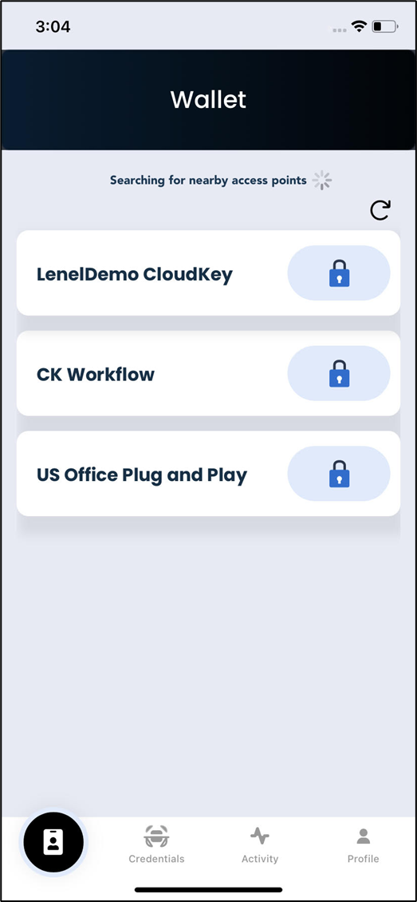
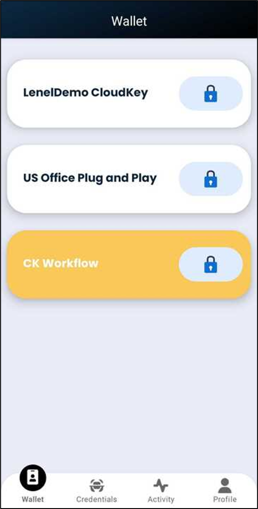
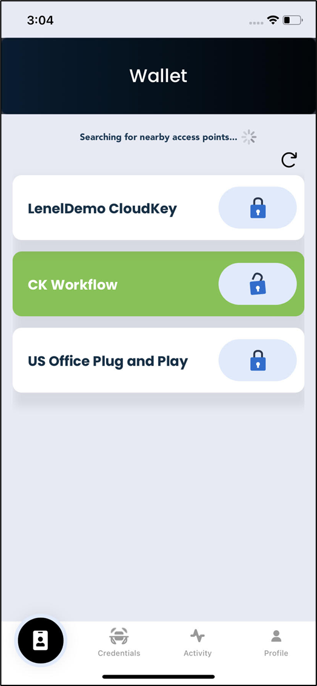

{/* Source: Intercom article 9310874 - https://oloid.help/en/articles/9310874-using-the-oloid-cloudkey-app-wallet */}
{/* Generated by intercom_to_mintlify.py - re-running overwrites this file. */}

The OLOID CloudKey App has four tabs: Wallet, Credentials, Activity, and Profile.

## Wallet

The Wallet screen shows the list of doors nearest to you. You can tap on the door name to open it.

## Pre-requisite

- *You should have a valid OloID account.*
- *You should have CloudKey credential assigned to the user.*

## To use the OloID CloudKey app Wallet

1. Launch the OloID CloudKey App.
   The **Wallet** page with a list of doors is displayed.

   

2. Tap on the door name.

The name bar color changes to yellow.

3. Upon successful communication with the CloudKey, the name bar color changes to green and the door opens*.*

***Note****: If your Wallet screen does not display the door names, you need to assign CloudKey credential to the user.*
