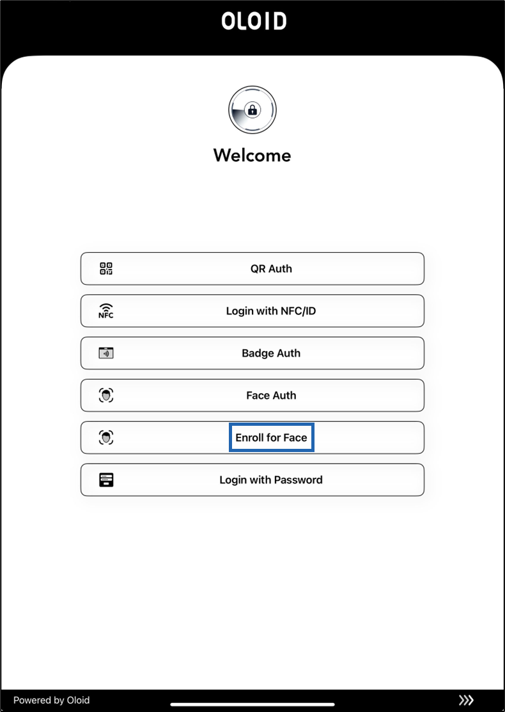
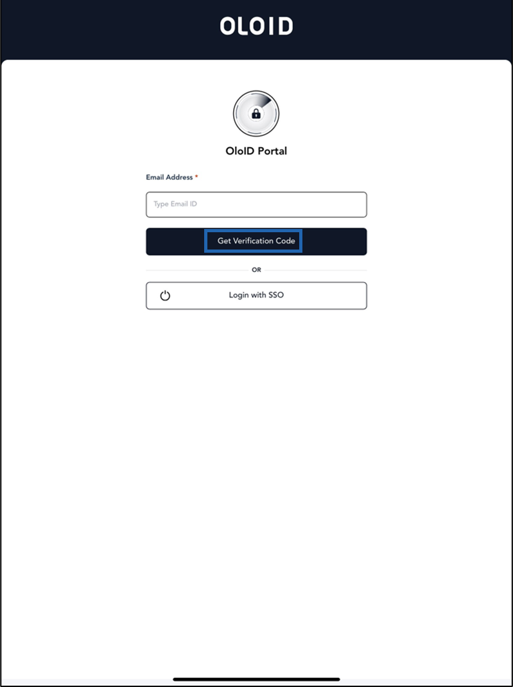
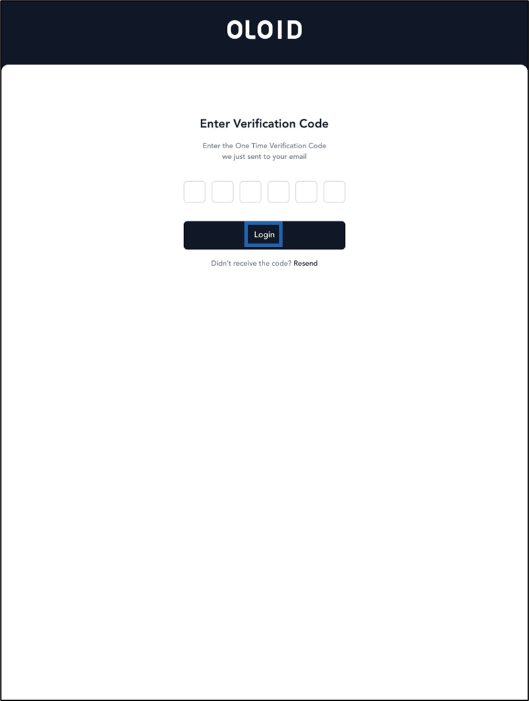
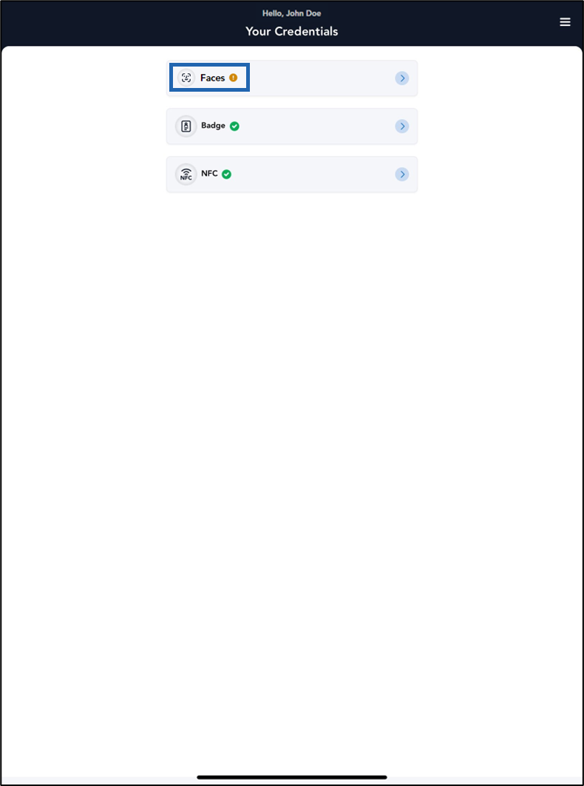
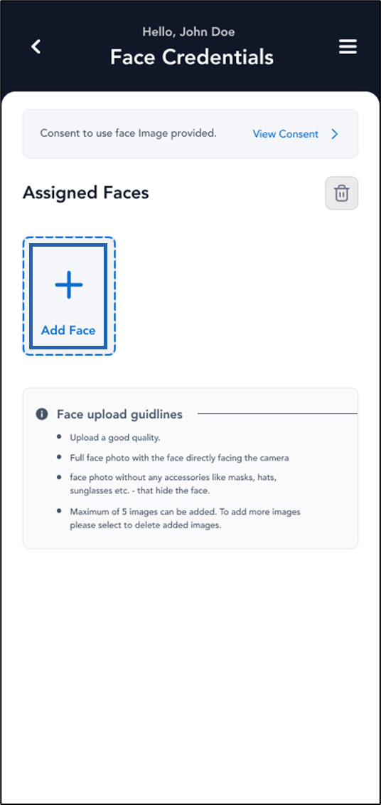
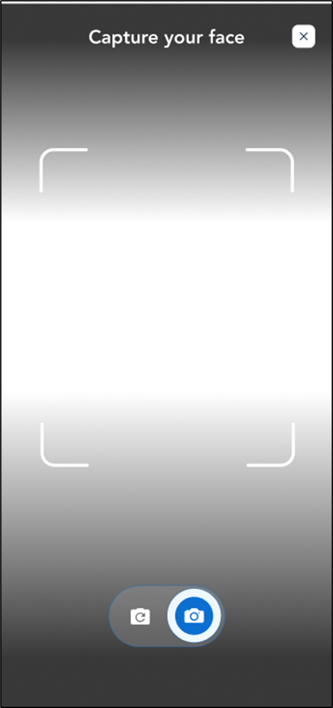
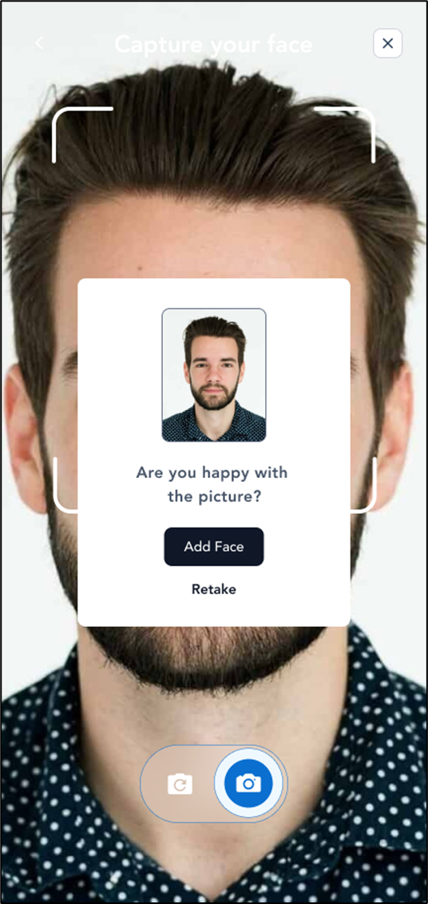
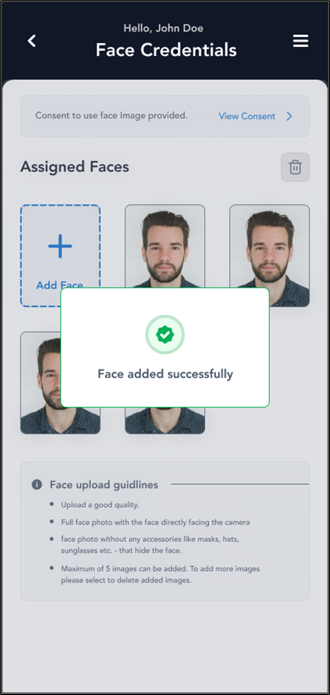

{/* Source: Intercom article 9891334 - https://oloid.help/en/articles/9891334-how-to-enroll-for-face-through-oloid-connect-passwordless-app */}
{/* Generated by intercom_to_mintlify.py - re-running overwrites this file. */}

**Pre-requisite**

User must have a registered email ID in the Oloid Portal.

To enroll for face login:

1. Launch the Oloid Connect app on your iPad.
2. On the home page of the app, select **Enroll for Face**.

   

   The Oloid User Portal login page is displayed.
3. Do the following:
   1. Enter your email address in the **Email Address** field.
   2. Click **Get Verification Code**.

      

      A verification code is sent to your registered email ID.
   3. Enter the Verification code.

      <Note>
        **Note:** The One Time Verification Code expires after 60 seconds.
      </Note>

   4. Click **Login**.

      

      The Oloid User Portal is displayed.
4. On the credential page of the Oloid User Portal, select **Faces**.

   

   The Face Credential page is displayed.

   <Note>
     **Note:** You need to provide your consent to proceed to the next steps if consent is enabled for you.
   </Note>

5. Select **Add Face**.

   

   This opens the camera on your device.
6. Look at the camera to confirm your identity.

   

   The pop-up screen appears with the captured image.

   

7. Do one of the following:
   1. Select **Add Face** to submit the image.
      The face is submitted successfully and is assigned as a face credential.
   2. Select **Retake** to take your photo again.
      The camera turns on to retake the photo.

      <Note>
        **Note:** You can add a maximum of five faces per user.
      </Note>

      Your face should be visible in the camera, or else it might get rejected. It is recommended to avoid wearing things that cover your facial features such as sunglasses, masks, headbands, etc.

The face is added successfully.

Watch our video [How to enroll for face through Oloid Connect Passwordless App-Video Tutorial](/platforms/ios/videos/how-to-enroll-for-face-through-oloid-connect-passwordless-app-video)
