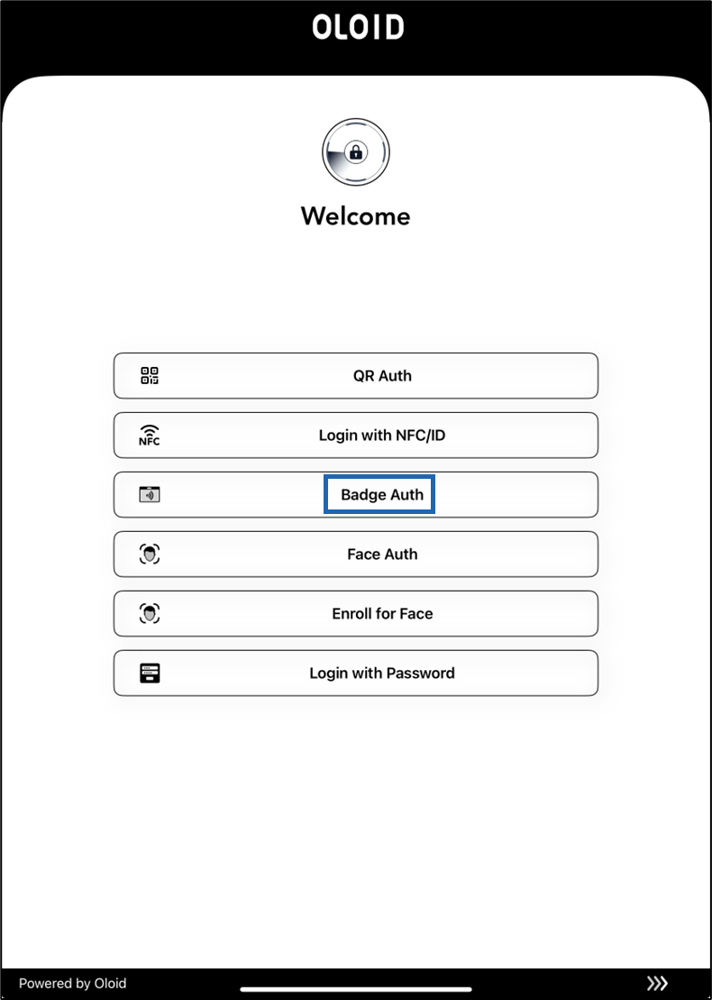
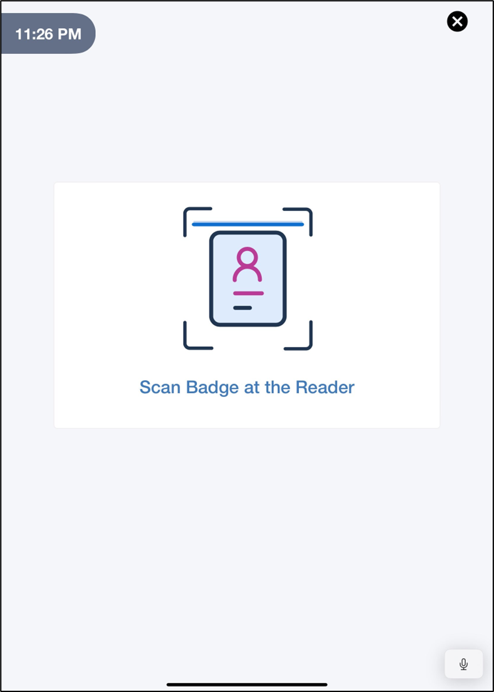
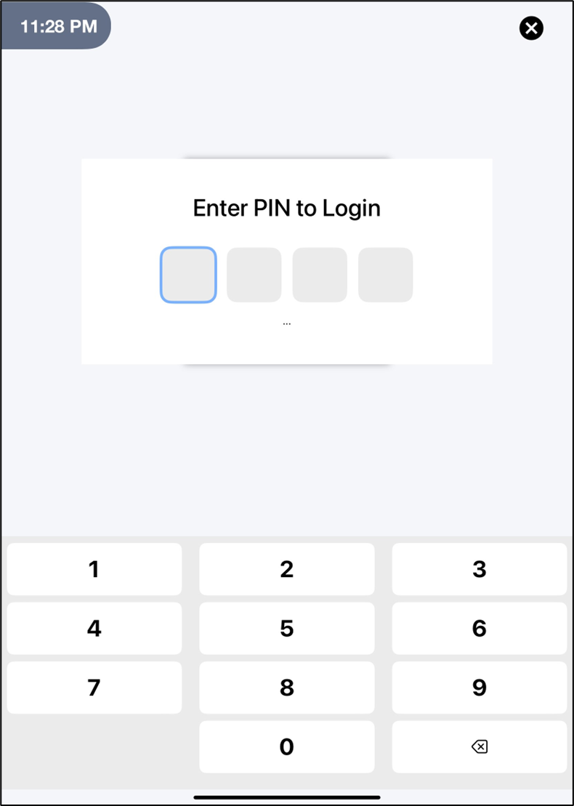
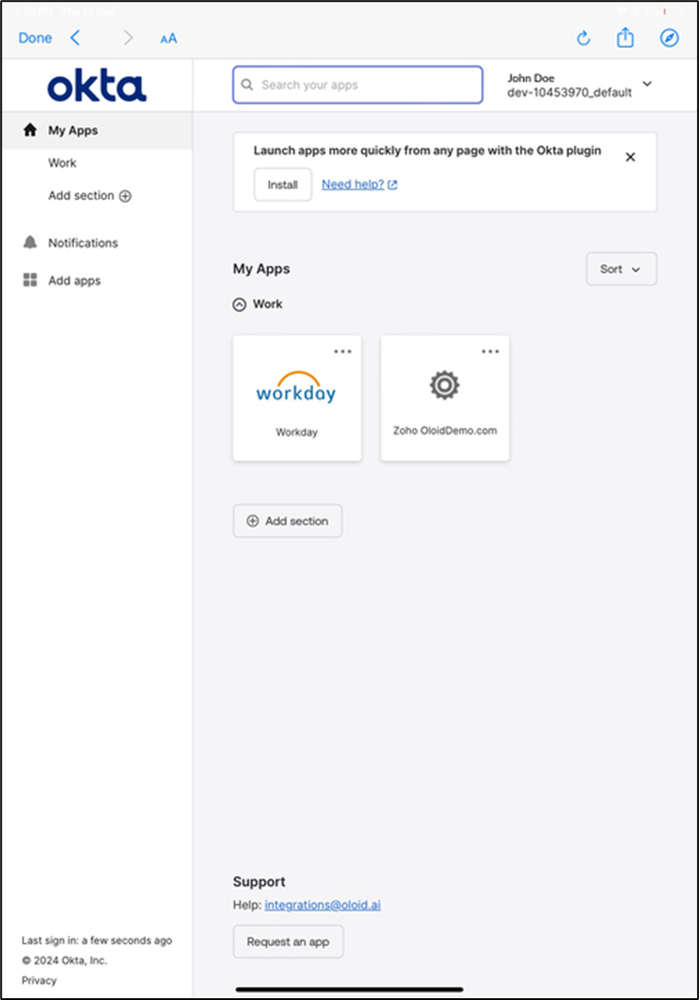

{/* Source: Intercom article 9789771 - https://oloid.help/en/articles/9789771-how-to-log-in-to-workforce-hrms-platform-using-badge-and-pin-through-oloid-connect-for-passwordless-app */}
{/* Generated by intercom_to_mintlify.py - re-running overwrites this file. */}

## Introduction

This document provides step-by-step instructions for logging in with badge and PIN to Workforce / HRMS platform.

## Pre-requisite

- User must have an Okta account.
- In the Oloid Portal, admin must do the following:
  - Okta credential (user email ID) must be added to the user details page in Oloid Portal.
  - Assign badge to the user. For more details, refer [How to assign Badge ID as credential to users](/platform/tenant-admin-portal/how-to-assign-badge-id-as-credential-to-users)
  - Add a PIN for the user. For more details, refer[How to add PIN as credential to users](/platform/tenant-admin-portal/tenant-admin-portal-how-to-add-pin-credential-for-user)
  - Enable Badge option under the Oloid Verify application in Authentication tab. For more details, refer [How to create and configure Connect for Passwordless application.](/platforms/ios/connect-passwordless/how-to-create-and-configure-oloid-connect-passwordless-application-in)

## Using the Badge

1. Launch the Oloid Connect app on your iPad.
2. On the home page of the app, select **Badge Auth**.

   

   The **Scan Badge at the Reader** screen is displayed.

   

3. Tap the **Badge** on the **Reader** to scan it.

   <Note>
     **Note:** The Card Reader should be connected to your iPad.
   </Note>

4. On Badge authentication, the **Enter PIN to Login** screen is displayed.

   

5. Enter the **PIN**.
   On PIN authentication, you are signed in to the **Workforce /HRMS** platform.

   
