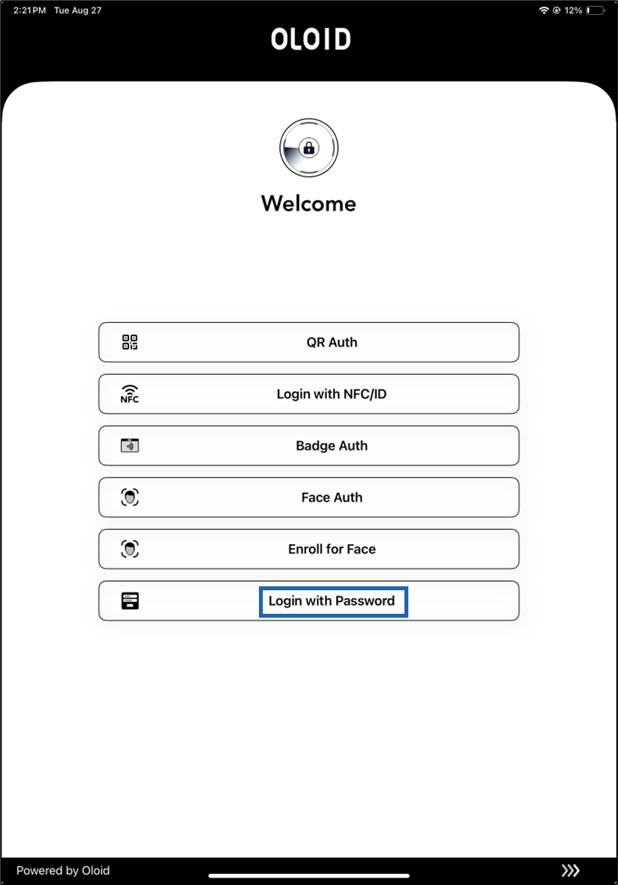
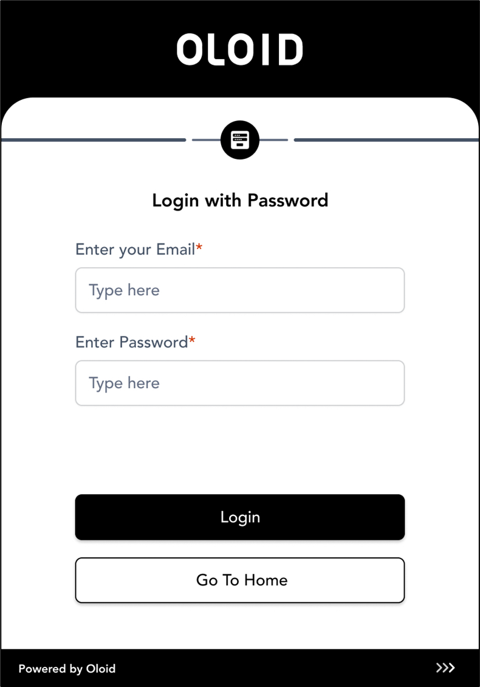
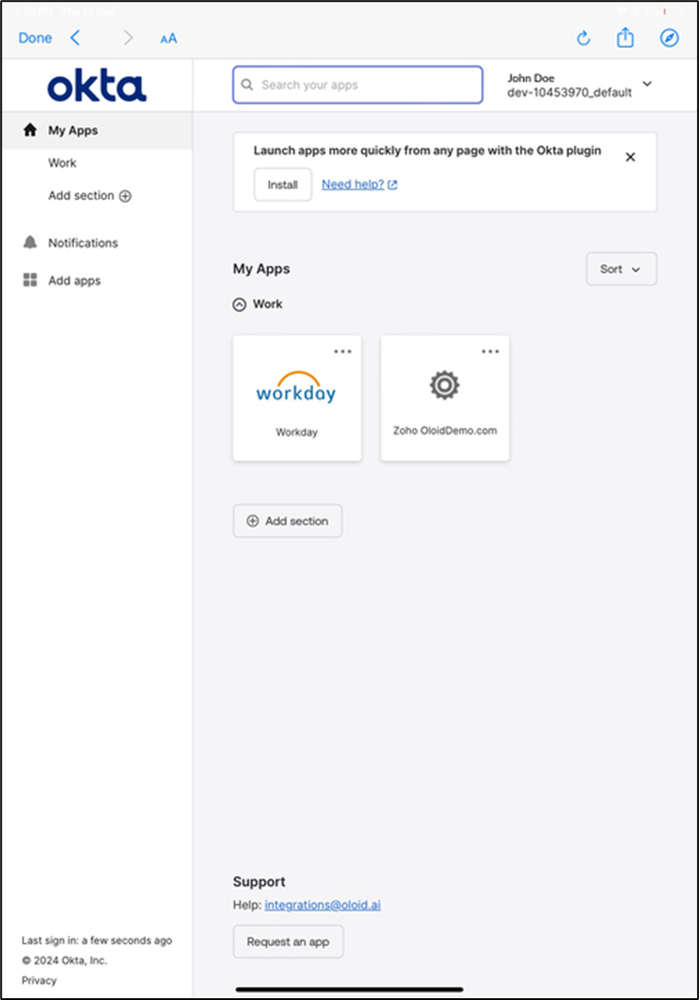

{/* Source: Intercom article 9895757 - https://oloid.help/en/articles/9895757-how-to-log-in-to-workforce-hrms-platform-using-password-through-oloid-connect-for-passwordless */}
{/* Generated by intercom_to_mintlify.py - re-running overwrites this file. */}

**Pre-requisite**

- User must have an Okta account.
- Okta credential (user email ID) must be added to the user details page in Oloid Portal.

To log in with password:

1. Launch the Oloid Connect app on your iPad.
2. On the home page of the app, select **Login with Password**.

   

3. Enter your login credential in the respective fields..

   

   You are successfully signed in to the Okta system.

   

   Watch our video [How to login with Password through Oloid Connect for Passwordless](/platforms/ios/connect-passwordless/how-to-log-in-to-workforce-hrms-platform-using-password-through-oloid)
