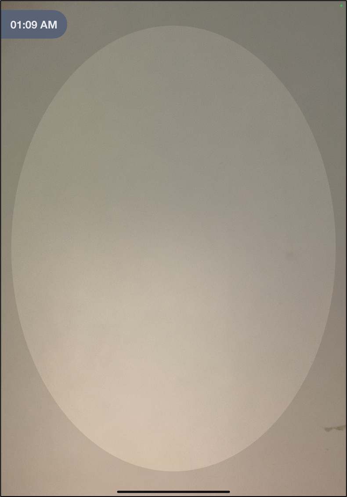
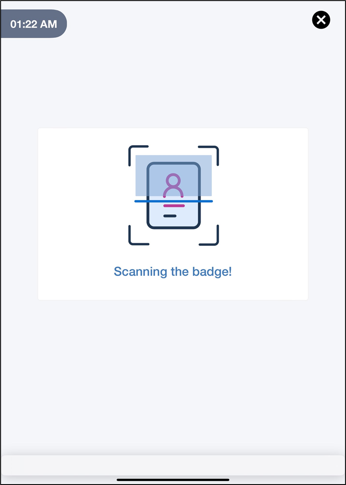
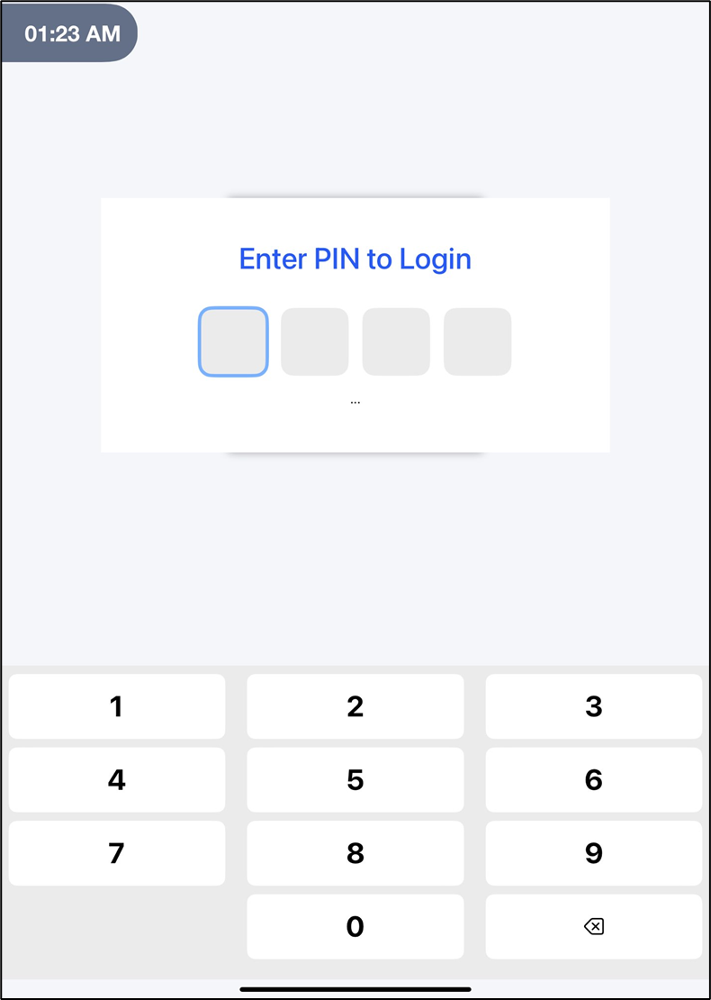
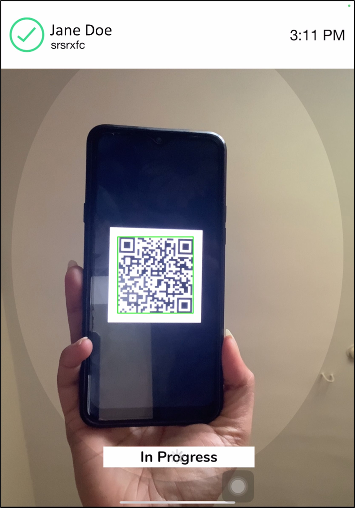
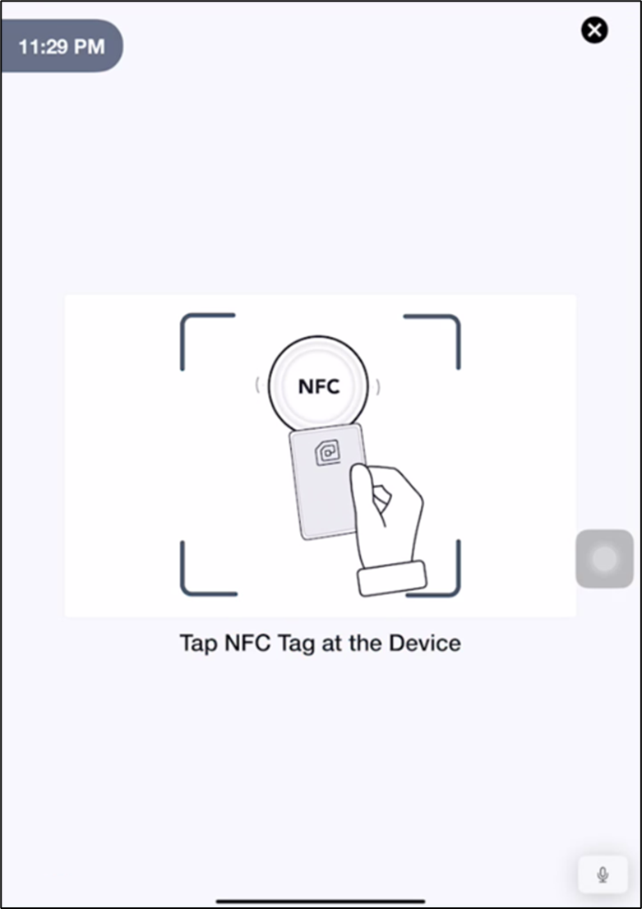

{/* Source: Intercom article 8413098 - https://oloid.help/en/articles/8413098-how-to-log-in-to-workforce-hrms-system-using-single-factor-authenticators-through-oloid-connect-passwordless-app */}
{/* Generated by intercom_to_mintlify.py - re-running overwrites this file. */}

You can log in to Workforce platforms using Face, Badge, PIN, QR, or NFC depending on your device configuration.

## Prerequisite

The Oloid Connect App should be configured in OloID platform for using the credentials. The user should have Okta user credentials.

Once the setup is complete, you can use one of the following to log in to Okta.

- [Login with Face](#login-with-face)
- [Login with Badge](#login-with-badge)
- [Login with PIN](#login-with-pin)
- [Login with QR Code](#login-with-qr-code)
- [Login with NFC](#login-with-nfc)

## Login with Face

### Pre-requisite

The user and user face are added to the Oloid Portal.

To log in with face:

1. Launch the **Oloid Connect** App on the iPad.
   The preview screen is displayed.

   

2. Position yourself in front of the iPad and align your face within the oval frame.
   The camera captures the face.
   On successful face authentication, the app takes you to the Okta dashboard.

## Login with Badge

### Pre-requisite

- The Badge Reader is connected to the device.
- User and Badge credentials are created in the Oloid Portal.

To log in with badge:

1. Launch the **Oloid Connect** App on the iPad.
   The scan badge screen is displayed.

   

2. Scan your badge in the Badge Reader.
   On successful badge authentication, the app takes you to the Okta dashboard.

## Login with PIN

### Pre-requisite

- User is added to the Oloid Portal.
- PIN is configured and communicated to the user.

To log in with PIN:

1. Launch the **Oloid Connect** App on the iPad.
   The login screen is displayed.
2. On **Enter PIN to Login** screen, enter the PIN.

   <Note>
     **Note:** By default, the PIN is set to 4 Digit Numeric PIN. You can configure the PIN length. For PIN configuration, see[How to configure the PIN](/platform/tenant-admin-portal/tenant-admin-portal-how-to-configure-pin)
   </Note>

   

On successful PIN authentication, the app takes you to the Okta dashboard.

## Login with QR Code

### Pre-requisite

The user and QR Code are added to the Oloid Portal.

To log in with QR Code:

1. Launch the **Oloid Connect** App on the iPad.
   The preview screen is displayed.
2. Show your QR Code for automatic capture.

   

On successful QR authentication, the application the app takes you to the Okta dashboard.

## Login with NFC

### Pre-requisite

- The Badge Reader is connected to the device.
- User and NFC credentials are created in the Oloid Portal.

To log in with NFC:

1. Launch the **Oloid Connect** App on the iPad.
   The NFC Tag screen is displayed.

   

2. Scan your NFC Tag in the Reader.
   On successful NFC authentication, the app takes you to the Okta dashboard.

### Video Tutorial

Watch the video [How to log in to Workforce/ HRMS system using Single Factor Authenticators through Oloid Connect Passwordless App- Video Tutorial](/platforms/ios/videos/how-to-log-in-to-workforce-hrms-system-using-single-factor)
