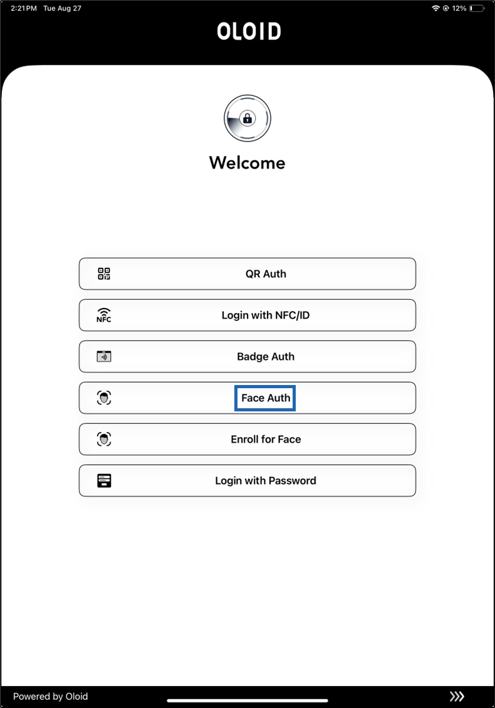
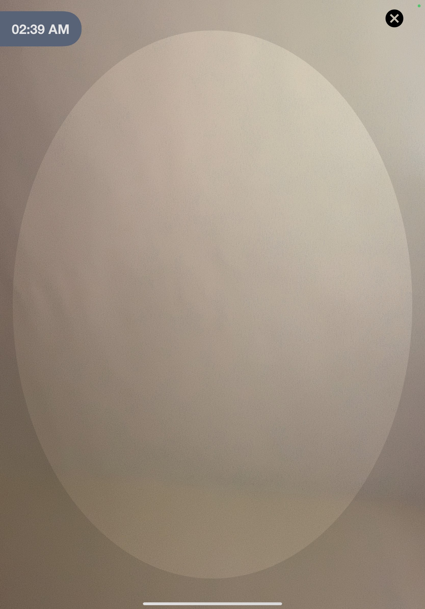
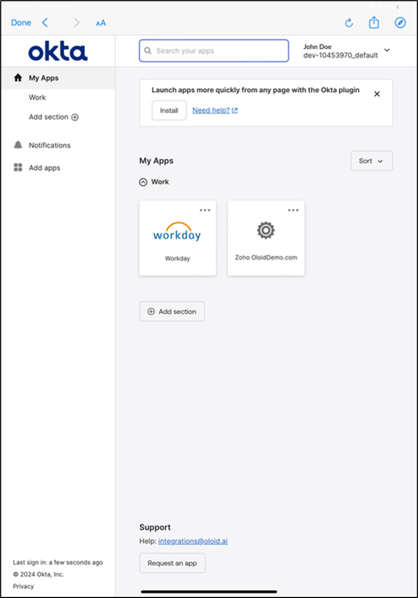

{/* Source: Intercom article 9920262 - https://oloid.help/en/articles/9920262-how-to-log-in-with-face-through-oloid-connect-for-passwordless */}
{/* Generated by intercom_to_mintlify.py - re-running overwrites this file. */}

**Pre-requisite**

- User must have an Okta account.
- Okta credential (user email ID) must be added to the user details page in Oloid Portal.
- The user face must be added in the Oloid Portal.

To log in with face:

1. Launch the Oloid Connect app on your iPad.
2. On the home page of the app, select **Face Auth**.

   

   This opens the camera on your device.
3. Look at the camera to confirm your identity.

   

   You are successfully signed in to the Okta system.

   
