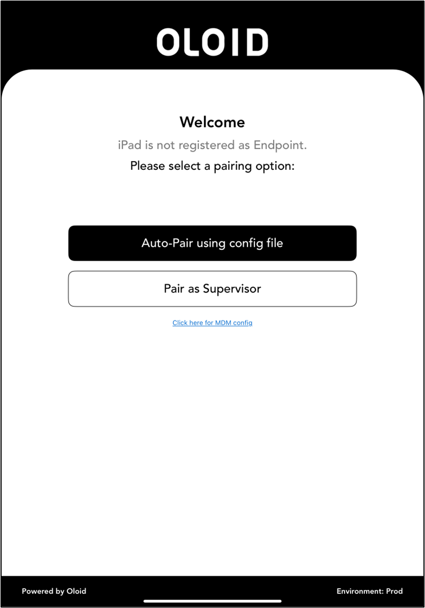
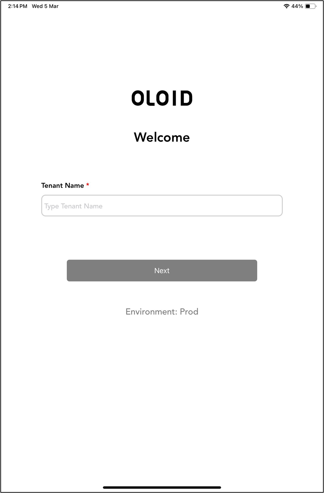
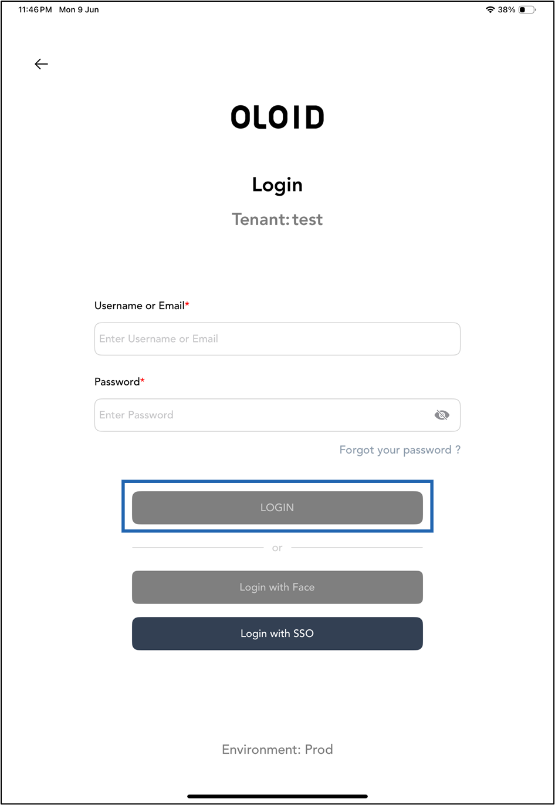
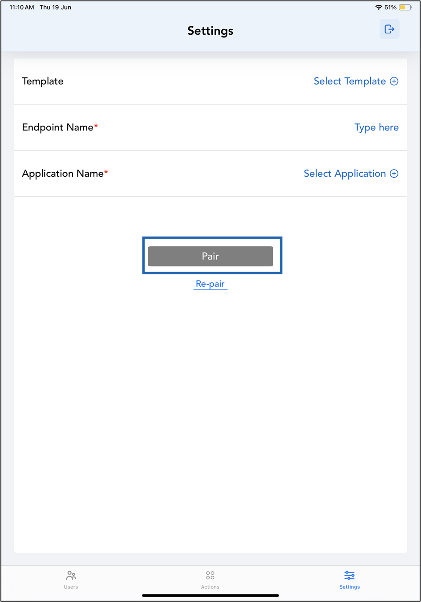
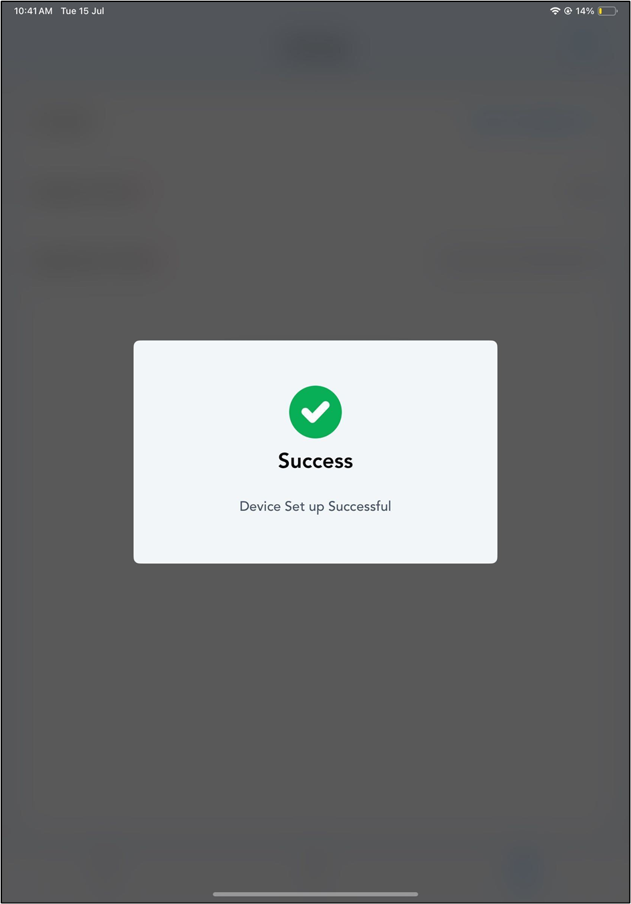
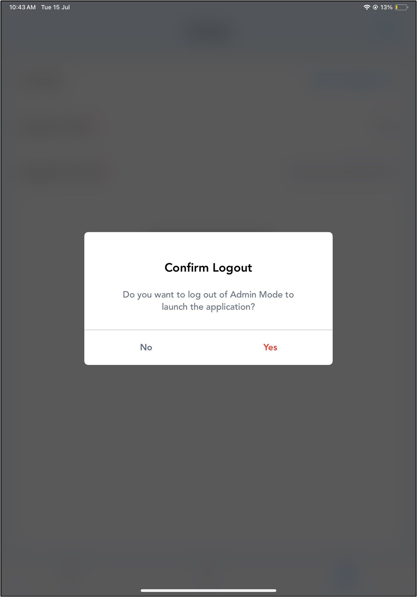

{/* Source: Intercom article 8400084 - https://oloid.help/en/articles/8400084-installing-the-oloid-connect-app-for-passwordless */}
{/* Generated by intercom_to_mintlify.py - re-running overwrites this file. */}

## Introduction

This document explains how to install the **Oloid Connect app** for passwordless authentication.

## Prerequisites

- You should be a Tenant Admin and Supervisor.
- Application, Connections, and template (optional) must be configured in Tenant Admin Portal.

## Device Compatibility

Ensure that your device is compatible with the Oloid Connect App. See, [Oloid Connect Passwordless - Hardware and Software Requirements](/platforms/ios/connect-passwordless/oloid-connect-passwordless-hardware-and-software-requirements)

## Internet Connection

Ensure that the device is connected to the internet using Wi-Fi or mobile data, for the app installation and setup.

## Steps to install and setup the Admin Mode

1. Go to **App Store** and download **Oloid Connect App**.
   For detailed information see, **[How to download Oloid Connect application](/platforms/ios/time-clock/oloid-connect/oloid-connect-how-to-download-and-install-on-ipad).**
2. Install the application and launch it after the installation is complete.
   The **Welcome** screen is displayed.

   

3. Tap **Pair as Supervisor.**

   

   The Welcome screen is displayed.
4. Enter **Tenant Name** > tap **Next**.

   

   The **Login** page is displayed.
5. Do the following:
   1. Enter your email ID in the **Email** text field.
   2. Enter your password in the **Password** text field.
   3. Tap **LOGIN**.

      <Note>
        **Note:** You may also log in using SSO options. For more, refer to[Log in Using SSO](/platforms/ios/time-clock/oloid-connect/how-to-log-in-to-admin-mode-in-the-oloid-connect-app)
      </Note>

      

      The **Settings** page is displayed.
6. Pair the endpoint. For more information, refer to [How to pair the endpoint in Oloid Connect app](/platforms/ios/time-clock/oloid-connect/oloid-connect-how-to-pair-an-endpoint)

   

   The settings are saved and the Device Setup success message is displayed.

   

   <Note>
     **Note:** Once the iPad is successfully paired, other settings can be configured in the Tenant Admin Portal.
   </Note>

   The application prompts you to log out of Admin mode.
7. Do one of the following:
   1. Tap **Yes** to log out and launch the application (**preview mode**).
      The app displays preview mode and allows you to capture live Images for facial transactions.

      <Note>
        **Note:** To go back to admin mode, **double-click with two fingers** on preview mode and tap **Yes- To Continue**.
      </Note>

   2. Tap **No** to stay logged in to the admin mode.

#### Admin Mode Actions Without Endpoint Pairing

You can perform the following actions without pairing the endpoint:

- [View user details](/platforms/ios/time-clock/oloid-connect/oloid-connect-how-to-view-user-details)
- [Add User](/platforms/ios/time-clock/oloid-connect/oloid-connect-how-to-add-a-user)
- [Add Face](/platforms/ios/time-clock/oloid-connect/oloid-connect-how-to-add-face-for-a-user)
- [Add QR Code](/platforms/ios/time-clock/oloid-connect/oloid-connect-how-to-add-qr-code-for-a-user)
- [Set PIN](/platforms/ios/time-clock/oloid-connect/oloid-connect-how-to-set-pin-for-a-user)
- [Add NFC/ID](/platforms/ios/time-clock/oloid-connect/oloid-connect-how-to-add-nfc-id-for-a-user)

#### Common Installation Issues

Ensure your device meets the app's requirements.

- Check your internet connection during installation.
- Verify that you've granted the necessary permissions to the app.

#### Support Contact

If you encounter any specific issues or have questions, reach out to **[Oloid support](mailto:support@oloid.ai)** for personalized assistance.
