{/* Source: Intercom article 11079712 - https://oloid.help/en/articles/11079712-how-to-configure-card-reader-using-rf-ideas-configuration-utility-for-oloid-applications */}
{/* Generated by intercom_to_mintlify.py - re-running overwrites this file. */}

## Introduction

This document provides step-by-step instructions for configuring the Card Reader using the RF IDEAS Configuration Utility for Oloid Connect, WebKey, Chrome Vault, and DeviceLock applications.

## Prerequisites

Before you begin, make sure you have:

- A compatible rf IDEAS badge reader.
- The required badge or card.
- The rf IDEAS Configuration Utility installed on your laptop.

<Note>
  **Note:** This document is based on the following configuration:
</Note>

| Item | Details |
| --- | --- |
| Utility application version | rf IDEAS Configuration Utility v6.2.6 |
| Badge readers used | RDR-80531BKU, RDR-80536BKU |
| Card type used | HID Prox |

Steps, screenshots, and behaviour may differ with other versions of the utility application, other badge reader models, or other card types. If your setup differs, or you need help, contact [Oloid Support](mailto:support@oloid.ai).

---

## To configure rfIDEAS for SDK Type Reader

Follow the below steps:

1. [Identify the card type](#identify-the-card-type)
2. Verify reader compatibility
3. [Configure the reader using Auto-Config](#configure-the-reader-using-auto-config)
4. [Steps to Retrieve Configured Badge Values](#steps-to-retrieve-configured-badge-values)

### Identify the card type

1. Launch the **rf IDEAS Configuration Utility** app.

   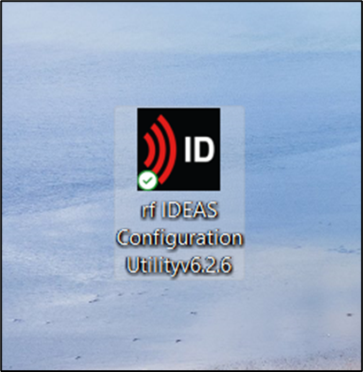

   The app opens.
2. Connect the card reader to the system.
3. Once the badge reader is connected to the laptop, Click On the **“Connect”** button in the **rf IDEAS Configuration Utility**

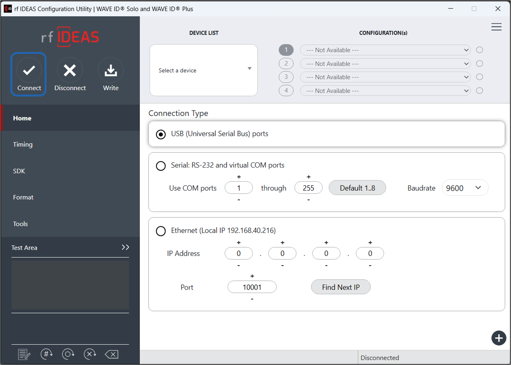

The **Reader ID** is displayed in the **Device List** section.

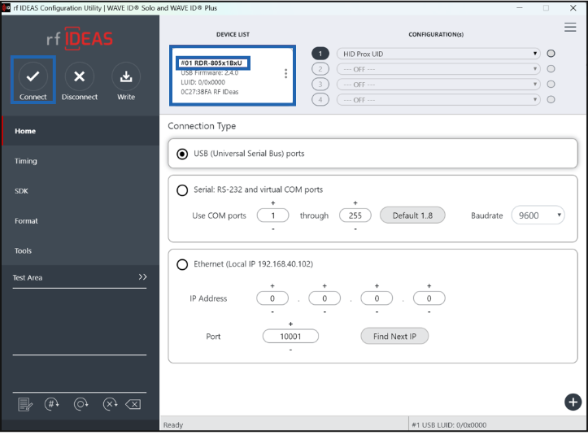

### Verify Badge Type and Reader Compatibility

1. Select the **Tools** option from the **rf IDEAS Configuration Utility** menu.

   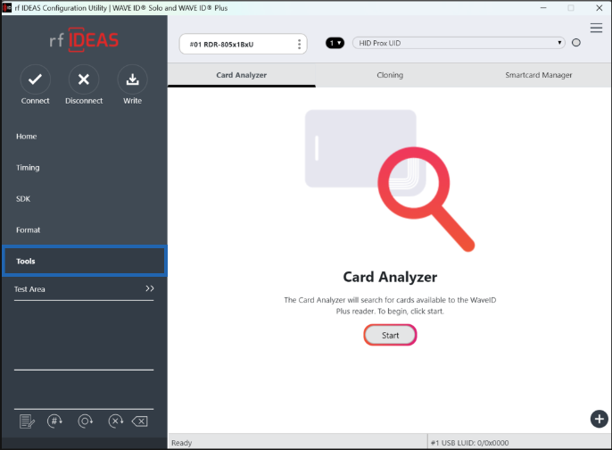

2. Place the card/badge on the reader.
3. Click **Start** in the “**Card Analyzer**” section.

   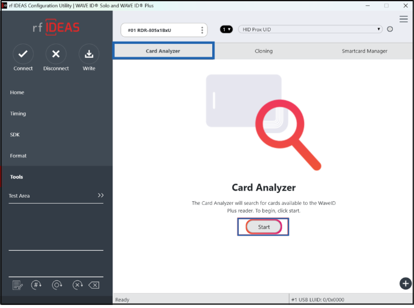

4. Click **Learn Card** to begin identifying the badge/card.

   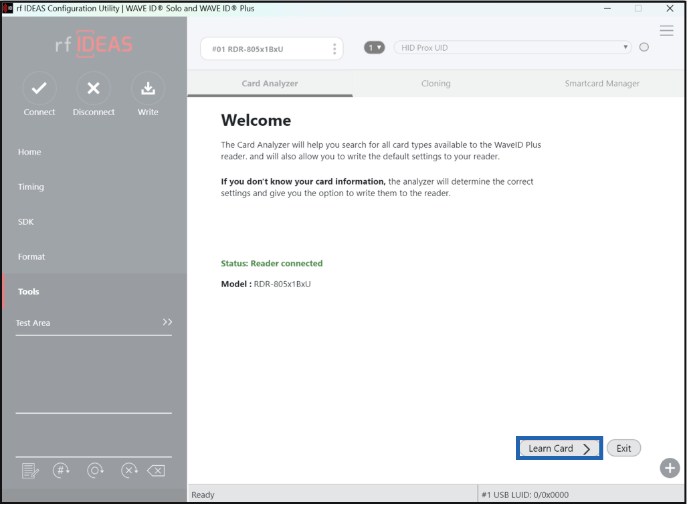

   The Learn Card screen is displayed.
5. Click **Start Scan** to begin scanning the badge/card.

   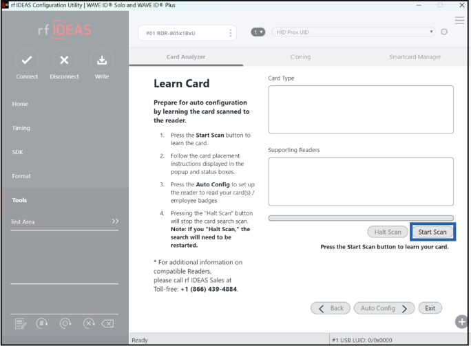

   Place the badge/card on the reader and click “**OK**” on the pop-up window that appears.

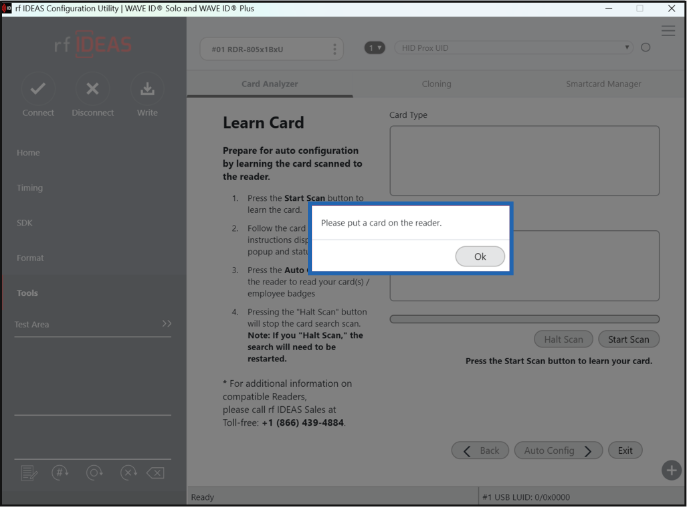

The badge scanning starts, and a **“Scanning in Progress”** message will be displayed. Wait until the scanning process is complete.

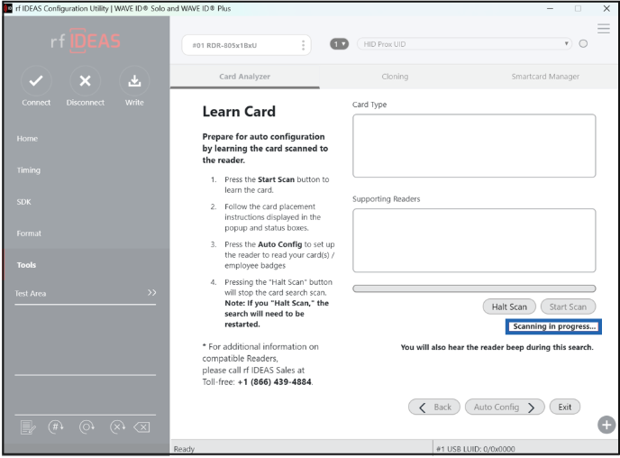

Once the scanning is completed, the identified card type will be displayed in the “**Card Type**” field. The “**Supporting Readers**” field displays a list of rf IDEAS readers that support the identified card type.

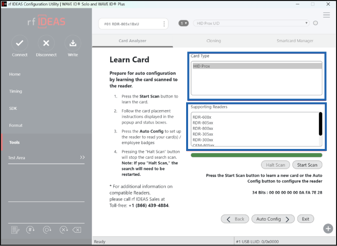

##### Note

Card Type : Identifies the type of RFID card/Badge.

Supporting Readers : The reader models that can read the card type.

### Configure the reader using Auto-Config

1. Click “**Auto Config**” to automatically configure the reader to read the Card ID, of the scanned badge/card.

   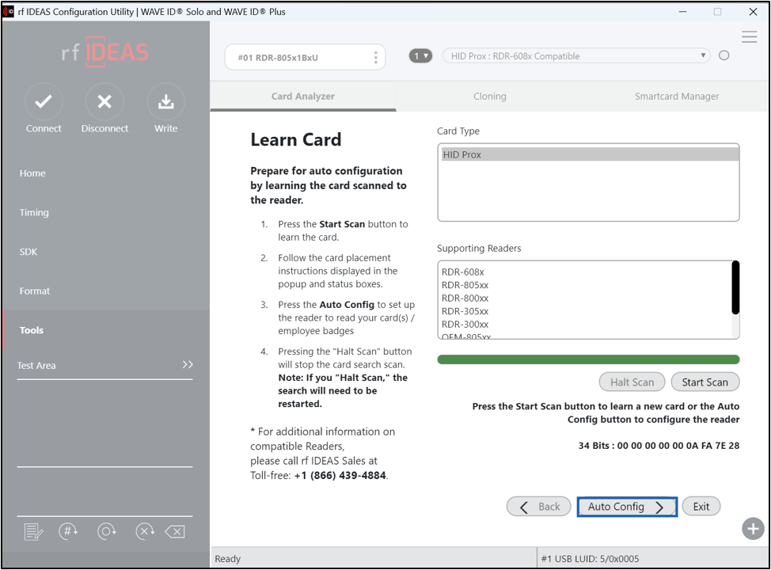

   <Note>
     **Note:** Once Auto-Config is completed for the card, the utility automatically identifies and displays the corresponding **Card Type and Card ID.**
   </Note>

   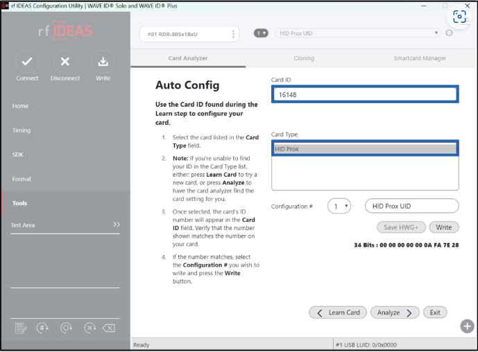

   **Notes:**
   1. The Card ID of the scanned/configured card will be displayed in the **Card ID** field, as illustrated in the image Above. For example, 16148 represents the Card ID of the card that has been scanned/configured.
   2. If multiple “**Card Type”** values are displayed, select the appropriate Card Type from the list. Once a Card Type is selected, the corresponding “**Card ID”**  will be displayed automatically in the Card ID field.
   3. **Important :** For the Same physical card, the Card ID may change when a different Card Type is selected. This is because the Card ID displayed by the utility is based on the selected "Card Type".
2. Click the **Write** button to save the configuration.

   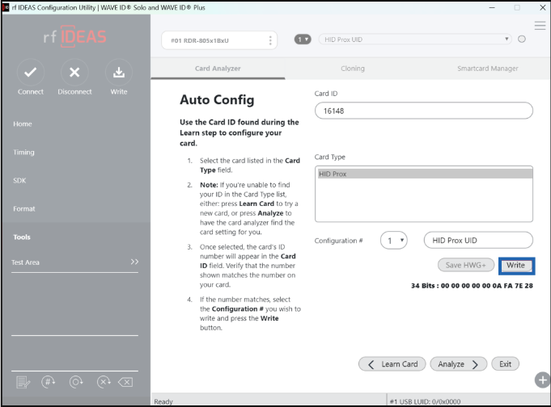

3. Remove the card from the reader, then click **OK** on the pop-up message.

   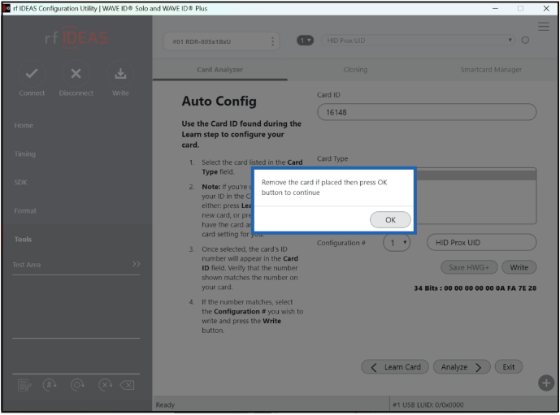

4. Finally, click the **Exit** button to close the application.

   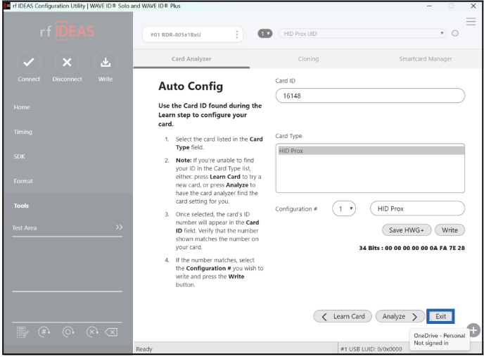

5. After clicking the **Exit** button, a confirmation pop-up will appear asking the user to confirm the badge configuration before closing the application.
   Do one of the following:
   1. **Yes:** The reader retains and restores the configuration that was in place before the **Card Analyzer** was used. The previous configuration is retained, and any new configuration written during the Card Analyzer operation is not retained
   2. **No:** The reader retains the new configuration written during the **Card Analyzer** operation. The configuration applied during the Card Analyzer operation is retained and becomes the active reader configuration. (Recommended)

      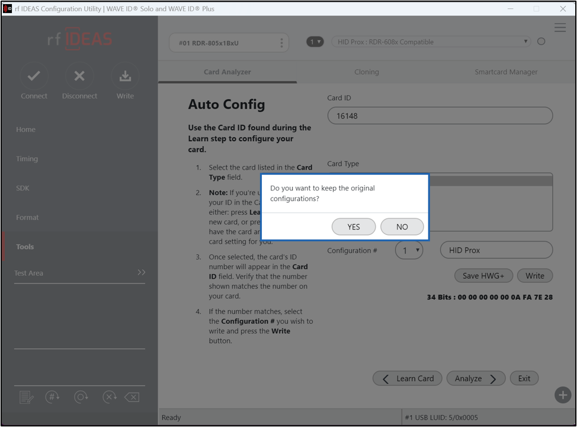

<Note>
  **Note:** The steps outlined above are intended solely for configuration the required values on the Badge/Card using the **Auto Config File**.
</Note>

### Steps to Retrieve Configured Badge Values

Ensure the **RF IDeas reader** is connected to the laptop and is displayed in the **Device List** section.

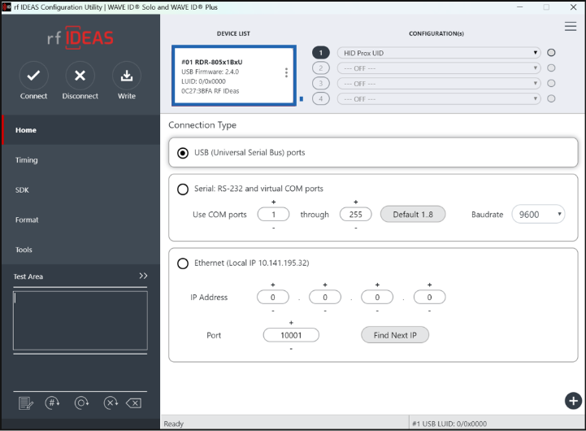

1. Select a **valid card type** from the **Configuration(s) Dropdown**. (When the new configurations are saved, the Card Type is selected by default.)

   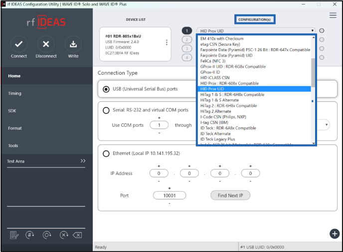

   <Note>
     **Note:** The **Configuration(s) Dropdown** refers to the type of card/badge being used to obtain the **badge value**. Select the card type based on the badge type identified earlier.
   </Note>

   Ex : HID Prox, HID iClass CSN,
   **→** “ Based on the badge type identified earlier, select the corresponding card type from the **Configuration(s) Dropdown**.”

   <Note>
     **Note:** The Card ID may vary depending on the Card Type selected from the Card Type drop-down menu.
   </Note>

   **→** If multiple supporting card types are identified in the card configuration, you can select any one of them.
   **→** If an invalid badge type is selected in the **Configuration(s) Dropdown**, the reader will not read the badge value.
2. Navigate to the **SDK** section in the **RF IDeas Utility Software**.
3. Turn off the **Disable Keystrokes for SDK** toggle button.

   <Note>
     **Note:** If **“Disable Keystroke for SDK”** is already turned off, proceed without making any changes to this setting.
   </Note>

   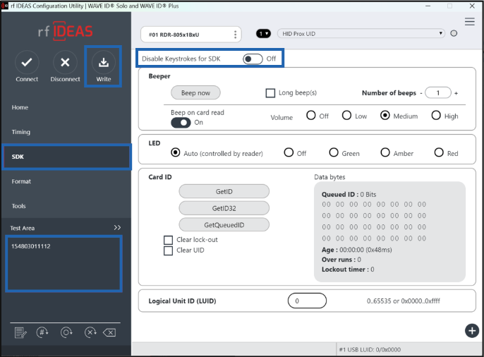

4. Click **Write** to save and apply the latest configuration changes.

   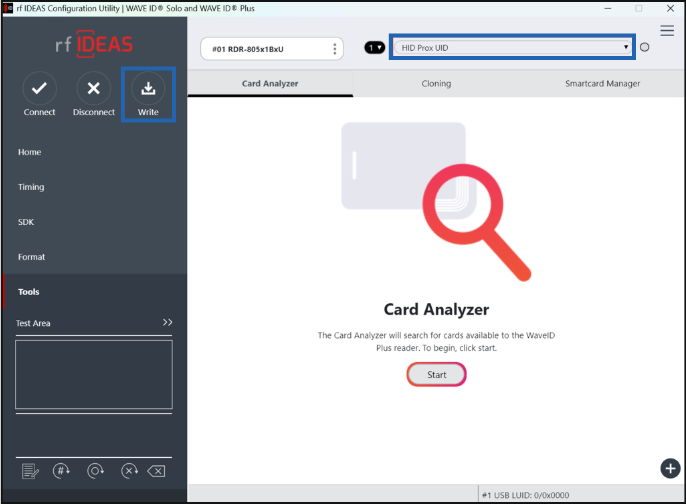

5. Click on the **Text Area** and scan the badge using the reader. If the correct configuration is applied, the reader will read the badge value and display it in the **Text Area**.

   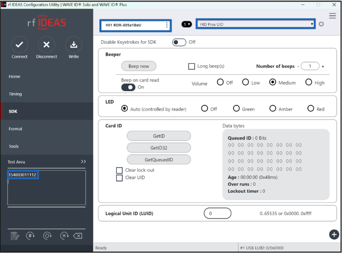

### Verify Badge Value Consistency

After completing the configuration, scan the same badge multiple times. The reader should return the **same badge value every time**. The badge value should remain consistent and should not change between scans.
