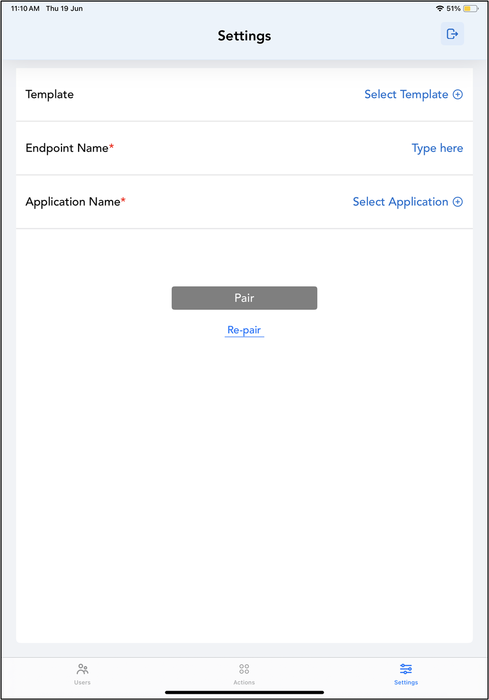
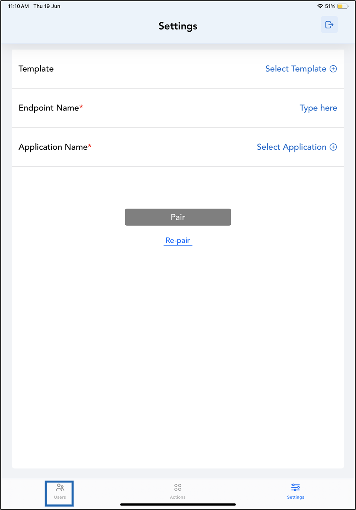
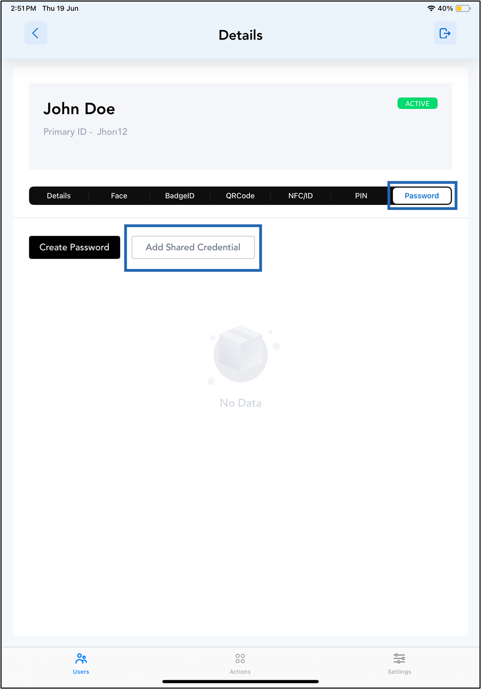
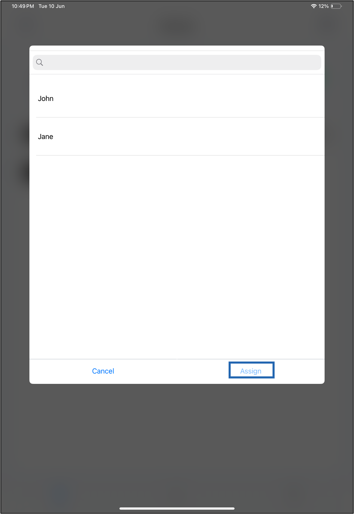
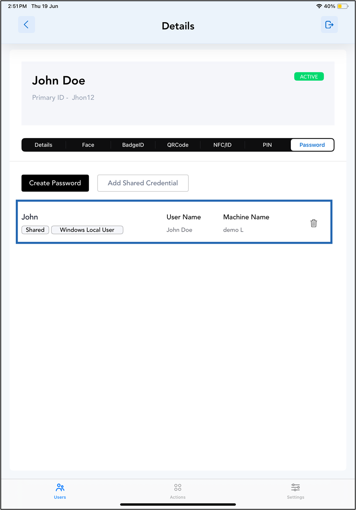

{/* Source: Intercom article 10307929 - https://oloid.help/en/articles/10307929-how-to-add-shared-credential-to-a-user-in-oloid-connect */}
{/* Generated by intercom_to_mintlify.py - re-running overwrites this file. */}

**Introduction**

The Shared Credential feature in the Oloid Connect app allows Tenant Admins and Supervisors to assign shared credentials to users.

## Steps to add Shared Credential

1. Launch the **Oloid Connect**  app and login with the provided options.

   <Note>
     **Note:** For more information about how to log in to the Oloid Connect, refer to [How to log into the admin mode of Oloid Connect App as a Supervisor/Admin](/platforms/ios/time-clock/oloid-connect/how-to-log-in-to-admin-mode-in-the-oloid-connect-app).
   </Note>

   

2. The **Settings** page is displayed.

   

3. Tap **Users** on the menu at the bottom of the screen.

   

   The **Users** page with list of users is displayed.
4. Tap on the selected user to view details.

   

   The user **Details** screen is displayed.
5. Go to **Password** > tap **Add Shared Credential**.

   

6. Select **Credential(s)** from the list.
7. Click **Assign**.

   

   The **Shared Credentials** are added and listed in the Password tab.

   
