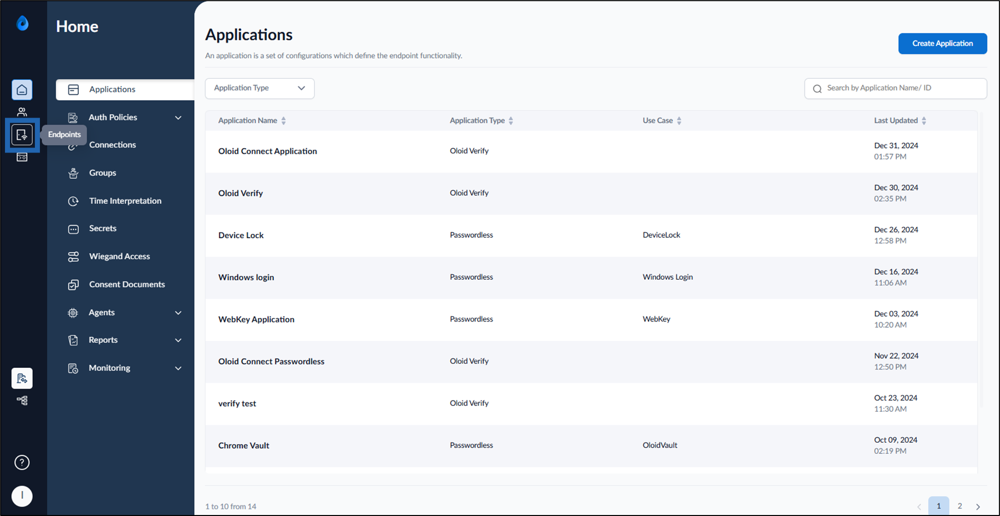
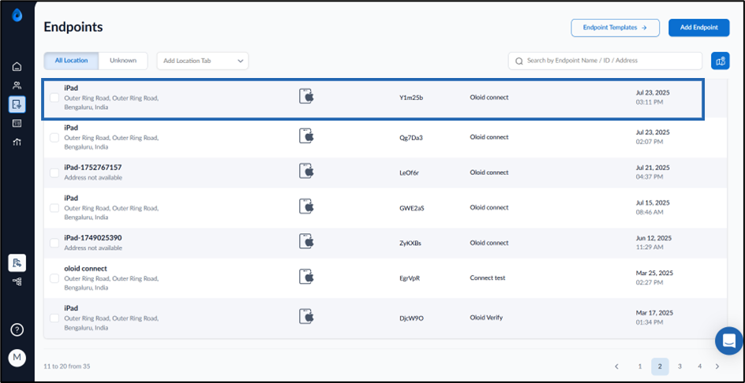
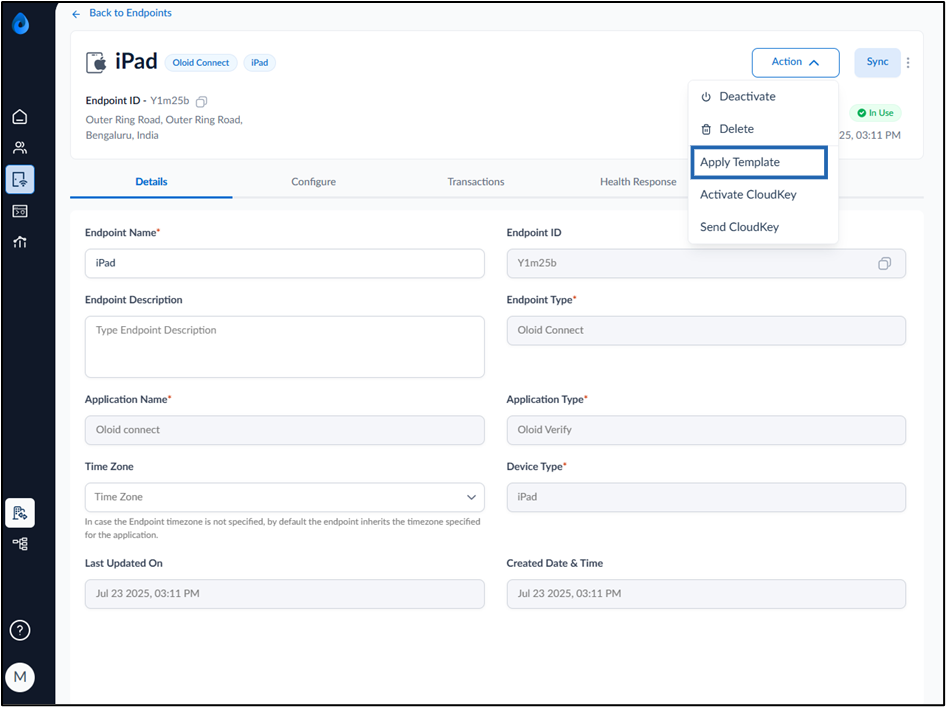
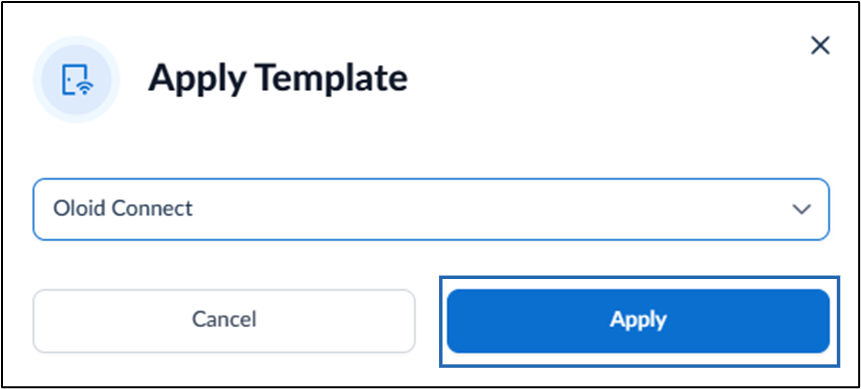
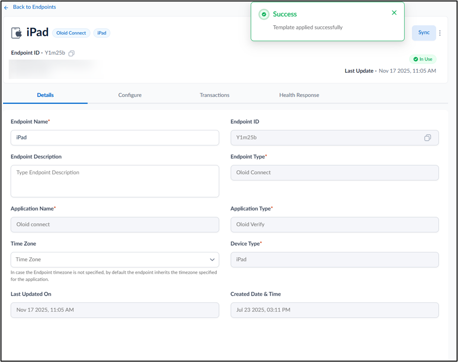

{/* Source: Intercom article 12838474 - https://oloid.help/en/articles/12838474-how-to-apply-endpoint-template-after-auto-pair-for-the-oloid-connect-application-in-the-tenant-admin-portal */}
{/* Generated by intercom_to_mintlify.py - re-running overwrites this file. */}

## Introduction

This document explains how to apply an endpoint template to a paired Oloid Connect endpoint in the Tenant Admin Portal. Applying the template makes sure the preset settings are automatically applied to the endpoint.

## Prerequisites

- You must have a Tenant Admin Account.
- The Oloid Connect endpoint must be paired. To pair refer [How to pair an Oloid Connect endpoint](/platforms/ios/time-clock/oloid-connect/oloid-connect-how-to-pair-an-endpoint)
- An Endpoint template must be created. To create refer [How to create and configure Oloid Connect endpoint template](/platforms/ios/time-clock/oloid-connect/oloid-connect-how-to-create-and-configure-endpoint-template-in-the)

## Steps to apply Endpoint Template

1. Log in to the **Tenant Admin Portal**.
2. On the Home page of the portal, click **Endpoints** from the left panel menu.

   

   The endpoint screen is displayed.
3. Select the **Endpoint**.

   

   The **Endpoint Detail** page is displayed.
4. Select **Action** dropdown > **Apply Template**.

   

   The **Apply Template** pop-up box is displayed.
5. Choose the applicable template from the **Select Template** dropdown.

   

   The selected template is displayed in the **Select Template** field.
6. Click **Apply**.

   

   The template is successfully applied to the endpoint.

   
