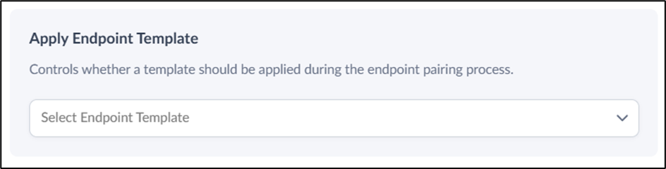
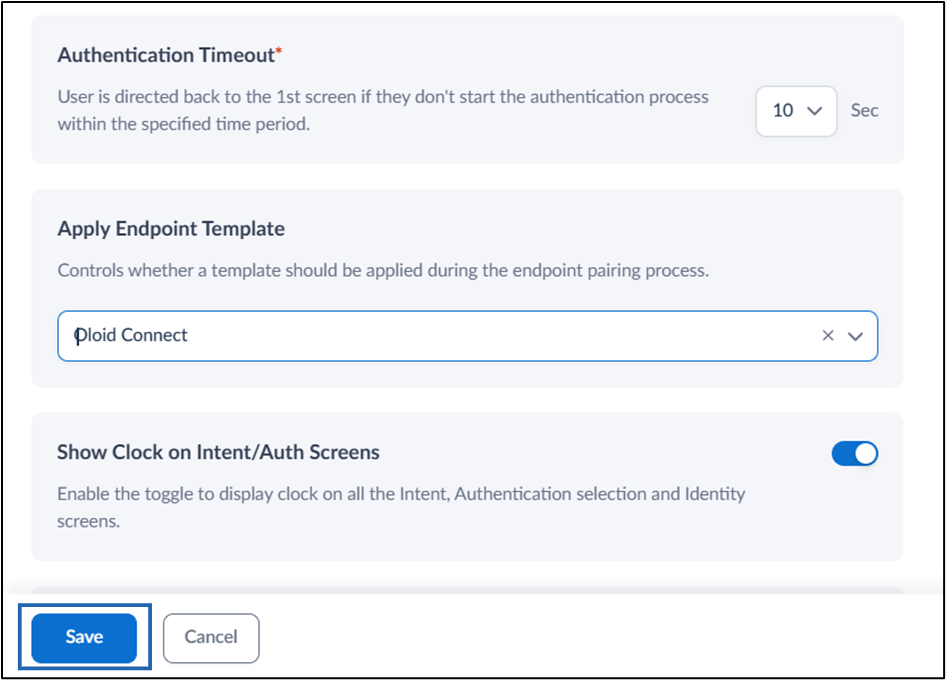
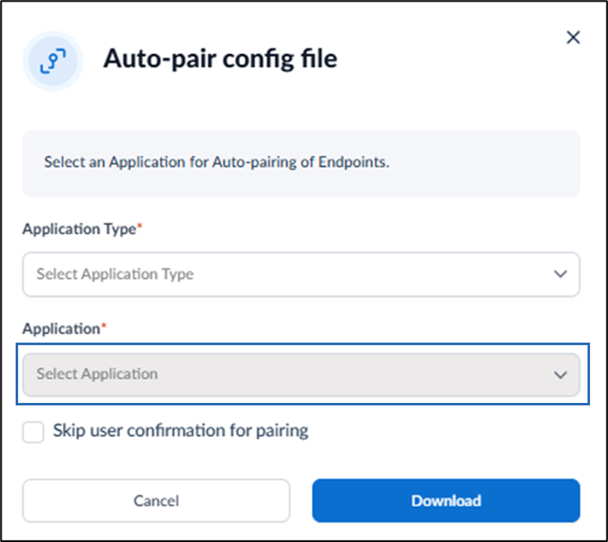

{/* Source: Intercom article 12750269 - https://oloid.help/en/articles/12750269-how-to-apply-endpoint-template-during-auto-pair-process-for-oloid-connect-application */}
{/* Generated by intercom_to_mintlify.py - re-running overwrites this file. */}

## Introduction

This document explains how to apply an Endpoint Template during the auto-pair configuration process for the Oloid Connect application. Applying the Endpoint Template ensures that predefined settings are automatically assigned to endpoint as part of the pairing process.

## Prerequisites

1. You have **Tenant Admin** access to the **Tenant Admin Portal**.
2. An **Endpoint Template** has been created. To create refer[How to create and configure Oloid Connect endpoint template](/platforms/ios/time-clock/oloid-connect/oloid-connect-how-to-create-and-configure-endpoint-template-in-the)

## Steps at a Glance

1. Create the Oloid Connect application in the Tenant Admin Portal and select the desired endpoint template in the **“Apply Endpoint Template”** field.
2. Generate and download the auto-pair config file; ensure it is mapped to the application with the predefined template.
3. Pair the Oloid Connect endpoint using the auto-pair option. The endpoint template is applied automatically.

## Steps to Apply Endpoint Template During Auto-Pair Process

### Step 1: Create and Configure the Oloid Connect Application

1. Log in to the **Tenant Admin Portal**.
2. Create the **Oloid Connect** application. Refer[How to create and configure Oloid Connect Application in Tenant Admin Portal](/platforms/ios/time-clock/oloid-connect/oloid-connect-how-to-create-and-configure-application-in-tenant-admin)

   <Note>
     **Note:** If Oloid Connect application is already created then select the desired application from the application list.
   </Note>

3. In the **Settings section**, select the applicable template from [Apply Endpoint Template](/platforms/ios/time-clock/oloid-connect/oloid-connect-how-to-create-and-configure-application-in-tenant-admin) dropdown.

   <Note>
     **Note:** Endpoint template must be added to apply template when using auto-pair option to pair the endpoint.
   </Note>

   

   The endpoint template is selected.
4. Select **Save**.

   

The Endpoint Template is successfully applied to the selected Oloid Connect Application.

### Step 2: Generate and Download the Auto-config File

1. Generate and download the auto-pair config file. Refer [How to generate Auto-Pair config file for Oloid Connect in Tenant Admin Portal](/platforms/ios/time-clock/oloid-connect/oloid-connect-how-to-generate-auto-pair-config-file-in-the-tenant)

   <Note>
     **Note:** Ensure that the **Application Mapping** includes the application where the **Endpoint Template** is specified. This mapping ensures that auto-pair applies the correct endpoint configuration.
   </Note>

   

### Step 3: Pair Oloid Connect endpoint with Auto-config File

1. On the target iPad, launch the **Oloid Connect App.**

Pair the endpoint using auto-pair option. To auto-pair refer [How to pair Oloid Connect App using Auto config file](/platforms/ios/time-clock/oloid-verify/oloid-connect-how-to-pair-oloid-connect-app-using-auto-pair-config)

<Note>
  **Note:** Once the auto-pair process completes, the **Endpoint Template** settings is automatically applied to the paired endpoint.
</Note>
