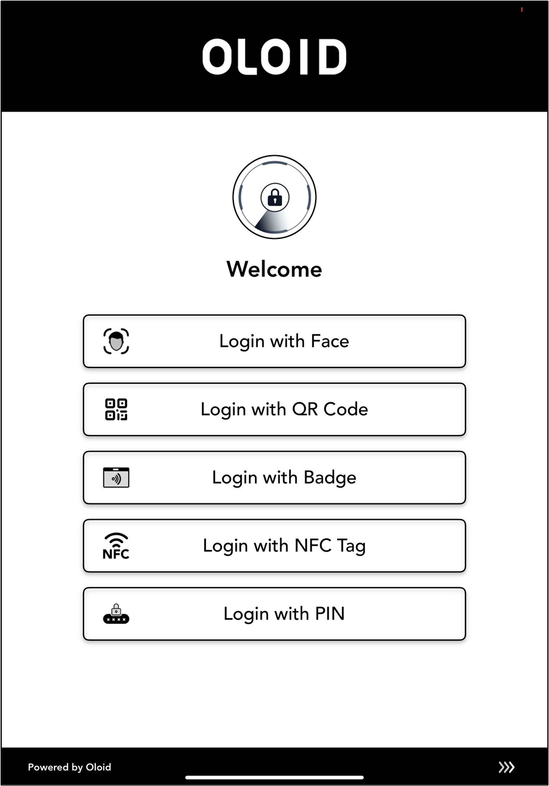
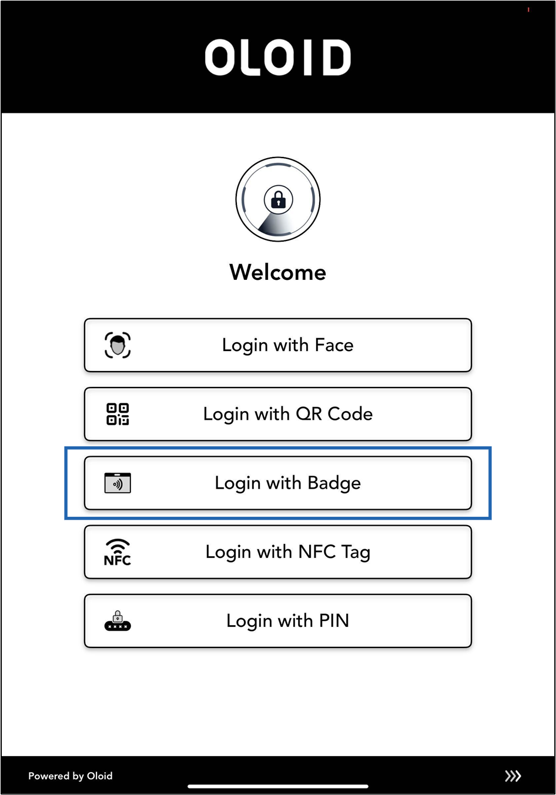
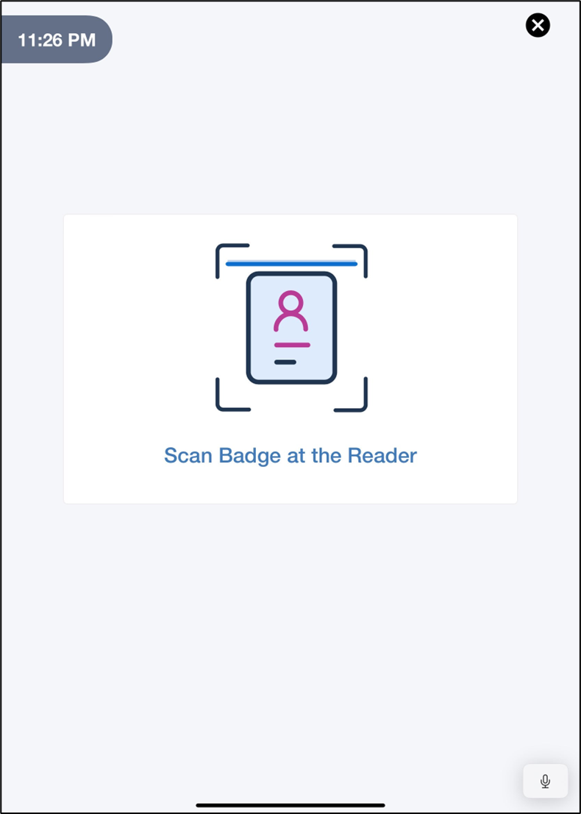
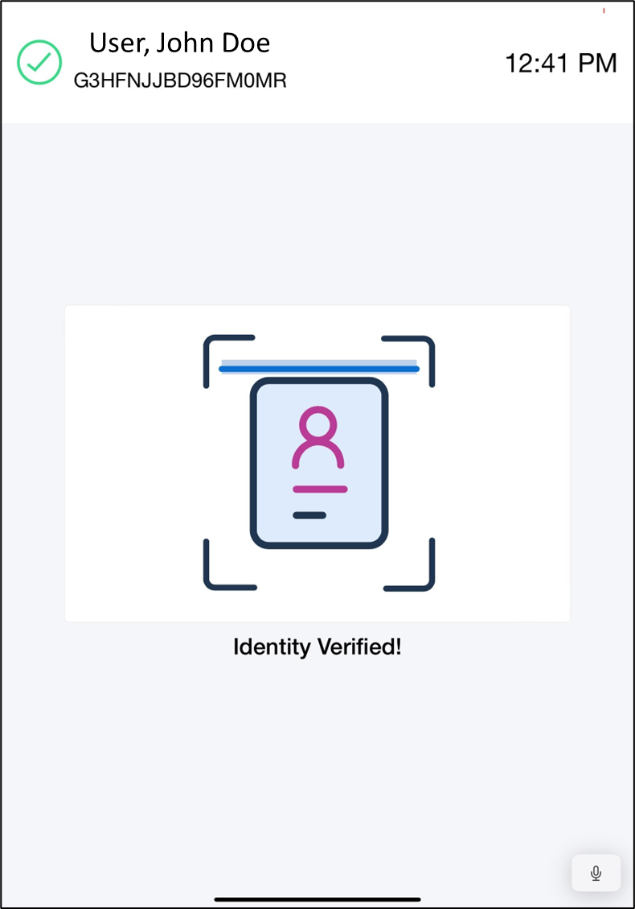
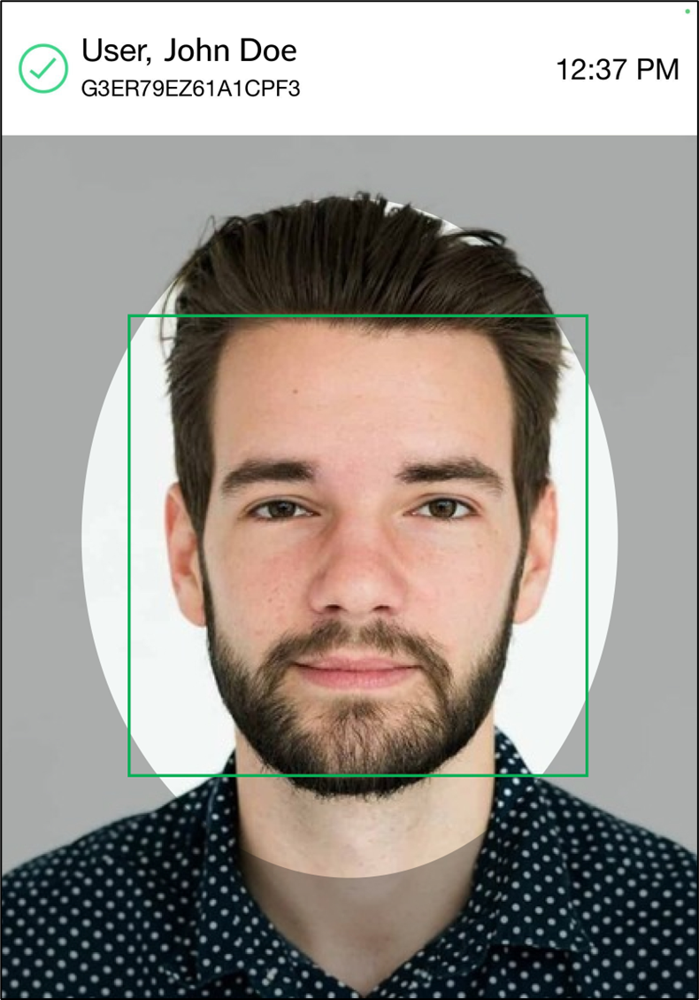
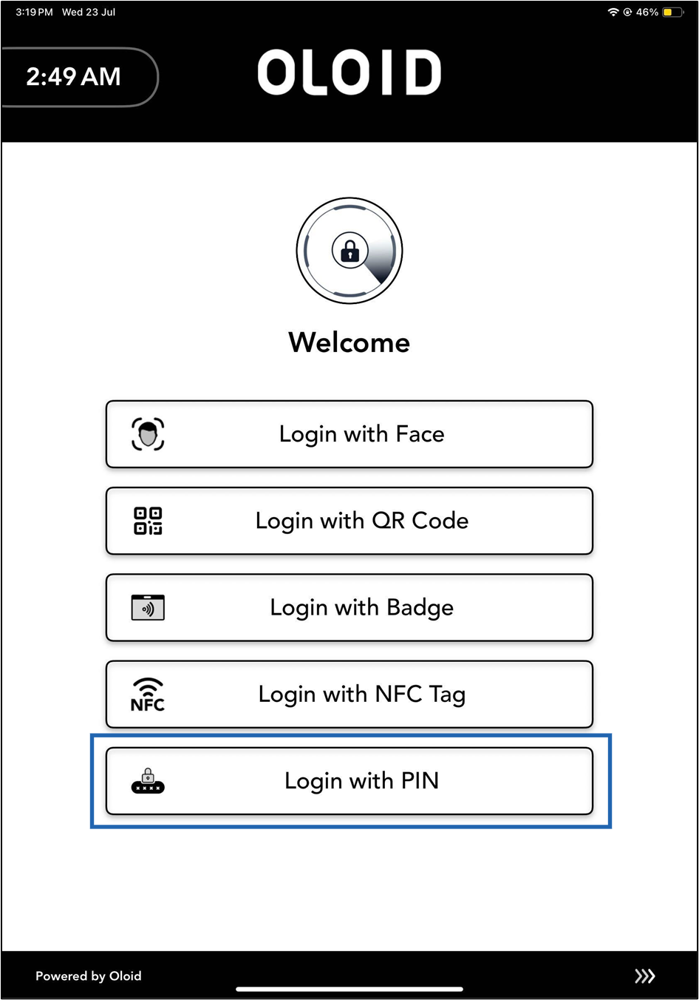
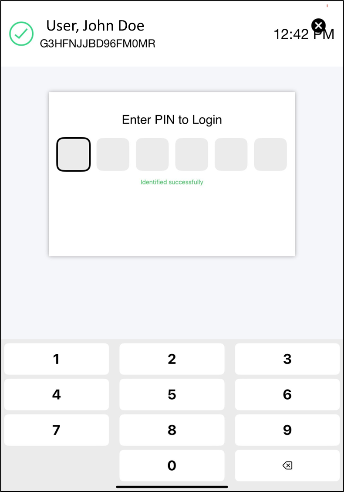
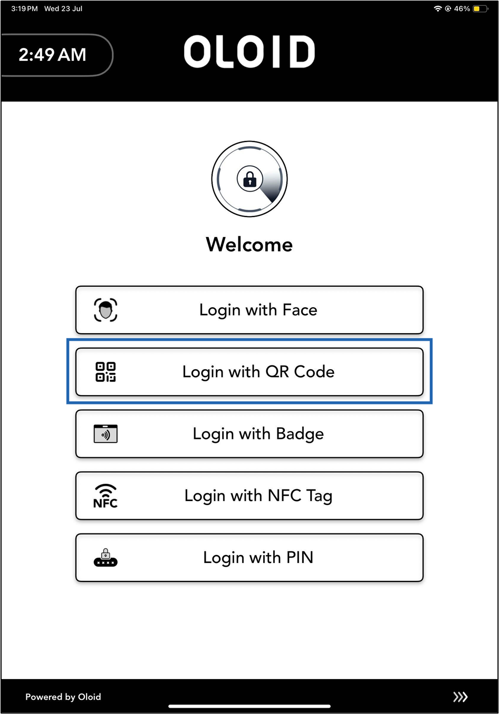
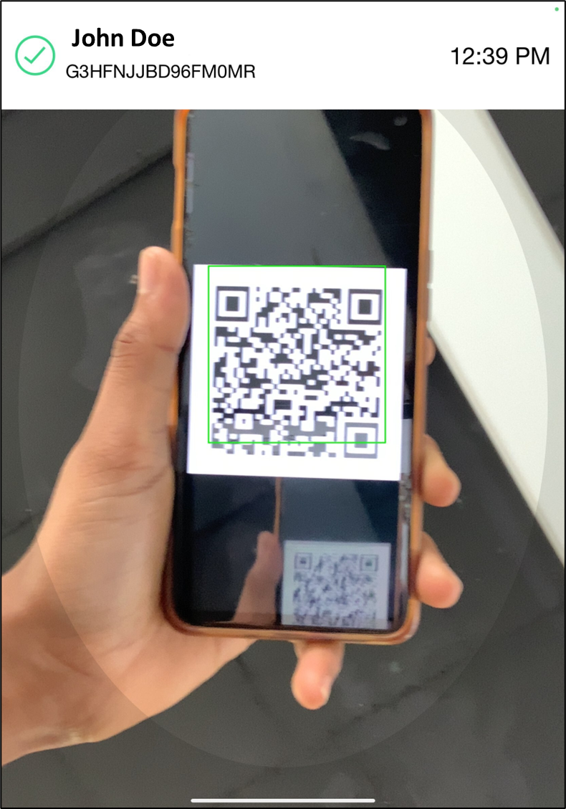
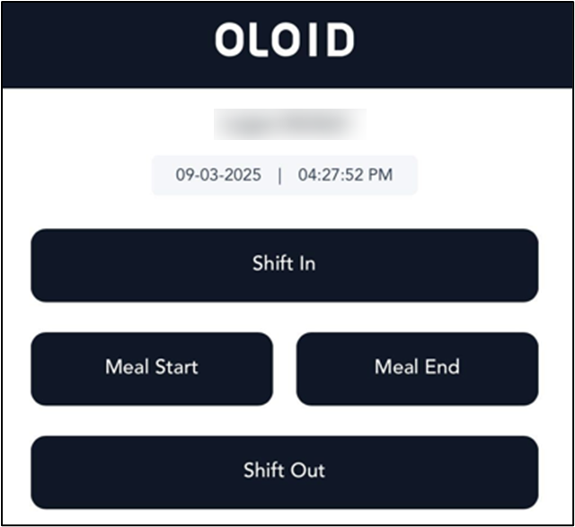

{/* Source: Intercom article 12136059 - https://oloid.help/en/articles/12136059-how-to-authenticate-using-oloid-connect-workday */}
{/* Generated by intercom_to_mintlify.py - re-running overwrites this file. */}

You can use the following authentication ways

Badge+Face
QR+Face
PIN+

### Prerequisite

- In the Tenant Admin Portal, Admin must do the following:
  - Assign badge to the user. For more details, refer [How to assign Badge ID as credential to users](/platform/tenant-admin-portal/how-to-assign-badge-id-as-credential-to-users)
  - Add PIN for the user. For more details, refer [How to add PIN as credential to users.](/platform/tenant-admin-portal/tenant-admin-portal-how-to-add-pin-credential-for-user)
  - Assign QR Code to the user. For more details, refer [How to create QR code as credential for User.](/platform/tenant-admin-portal/tenant-admin-portal-how-to-create-and-share-qr-code-credential-with)
  - Assign a face credential to the user. For more details, refer [Face Onboarding](/more/passwordless-authenticator/face-onboarding)
  - Enable Badge, PIN, QR and Face option under the Oloid Connect application in Authentication tab. For more details, refer [How to create and configure Oloid Connect Application in Tenant Admin Portal](/platforms/ios/time-clock/oloid-connect/oloid-connect-how-to-create-and-configure-application-in-tenant-admin)
  - Enable Workday Punch Integration in Oloid Connect application. For more,

## Steps to log in using badge and Face

## Prerequisite

1. Launch the **Oloid Connect App**.

   <Note>
     **Note:** Since the endpoint is already paired, the App will launch in the Auth selection screen of the App. For more, refer to [How to pair an Oloid Connect endpoint](/platforms/ios/time-clock/oloid-connect/oloid-connect-how-to-pair-an-endpoint).
   </Note>

   

   The Auth selection screen is displayed.
2. Tap **Login with Badge.**

   

   The **Scan Badge at the Reader** screen is displayed.

   

3. Tap the **Badge** on the **Reader** to scan it.

   <Note>
     **Note:** The Card Reader should be connected to your iPad.
   </Note>

   

   On Badge authentication, The Camera opens to capture the user's face.
4. Place your Face inside the ovel shape in the screen.

After successful authentication user details are appeared on the top of the screen.

On Face authentication, you are logged in to the **HRIS** platform successfully.

## Steps to log in using PIN and Face

1. Launch the Oloid Connect App.

   <Note>
     **Note:** Since the endpoint is already paired, the App will launch in the Auth selection screen of the App. For more, refer to [How to pair an Oloid Connect endpoint](/platforms/ios/time-clock/oloid-connect/oloid-connect-how-to-pair-an-endpoint).
   </Note>

   

   The Auth selection screen is displayed.
2. Tap **Login with PIN.**

   

   The **Enter PIN to Login** screen is displayed.
3. Enter PIN.

   

   After successful authentication, the Camera opens to capture the user's face.
4. Place your Face inside the ovel shape in the screen.

After successful authentication user details are appeared on the top of the screen.

On Face authentication, you are logged in to the **HRIS** platform successfully.

## Steps to log in using QR and Face

1. Launch the **Oloid Connect App**.

   <Note>
     **Note:** Since the endpoint is already paired, the App will launch in the Auth selection screen of the App. For more, refer to [How to pair an Oloid Connect endpoint](/platforms/ios/time-clock/oloid-connect/oloid-connect-how-to-pair-an-endpoint).
   </Note>

   

   The Auth selection screen is displayed.
2. Tap **Login with QR Code.**

   

   The Camera opens to scan the **QR Code**.
3. Scan **QR Code**.

   

   After successful authentication, the Camera opens to capture the user's face.
4. Place your Face inside the ovel shape in the screen.

After successful authentication user details are appeared on the top of the screen.

On Face authentication, you are logged in to the **HRIS** platform successfully.

## Sample Screen

