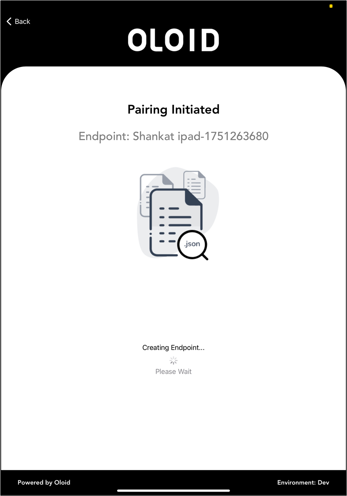
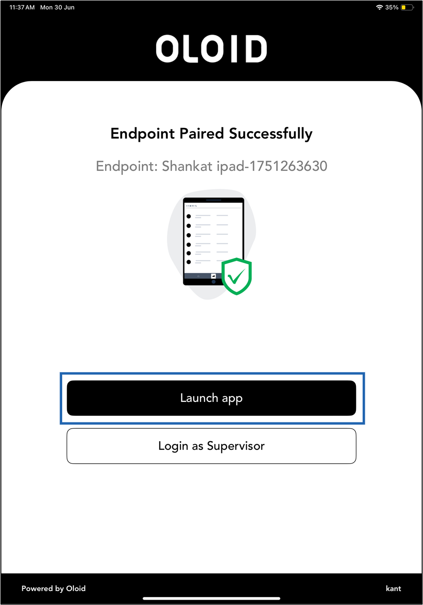

{/* Source: Intercom article 11677542 - https://oloid.help/en/articles/11677542-how-to-install-and-auto-pair-oloid-connect-app-through-mdm */}
{/* Generated by intercom_to_mintlify.py - re-running overwrites this file. */}

## Prerequisites

Before beginning installation, ensure the following components are available in your MDM system:

- **Oloid Connect IPA file**
- **Auto-Pair Configuration File** (`AutoPairConfig.xml`)
- **Target iOS device details**

## Preparation Steps

1. **Generate the Auto-Pair Config File**
   1. Log in to the Tenant Admin Portal.
   2. Navigate to the section for generating Auto-Pair config.
   3. Download and save the file as `AutoPairConfig.xml`.

      <Note>
        **Note:** You can generate the Auto-Pair Configuration File from the Tenant Admin Portal.
      </Note>

      For step-by-step guidance, refer to: [How to generate Auto-Pair config file for Oloid Connect in Tenant Admin Portal](/platforms/ios/time-clock/oloid-connect/oloid-connect-how-to-generate-auto-pair-config-file-in-the-tenant)
2. **Upload Files to MDM**
   1. Upload the **IPA file** of Oloid Connect.
   2. Upload the **AutoPairConfig.xml** to the appropriate configuration section in your MDM system.

## Steps to install and auto-pair Oloid Connect app on end-user machines

1. Once the IPA and config files are uploaded and policies are set:
   1. The MDM system will automatically **push the IPA file** to the registered iOS devices.
   2. The **Oloid Connect app will be installed** on the device.
   3. Launch the **Oloid Connect** app, the **AutoPairConfig.xml** file configures and pairs the app on the endpoint automatically.
   4. Once pairing is complete, the device will be **ready to use**.

The Oloid Connect app is successfully installed and automatically paired on the endpoint.
