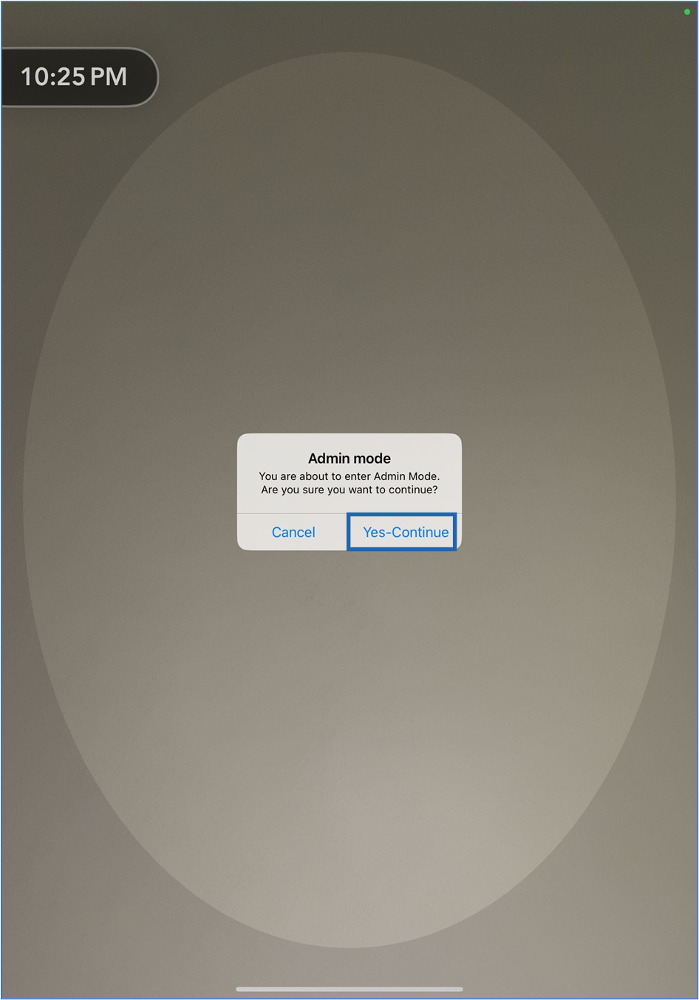
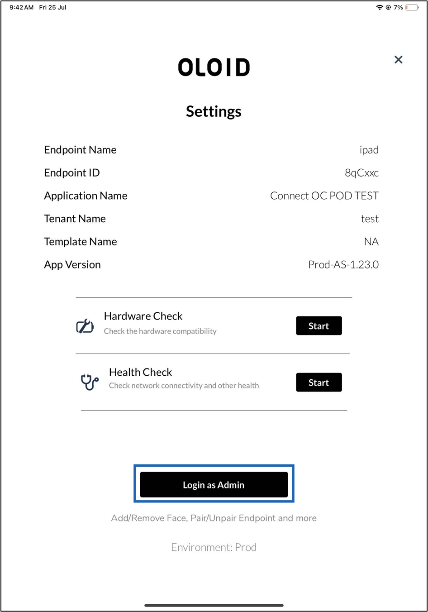
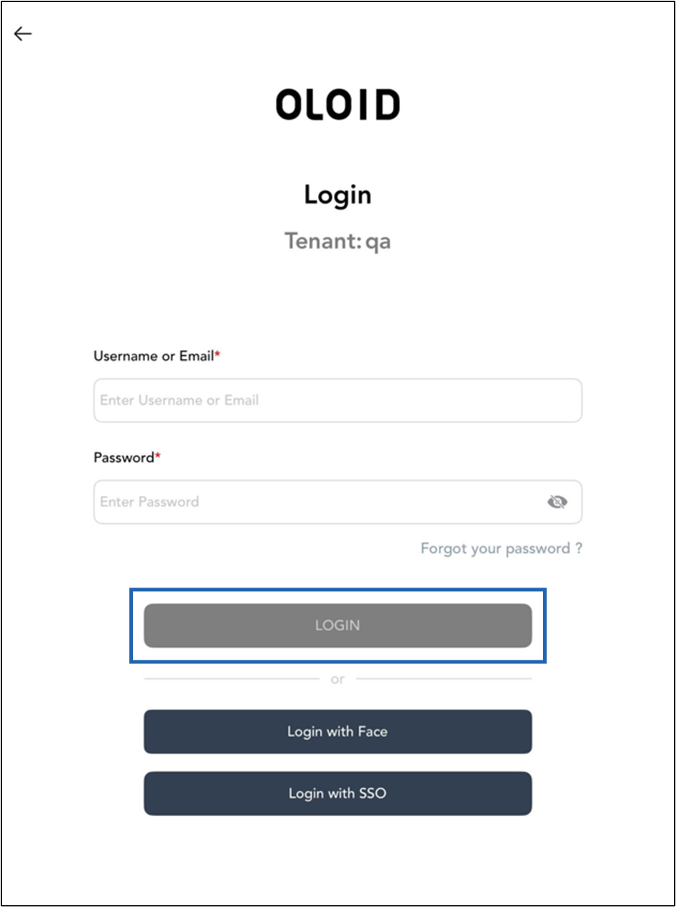
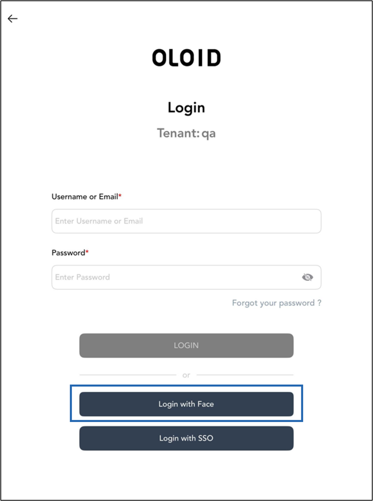
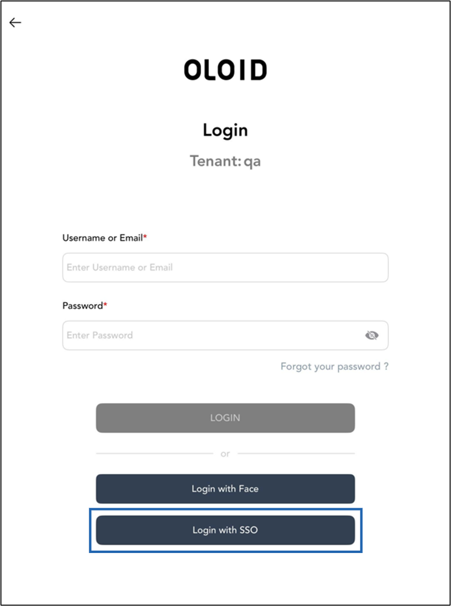
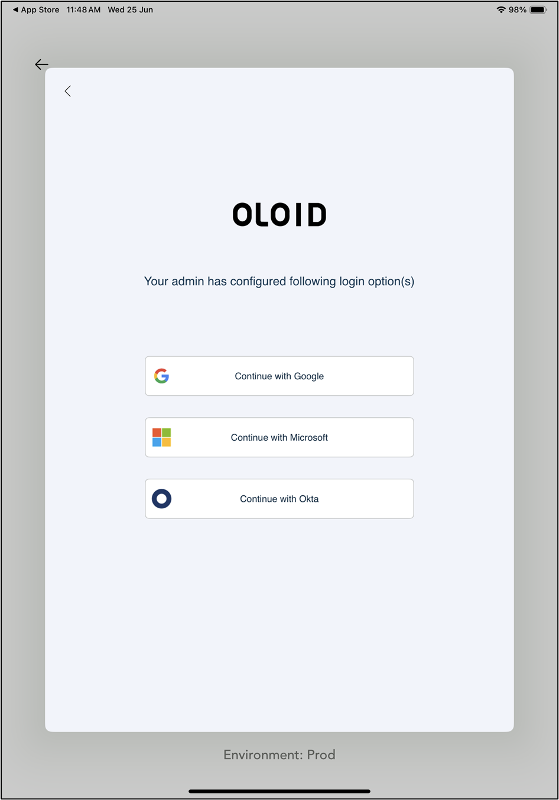

{/* Source: Intercom article 8671144 - https://oloid.help/en/articles/8671144-how-to-log-in-to-admin-mode-in-the-oloid-connect-app */}
{/* Generated by intercom_to_mintlify.py - re-running overwrites this file. */}

A Tenant Admin and Supervisor can log in to the admin mode of the Oloid Connect App through the following methods:

- [Log in Using Email and Password](#log-in-using-email-and-password)
- [Log in Using Face](#log-in-using-face)
- [Log in Using SSO](#log-in-using-sso)

## Log in Using Email and Password

## Pre-requisite

- The user must be a Tenant Admin or Supervisor to log in to Admin Mode.
- The endpoint must be paired.
  For more, refer to [How to pair an Oloid Connect endpoint](/platforms/ios/time-clock/oloid-connect/oloid-connect-how-to-pair-an-endpoint)

### Steps to log using Email and Password

1. Launch the **Oloid Connect**  **App**.

   <Note>
     **Note:** Since the endpoint is already paired, the App will launch in the preview screen of the App. For more, refer to [How to pair an Oloid Connect endpoint](/platforms/ios/time-clock/oloid-connect/oloid-connect-how-to-pair-an-endpoint).
   </Note>

   

2. Double tap with two fingers on the preview screen to launch the Admin Mode.
3. Tap **Yes- Continue.**

   

   The **Settings** screen is displayed.
4. Click **Login as Admin**.

   

   The Login screen is displayed.
5. Do the following:
   1. Enter your email ID in the **Email** text field.
   2. Enter your password in the **Password** text field.
6. Tap **Login.**

   

   You are logged in to the Admin Mode successfully.

## Log in Using Face

**Pre-Requisite:**

- Face should be onboarded for the Tenant Admin or Supervisor.
- Endpoint should be paired with the Oloid Connect application.
- The Connection assigned to the Supervisor must be linked to the application paired with the endpoint.
  For further details, refer [How to pair an Oloid Connect endpoint](/platforms/ios/time-clock/oloid-connect/oloid-connect-how-to-pair-an-endpoint)

### Steps to log in with Face

1. Launch the **Oloid Connect**  **App**.

   <Note>
     **Note:** Since the endpoint is already paired, the App will launch in the preview screen of the App. For more, refer to [How to pair an Oloid Connect endpoint](/platforms/ios/time-clock/oloid-connect/oloid-connect-how-to-pair-an-endpoint).
   </Note>

   

2. Double tap with two fingers on the preview screen to launch the Admin Mode.
3. Tap **Yes- Continue.**

   

   The **Settings** screen is displayed.
4. Click **Login as Admin**.

   

   The Login screen is displayed.
5. On the Login Page, tap **Login with Face**.

   

   This will open the camera preview screen.
6. Tenant Admin and Supervisor needs to show their face.

   

   As soon as face match is done, you are logged in to the Admin Mode.

## Log in Using SSO

### Pre-requisite

- Tenant admin and Supervisor's Email ID needs to be updated in the Tenant Admin Portal.
- The endpoint must be paired.
  For further details, refer [How to pair an Oloid Connect endpoint](/platforms/ios/time-clock/oloid-connect/oloid-connect-how-to-pair-an-endpoint)

### Steps to log in with SSO Options

1. Launch the **Oloid Connect**  **App**.

   <Note>
     **Note:** Since the endpoint is already paired, the App will launch in the preview screen of the App. For more, refer to [How to pair an Oloid Connect endpoint](/platforms/ios/time-clock/oloid-connect/oloid-connect-how-to-pair-an-endpoint).
   </Note>

   

2. Double tap with two fingers on the preview screen to launch the Admin Mode.
3. Tap **Yes- Continue.**

   

   The **Settings** screen is displayed.
4. Click **Login as Admin**.

   

   The Login screen is displayed.
5. On the login page, tap **Login with SSO**.

   

   The screen with **SSO options** is displayed.

   

<Note>
  **Note:** Oloid Connect uses **SSO login** and also allows you to log in to the portal with your [Google](/platforms/ios/time-clock/oloid-connect/oloid-connect-login-using-google-sso) , [Microsoft](/platforms/ios/time-clock/oloid-connect/oloid-connect-login-using-microsoft-sso), and [Okta](/platforms/ios/time-clock/oloid-connect/oloid-connect-login-using-okta-sso).
</Note>
