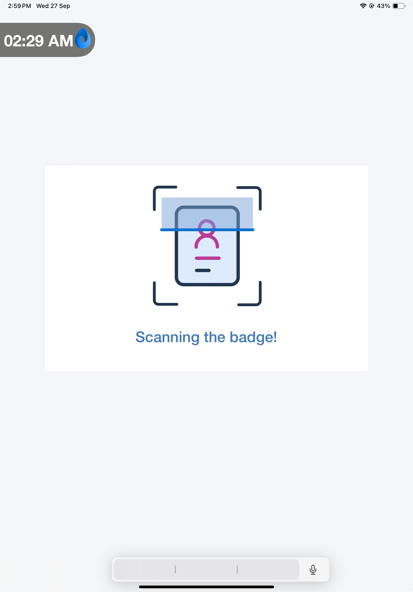

{/* Source: Intercom article 8679444 - https://oloid.help/en/articles/8679444-how-to-login-into-workforce-hrms-application-using-badge-with-oloid-connect */}
{/* Generated by intercom_to_mintlify.py - re-running overwrites this file. */}

## Login with Badge

### Pre-requisite

- The Badge Reader is connected to the device.
- User and user NFC Id credentials are created in the Oloid Portal.
- In the endpoint detail page, the third-party url should be configured in the web button section.
- The HTTP Request is enabled under Enable Integrations section in the Oloid Portal.
- Badge is enabled as authentication method to log into your Okta system.
- Oloid Connect App is launched and Login screen is displayed.

1. Scan your badge in the Badge Reader.
   On successful badge authentication, the application displays the Okta screen.
