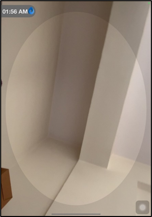

{/* Source: Intercom article 8679197 - https://oloid.help/en/articles/8679197-how-to-login-into-workforce-hrms-application-using-face-with-oloid-connect */}
{/* Generated by intercom_to_mintlify.py - re-running overwrites this file. */}

## Login with Face

### Pre-requisite

- The user and user face are added to the application.
- In the endpoint detail page, the third-party url should be configured in the web button section.
- The HTTP Request is enabled under Enable Integrations section in the Oloid Portal.
- Face is enabled as authentication method to log into your Okta system.
- Oloid Connect App is launched and Preview screen is displayed on the device(iPad).

  

  1. Stand in front of the iPad.
  2. The camera captures the face.
     The application compares your face with the reference image and on a successful face match displays the Okta screen.
