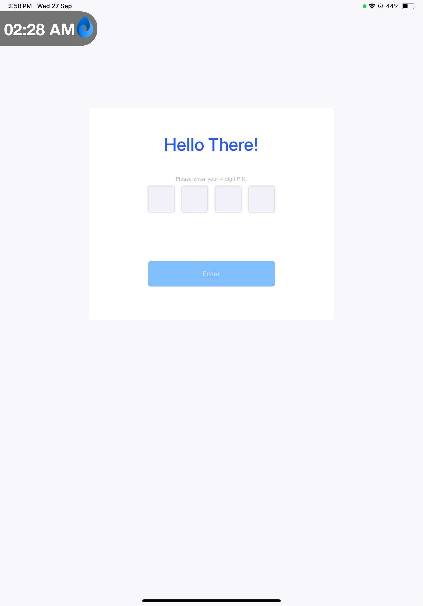

{/* Source: Intercom article 8679447 - https://oloid.help/en/articles/8679447-how-to-login-into-workforce-hrms-application-using-pin-with-oloid-connect */}
{/* Generated by intercom_to_mintlify.py - re-running overwrites this file. */}

## Login with PIN

### Pre-requisite

- User is added to the Oloid Portal.
- PIN is configured and communicated to the user.
- In the endpoint detail page, the third-party URL should be configured in the web button section.
- The HTTP Request is enabled under Enable Integrations section in the Oloid Portal.
- PIN is enabled as authentication method to log into your Okta system.
- Oloid Connect App is launched and Login screen is displayed.

1. Click Login with PIN.
2. Enter the PIN.

On successful PIN authentication, the application displays the Okta screen.
