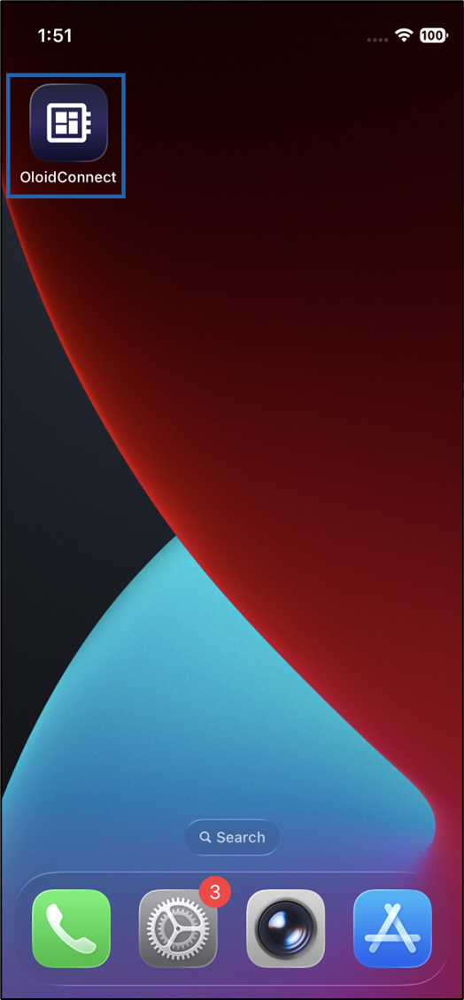
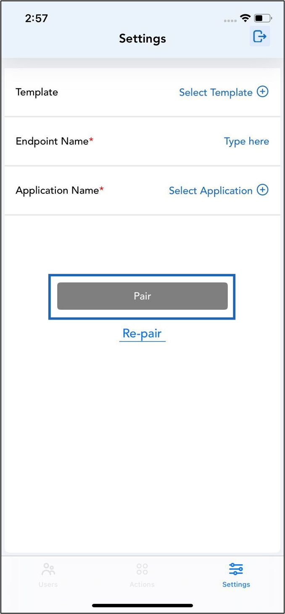
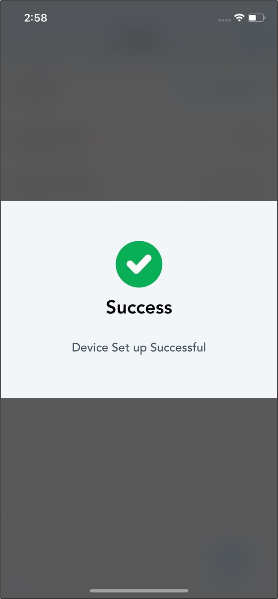
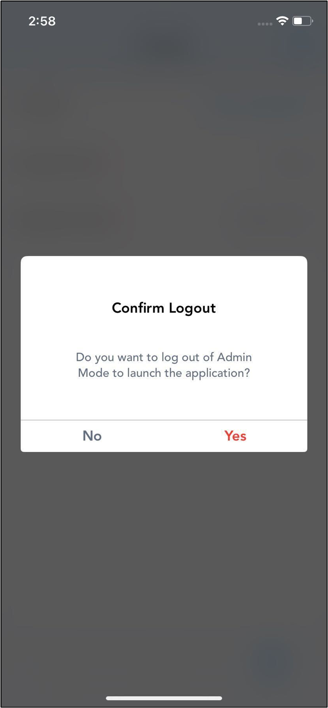
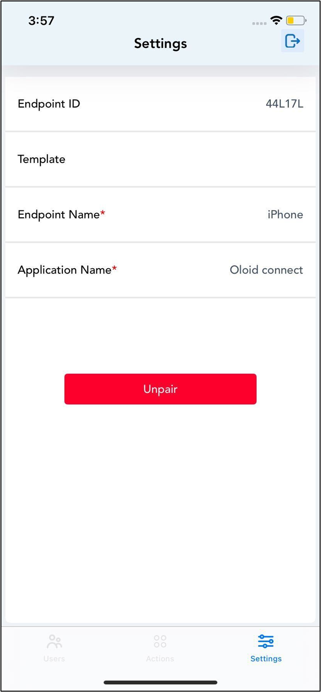

{/* Source: Intercom article 12577230 - https://oloid.help/en/articles/12577230-how-to-pair-oloid-connect-endpoint-on-iphone */}
{/* Generated by intercom_to_mintlify.py - re-running overwrites this file. */}

## Introduction

This feature of the **Oloid Connect app** allows Tenant Admins and Supervisors to pair an endpoint on iPhone. Pairing an endpoint enables the app to connect with the configured application and perform transactions.

## Prerequisite

- You must download and the install the Oloid Connect app. To download and install refer to [How to Download and Install the Oloid Connect App on iPhone](/platforms/ios/time-clock/oloid-connect/oloid-connect-how-to-download-and-install-on-iphone).
- You must complete the Admin setup before pairing an endpoint. To complete the Admin setup refer to [Oloid Connect - Admin Setup on iPhone](/platforms/ios/time-clock/oloid-connect/oloid-connect-admin-setup-on-iphone).

## Steps to pair an endpoint

1. Launch the Oloid Connect app.

   

2. Log in to **Oloid Connect** app.
   The Settings page is displayed on a successful login.
3. Do the following:
   1. Add **Template** (optional).

      <Note>
        **Note:** Templates allow Admins to configure Endpoints at scale. A template has to be created in Oloid Portal. See [How to create and configure Oloid Connect endpoint template](/platforms/ios/time-clock/oloid-connect/oloid-connect-how-to-create-and-configure-endpoint-template-in-the)
      </Note>

   2. Enter **Endpoint Name**.
   3. Select **Application Name** from **Application Name** dropdown list.
   4. Click **Pair**.

      

      The settings are saved and endpoint is successfully paired.

      

      The application prompts you to log out of Admin mode.
4. Do one of the following:
   1. Click **Yes** to log out and launch the application (**preview mode**).
      The app displays preview mode and allows you to do the transactions.
   2. Click **No** to stay logged in to the admin mode.

      

      The app remains in Admin mode.

      

      The endpoint is successfully paired with your iPhone.
