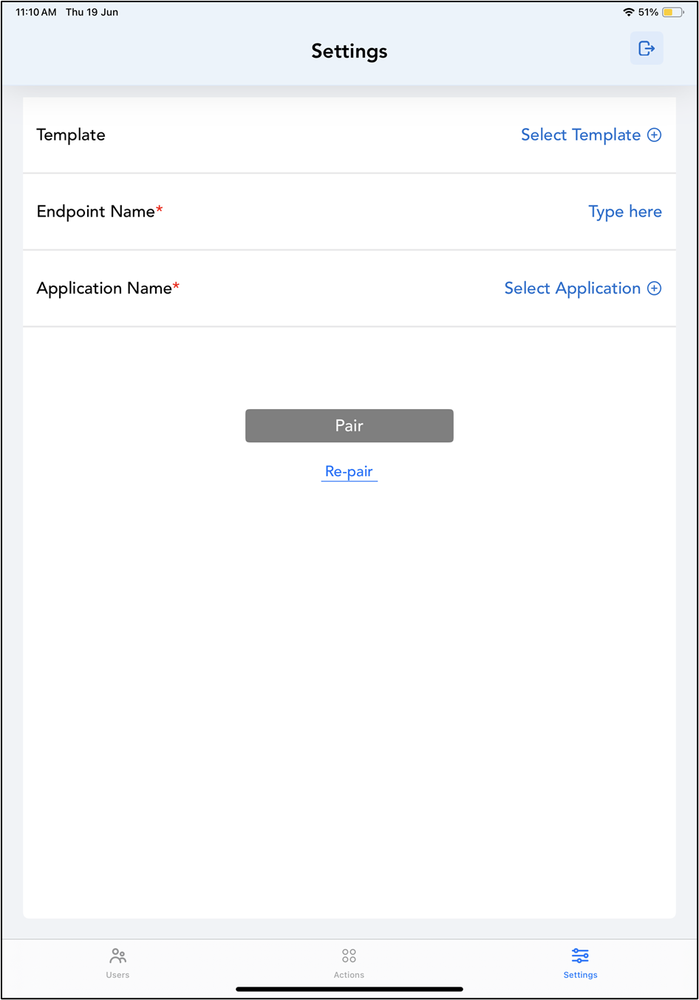
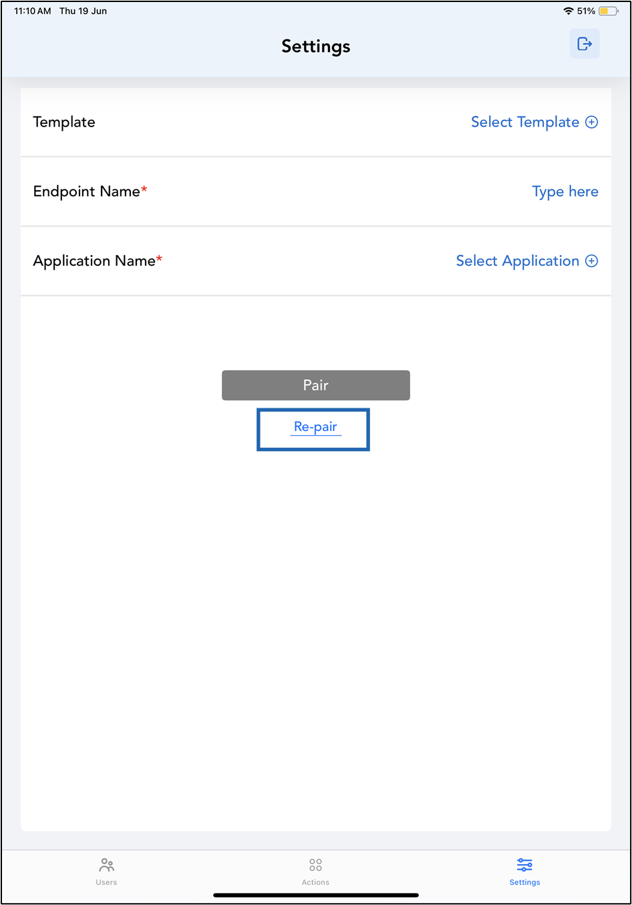
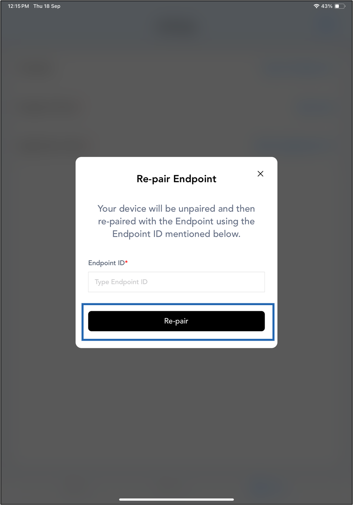
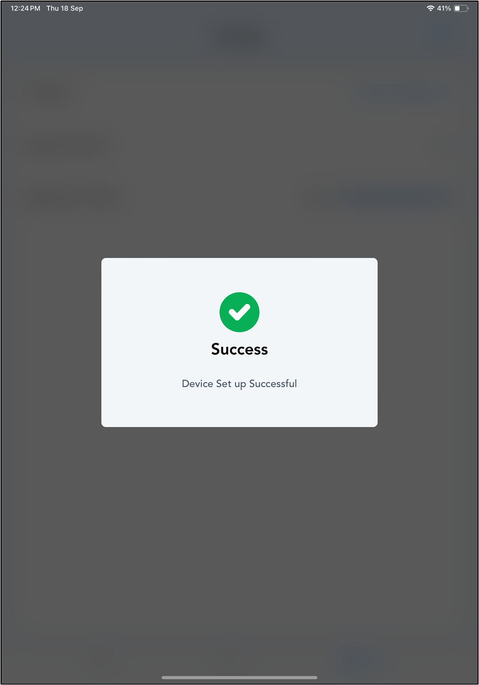

{/* Source: Intercom article 10288447 - https://oloid.help/en/articles/10288447-how-to-re-pair-an-endpoint-in-oloid-connect-app */}
{/* Generated by intercom_to_mintlify.py - re-running overwrites this file. */}

## Introduction

The Re-pair Endpoint feature in the Oloid Connect App allows Admins and Supervisors to restore an endpoint that requires reconfiguration. This process ensures that the endpoint reconnects properly with the assigned application and continues to operate as expected.

## Steps to re-pair an endpoint

1. Launch the **Oloid Connect** app.

   <Note>
     **Note:** For more information about how to log in to the Oloid Connect, refer to [How to log in to the Admin mode in Oloid Connect App.](/platforms/ios/time-clock/oloid-connect/how-to-log-in-to-admin-mode-in-the-oloid-connect-app)
   </Note>

   The **Settings** page is displayed.

   

2. Tap **Re-pair.**

   

   **Re-pair Endpoint** pop-up is displayed.

   <Note>
     **Note:** You can only re-pair an endpoint if it is not paired.
   </Note>

   

3. On the pop-up box, do the following:
   1. Enter **Endpoint ID**.
   2. Tap **Re-pair**.
      The Endpoint is re-paired successfully.

      

      <Note>
        **Note:** Kill and relaunch the app to make the new updates function properly.
      </Note>
