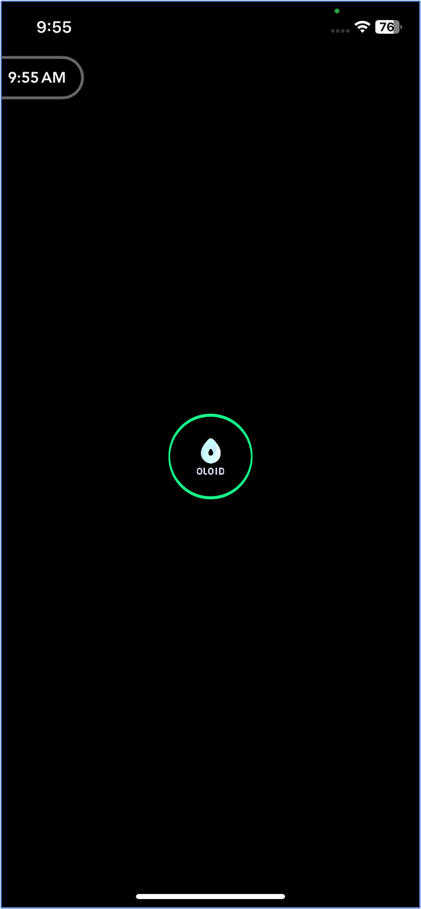
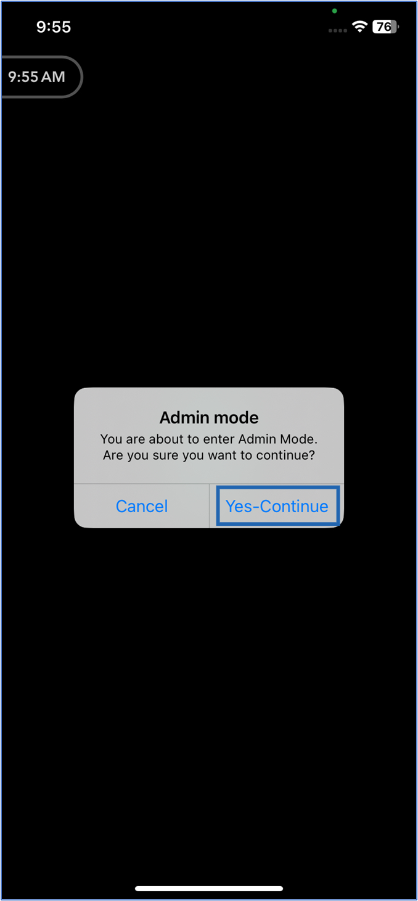
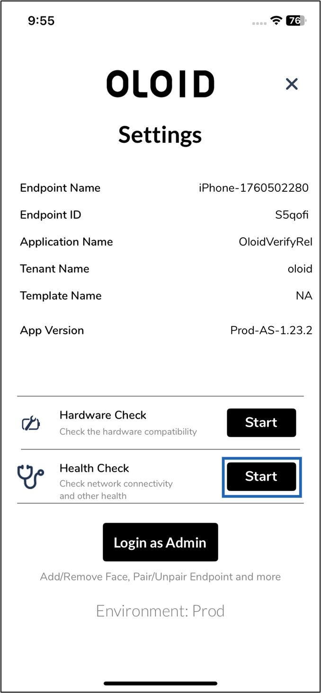
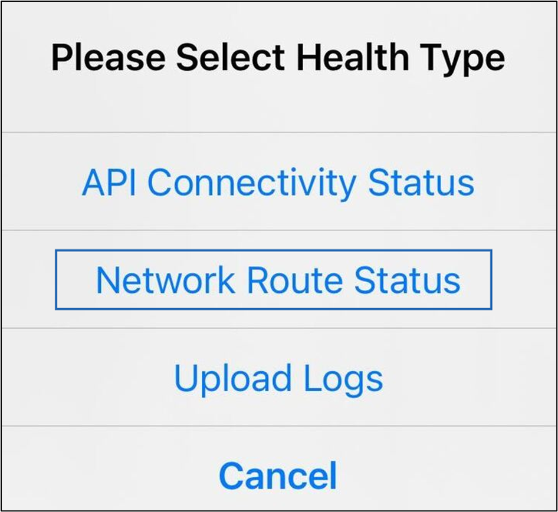
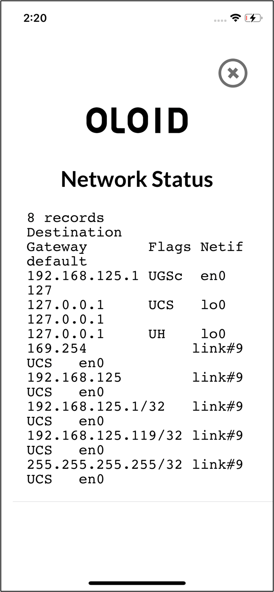

{/* Source: Intercom article 12644692 - https://oloid.help/en/articles/12644692-how-to-test-network-connectivity-on-oloid-connect-iphone-endpoint */}
{/* Generated by intercom_to_mintlify.py - re-running overwrites this file. */}

## Introduction

This document provides step-by-step instructions to test network connectivity on the Oloid Connect iPhone app.

## Prerequisite

The endpoint must be paired.

For more, refer to [How to pair an Oloid Connect endpoint on iPhone](/platforms/ios/time-clock/oloid-connect/how-to-pair-oloid-connect-endpoint-on-iphone)

## Steps to test Network Connectivity

1. Launch the **Oloid Connect App**.

   <Note>
     **Note:** Since the endpoint is already paired, the App will launch in the initial screen of the App. For more, refer to [How to pair an Oloid Connect endpoint on iPhone](/platforms/ios/time-clock/oloid-connect/how-to-pair-oloid-connect-endpoint-on-iphone)
   </Note>

   

2. Double tap with two fingers on the initial screen to launch the Admin Mode.
3. Tap **Yes- Continue.**

   

   The **Settings** screen is displayed.
4. Tap **Start** in the **Health Check** section.

   

   The **Please Select Health Type** pop-up box is displayed.

On the pop-up box, tap **Network Route Status**.

The **Network Status** page is displayed.

