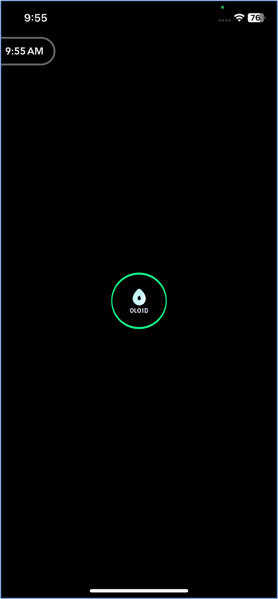
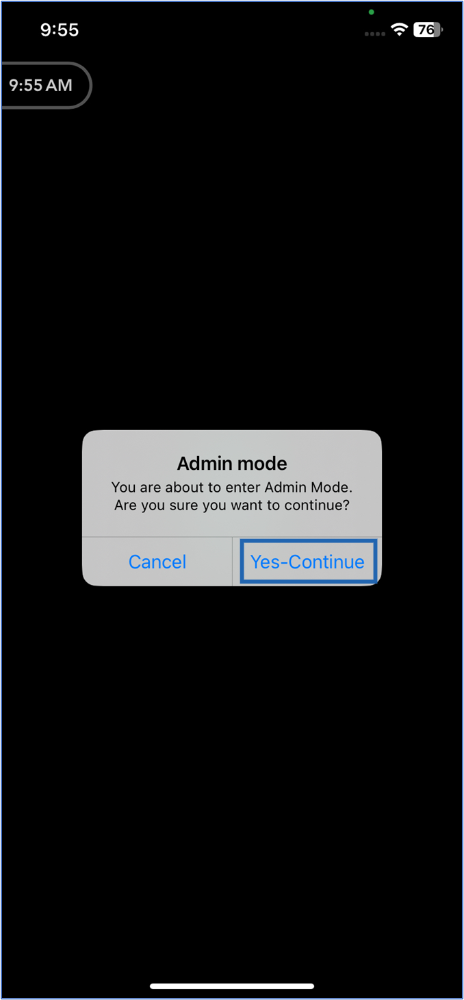
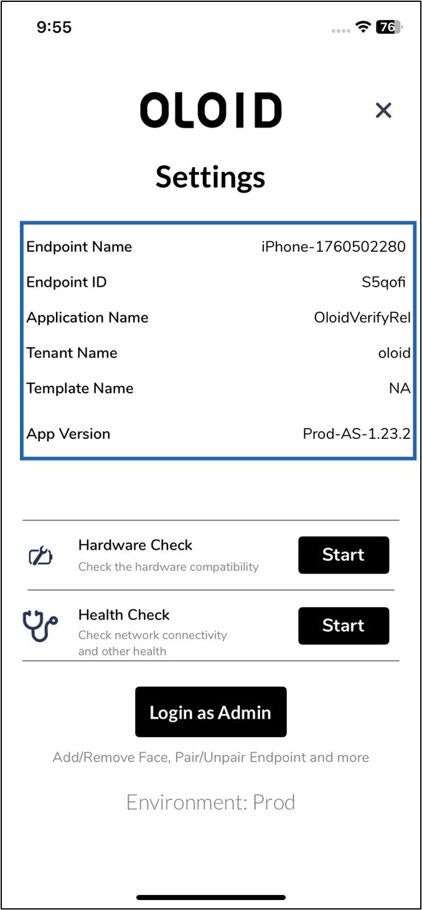

{/* Source: Intercom article 12585316 - https://oloid.help/en/articles/12585316-how-to-view-endpoint-details-on-the-oloid-connect-iphone-endpoint */}
{/* Generated by intercom_to_mintlify.py - re-running overwrites this file. */}

## Introduction

This document provides step-by-step instructions to view endpoint details on the Oloid Connect iPhone app.

## Prerequisite

The endpoint must be paired.

For more, refer to [How to pair an Oloid Connect endpoint on iPhone](/platforms/ios/time-clock/oloid-connect/how-to-pair-oloid-connect-endpoint-on-iphone)

## Steps to view Endpoint Details on the Endpoint

1. Launch the **Oloid Connect App**.

   <Note>
     **Note:** Since the endpoint is already paired, the App will launch in the initial screen of the App. For more, refer to [How to pair an Oloid Connect endpoint on iPhone](/platforms/ios/time-clock/oloid-connect/how-to-pair-oloid-connect-endpoint-on-iphone)
   </Note>

   

2. Double tap with two fingers on the initial screen to launch the Admin Mode.
3. Tap **Yes-Continue.**

   

   The **Settings** page is displayed.
4. On the Settings page, the endpoint details are displayed.

   
