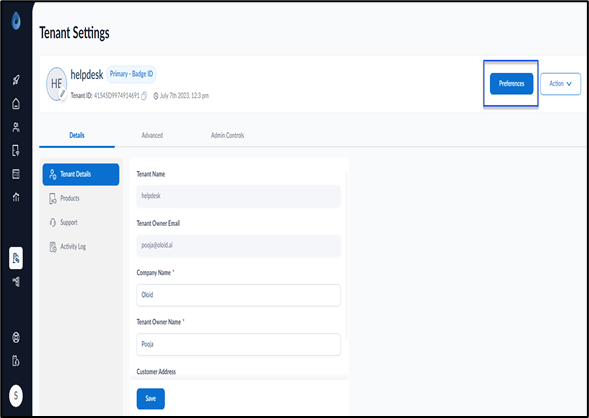
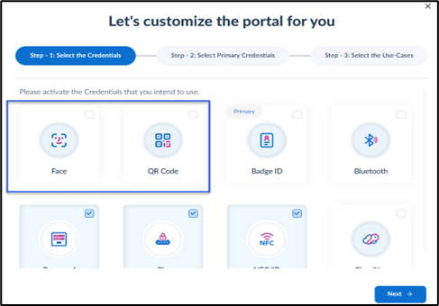
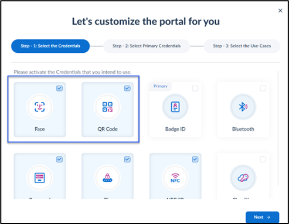

{/* Source: Intercom article 9361377 - https://oloid.help/en/articles/9361377-issue-oloid-connect-unable-to-view-add-face-or-qr */}
{/* Generated by intercom_to_mintlify.py - re-running overwrites this file. */}

## Summary

Admin and Supervisor was not able to add or view the face/QR in the Admin mode of the app.

## Description

## Applies To

Oloid Connect

## Cause

Config Issue

## Solution

1. Login to Oloid Platform ( Switch to new UI).
2. Click Tenant Settings.
3. Go to Preferences.
4. Check if Face/QR checkbox is selected under Select Credentials and Select Primary Credentials tab

   

   

5. Check the box if it is not selected. Click on Save and Next .

   

6. If the box is selected ,contact Oloid Support ( hyperlinked to [support@oloid.ai](mailto:support@oloid.ai) )

## Related Documents
