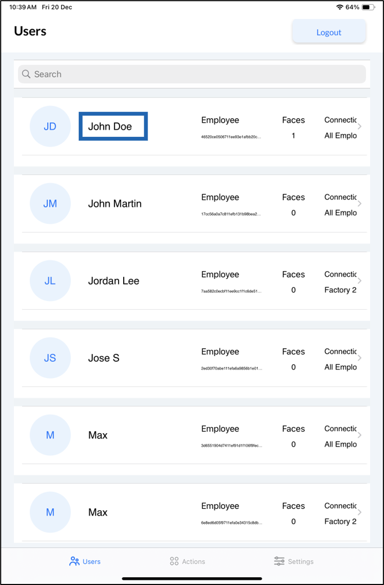
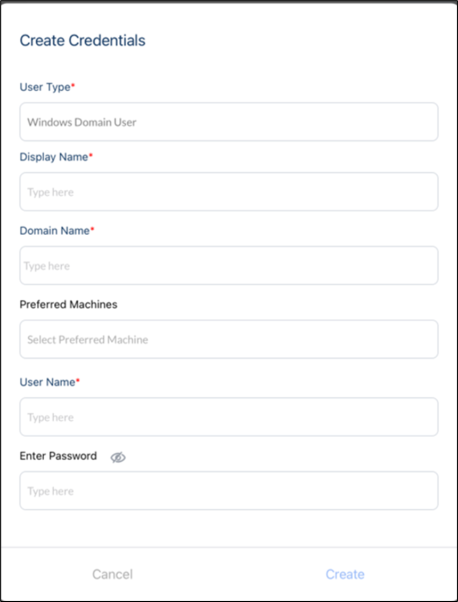
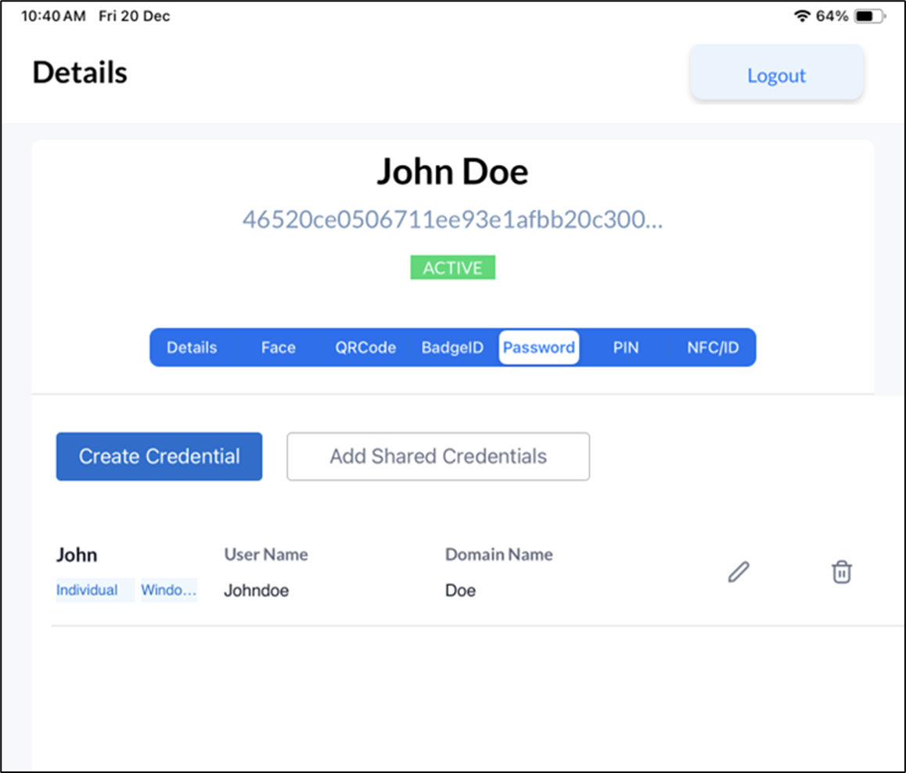
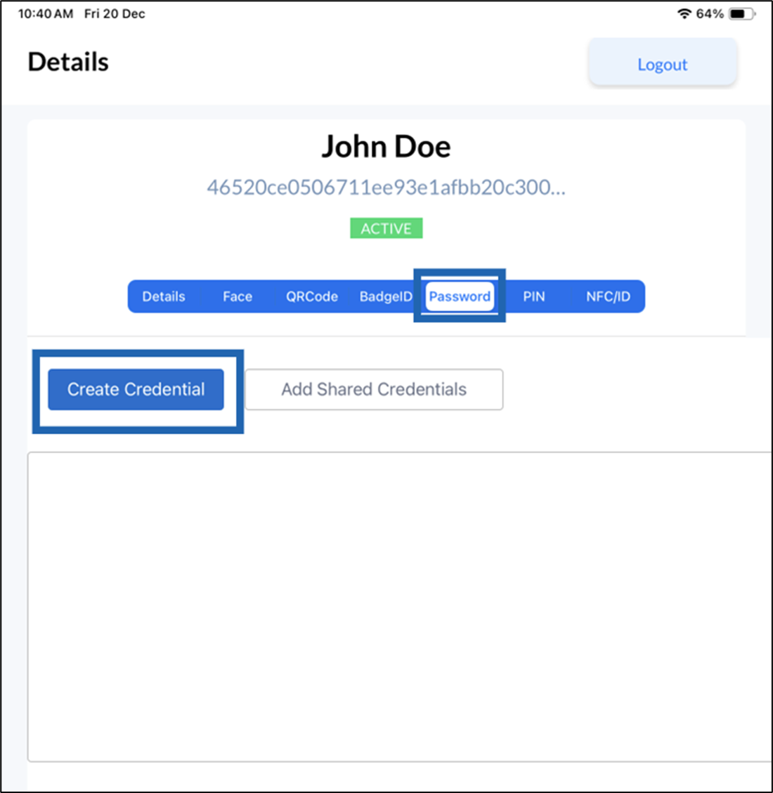
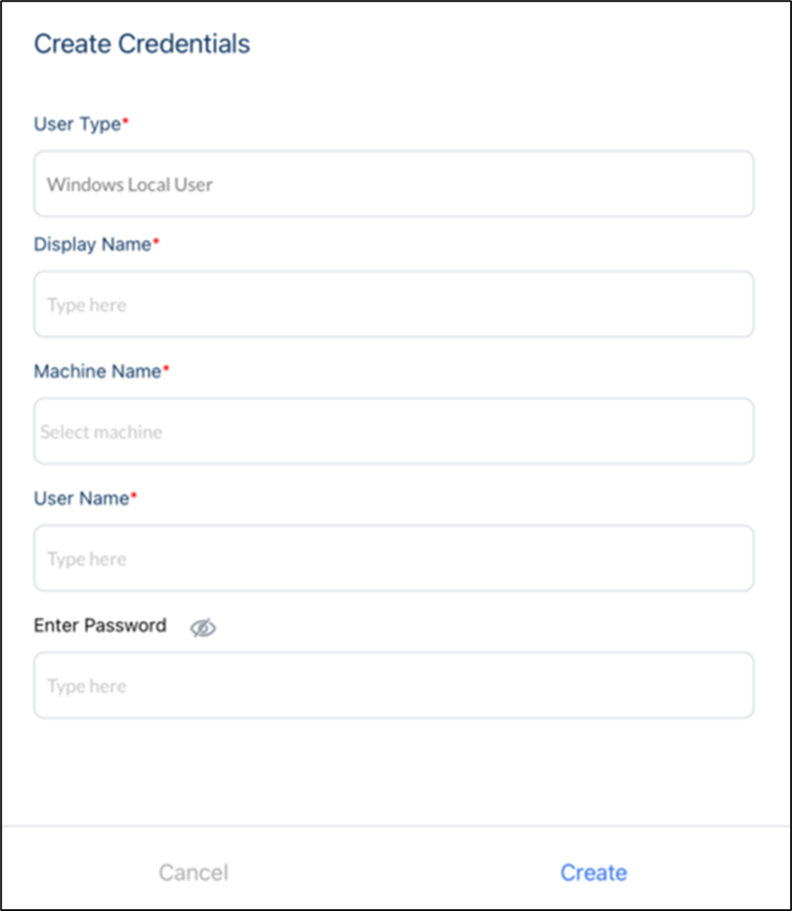
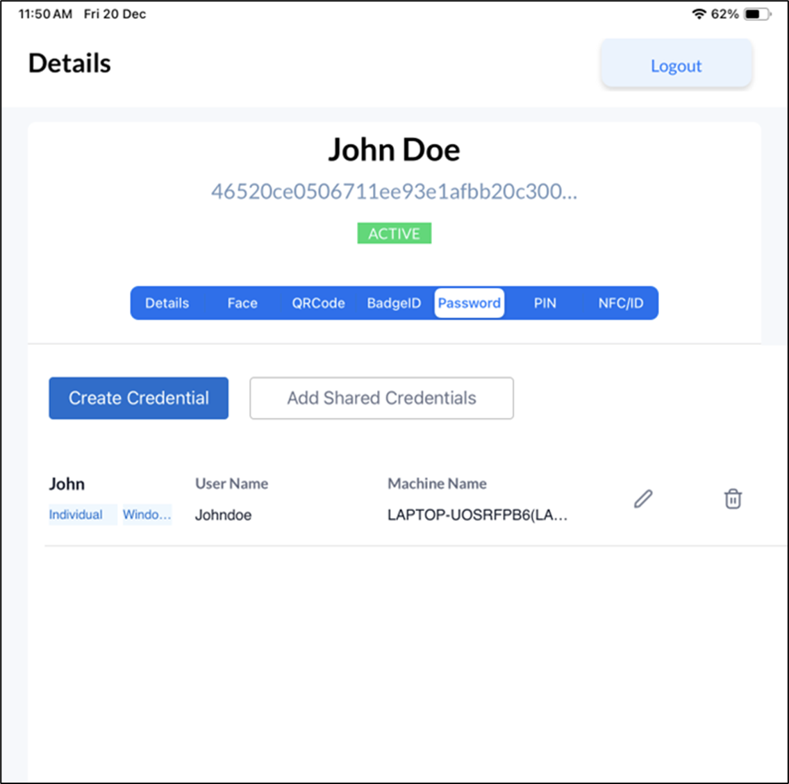

{/* Source: Intercom article 10299840 - https://oloid.help/en/articles/10299840-oloid-connect-add-password */}
{/* Generated by intercom_to_mintlify.py - re-running overwrites this file. */}

[Windows Domain User.](#steps-to-add-password-for-windows-domain-user)

[Windows Local User.](#steps-to-add-password-for-windows-local-user)

## Steps to add Password for Windows Domain User

1. Log in to **Admin Mode** in **Oloid Connect**.

   <Note>
     **Note:** For more information about logging in to Admin Mode, see[**How to log into the admin mode of Oloid Connect App as a Supervisor/Admin**](/platforms/ios/time-clock/oloid-connect/how-to-log-in-to-admin-mode-in-the-oloid-connect-app)**.**
   </Note>

   The **Users** screen is displayed.
2. Select **user**.

   

   The **details** screen is displayed.
3. Go to **Password** > tap **Create Credential**.

   

   The **Create Credentials** pop-up is displayed.

   

4. Do the following.
   1. Select **Windows Domain User** from the **User type** dropdown.
   2. Enter **Display Name**.
   3. Enter **Domain Name**.
   4. Select **Preferred Machine** from the dropdown. (Optional)
   5. Enter **User Name**.
   6. Enter **Password**.(Optional)
   7. Click **Create**.
      The Windows Domain Password is created for the user successfully.

      

## Steps to add Password for Windows Local User

1. Log in to **Admin Mode** in **Oloid Connect**.
   The **Users** screen is displayed.
2. Select **user**.

   

   The **details** screen is displayed.
3. Go to **Password** > tap **Create Credential**.

   

   The **Create Credentials** pop-up is displayed.

   

4. Do the following.
   1. Select **Windows Local User** from the **User Type** dropdown.
   2. Enter **Display Name**.
   3. Select **Machine Name** from the dropdown.
   4. Enter **User Name**.
   5. Enter **Password**. (Optional)
   6. Click **Create**.
      The Windows Local Password is created for the user successfully.

      
