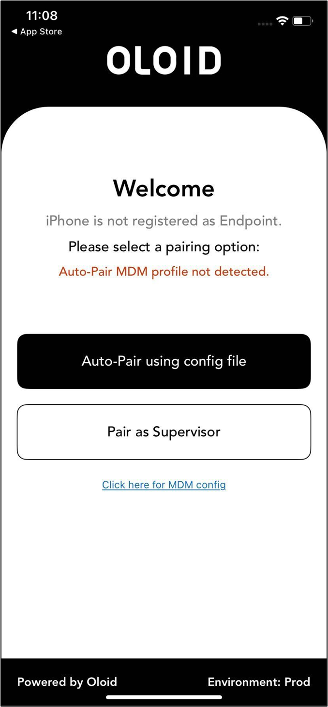
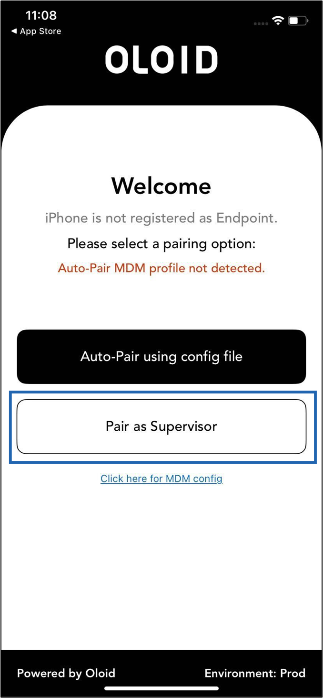
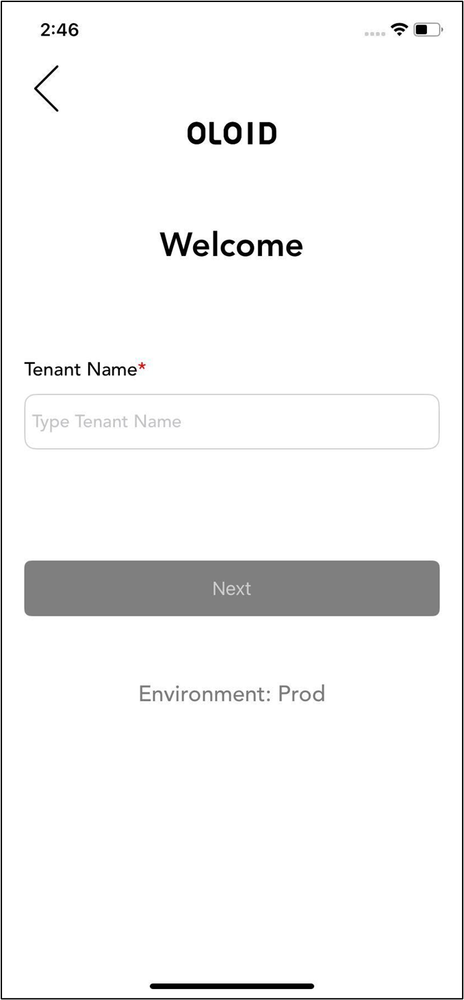
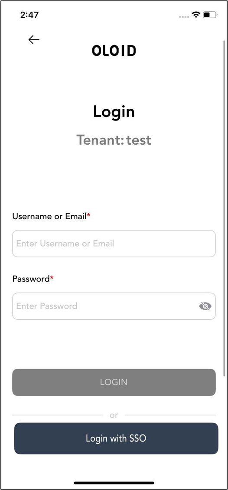
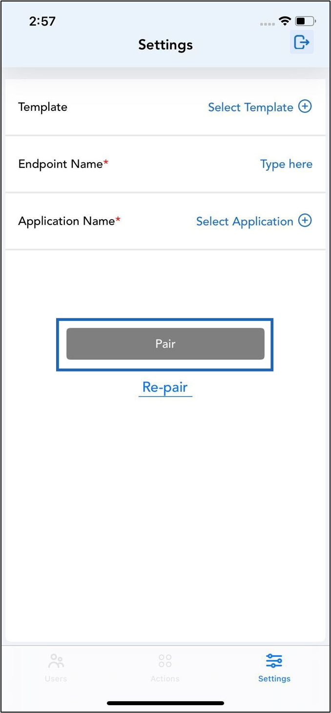
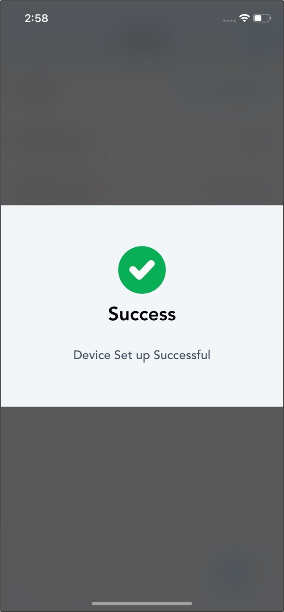
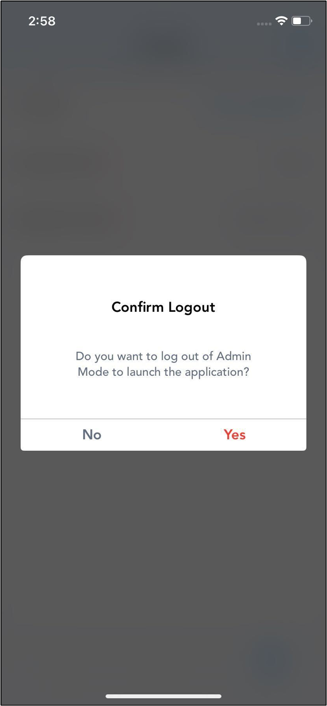

{/* Source: Intercom article 12554774 - https://oloid.help/en/articles/12554774-oloid-connect-admin-setup-on-iphone */}
{/* Generated by intercom_to_mintlify.py - re-running overwrites this file. */}

## Introduction

This feature of the **Oloid Connect app** allow Tenant Admin and Supervisor to set up iPhone in Admin mode. Once set up, you can manage settings, pair endpoints, and use the app for authentication.

## Pre-requisite

- You should be a Tenant Admin or Supervisor.
- Application, Connections, and template (optional) must be configured in Tenant Admin Portal.

## Device Compatibility

Ensure that your device is compatible with Oloid Connect App. See, [Hardware requirement for Oloid Connect installation](/platforms/ios/time-clock/oloid-connect/oloid-connect-hardware-and-software-requirements)

## Internet Connection

Make sure your device is connected to the internet for the setup.

## Steps to setup the Admin Mode

1. Launch the **Oloid Connect** app.
   The **Welcome** screen is displayed.

   

2. Tap **Pair as Supervisor.**

   

   The Welcome screen is displayed.

   

3. Enter **Tenant Name**, then tap **Next**.
   The **Login** page is displayed.
4. Do the following:
   1. Enter your email ID in the **Email** text field.
   2. Enter your password in the **Password** text field.
   3. Tap **LOGIN**.

      <Note>
        **Note:** You may also log in using SSO options.
      </Note>

      

      The **Settings** page is displayed.
5. Pair the endpoint. For more, refer to[How to pair an Oloid Connect endpoint on iPhone](/platforms/ios/time-clock/oloid-connect/how-to-pair-oloid-connect-endpoint-on-iphone)

   

   The settings are saved and the Device Setup success message is displayed.

   

   <Note>
     **Note:** Once the iPhone is successfully paired, other settings can be configured in the Tenant Admin Portal.
   </Note>

   The application prompts you to log out of Admin mode.
6. Do one of the following:
   1. Tap **Yes** to log out and launch the application (**preview mode**).
      The app displays preview mode and allows you to capture live Images for facial transactions.

      <Note>
        **Note:** To go back to admin mode, **double-click with two fingers** on preview mode and tap **Yes- To Continue**.
      </Note>

   2. Tap **No** to stay logged in to the admin mode.

