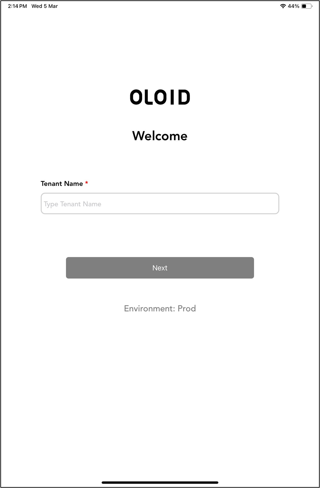
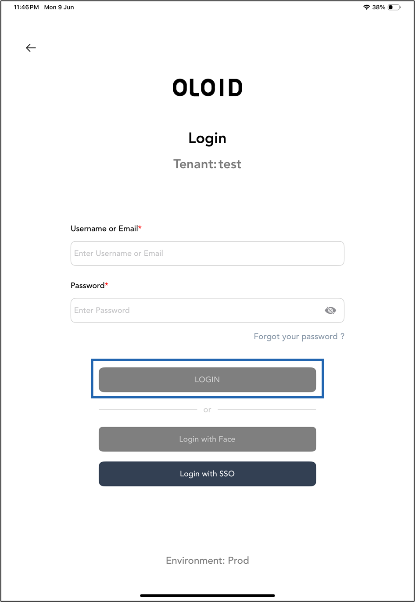
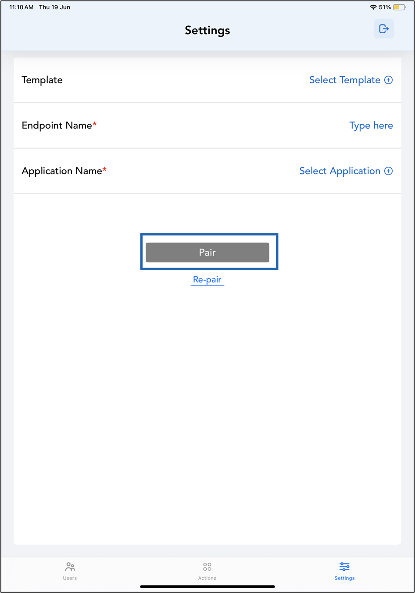
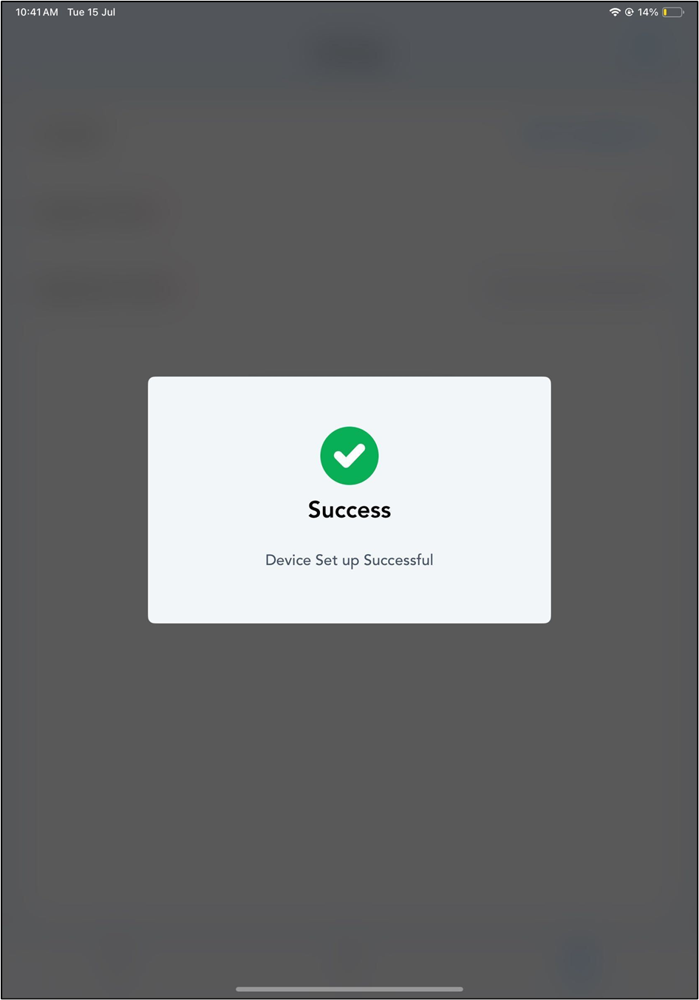
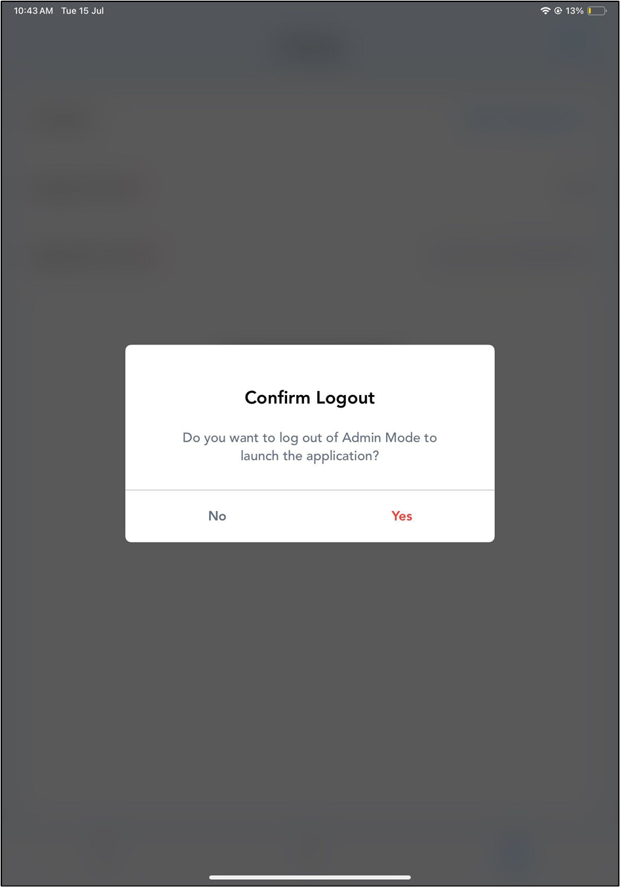

{/* Source: Intercom article 8592262 - https://oloid.help/en/articles/8592262-oloid-connect-admin-setup */}
{/* Generated by intercom_to_mintlify.py - re-running overwrites this file. */}

## Introduction

The **Oloid Connect - Admin Setup** process includes logging into the Oloid Connect app, pairing the endpoint with the Oloid Connect application.

## Prerequisites

- You must have access to Admin or Supervisor account.
- Oloid Connect Application and Connections must be configured in Tenant Admin Portal. For more information, refer to [How to Create and Configure Oloid Connect Application in Tenant Admin Portal](/platforms/ios/time-clock/oloid-connect/oloid-connect-how-to-create-and-configure-application-in-tenant-admin)

### Device Compatibility

Ensure that your device is compatible with Oloid Connect App. See, [Oloid Connect - Hardware and Software Requirements](/platforms/ios/time-clock/oloid-connect/oloid-connect-hardware-and-software-requirements)

### Internet Connection

Make sure your device is connected to the internet for the setup.

## Steps to setup the Admin Mode

1. Launch the **Oloid Connect**  app.
   The **Welcome** screen is displayed.
2. Tap **Pair as Supervisor.**

   

   The Welcome screen is displayed.

   

3. Enter **Tenant Name**, then tap **Next**.
   The **Login** page is displayed.
4. Do the following:
   1. Enter **Tenant Name**.
   2. Enter your email ID in the **Email** text field.
   3. Enter your password in the **Password** text field.
   4. Tap **LOGIN**.

      <Note>
        **Note:** You may also log in using SSO options. For more, refer to[Log in Using SSO](/platforms/ios/time-clock/oloid-connect/how-to-log-in-to-admin-mode-in-the-oloid-connect-app)
      </Note>

      

      The **Settings** page is displayed.
5. Pair the Endpoint. For more details, see [How to pair the endpoint in Oloid Connect app](/platforms/ios/time-clock/oloid-connect/oloid-connect-how-to-pair-an-endpoint)

   

   The Endpoint is paired successfully and the Device Setup successful pop up box is displayed.

   

   <Note>
     **Note:** Once the iPad is successfully paired, other settings can be configured in the Tenant Admin Portal.
   </Note>

   The application prompts you to log out of Admin mode.
6. Do one of the following:
   1. Tap **Yes** to log out and launch the application (**preview mode**).
      The app displays preview mode and allows you to capture live Images for facial transactions.

      <Note>
        **Note:** To go back to admin mode, **double-click with two fingers** on preview mode and tap **Yes- To Continue**.
      </Note>

   2. Tap **No** to stay logged in to the admin mode.

### Admin Mode Actions Without Endpoint Pairing

You can perform the following actions without pairing the endpoint:

- [View user details](/platforms/ios/time-clock/oloid-connect/oloid-connect-how-to-view-user-details)
- [Add User](/platforms/ios/time-clock/oloid-connect/oloid-connect-how-to-add-a-user)
- [Add Face](/platforms/ios/time-clock/oloid-connect/oloid-connect-how-to-add-face-for-a-user)
- [Add QR Code](/platforms/ios/time-clock/oloid-connect/oloid-connect-how-to-add-qr-code-for-a-user)
- [Set PIN](/platforms/ios/time-clock/oloid-connect/oloid-connect-how-to-set-pin-for-a-user)
- [Add NFC/ID](/platforms/ios/time-clock/oloid-connect/oloid-connect-how-to-add-nfc-id-for-a-user)
- [Assign Badge](/platforms/ios/time-clock/oloid-connect/oloid-connect-assign-badge)

### Common Installation Requirements

- Ensure your device meets the app's requirements.
- Check your internet connection during installation.
- Verify that you've granted the necessary permissions to the app.

### Support Contact

If you encounter any specific issues or have questions, reach out to **[Oloid support](mailto:support@oloid.ai)** for personalized assistance.
