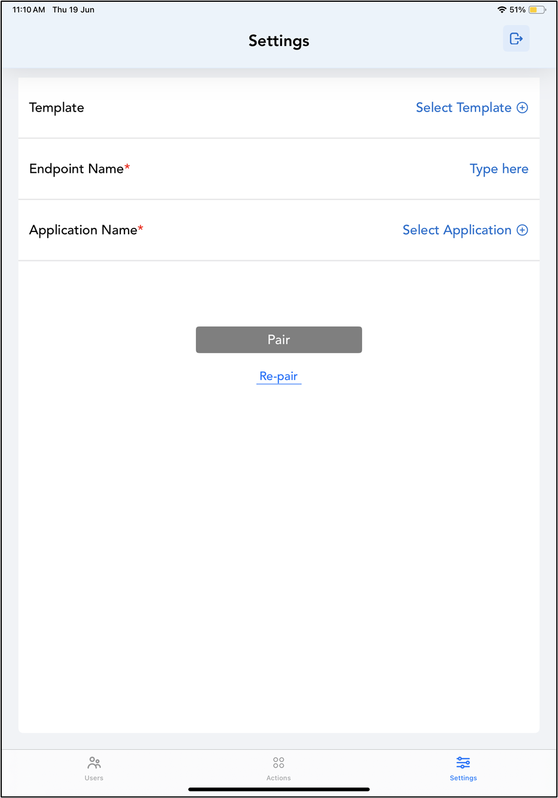
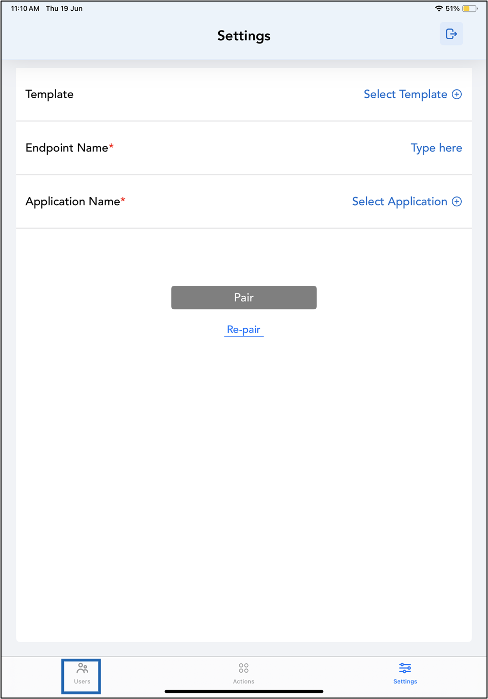
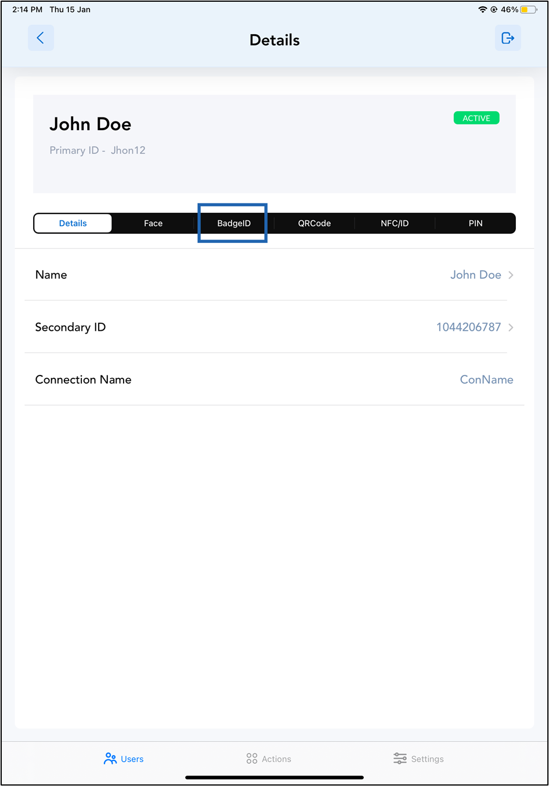
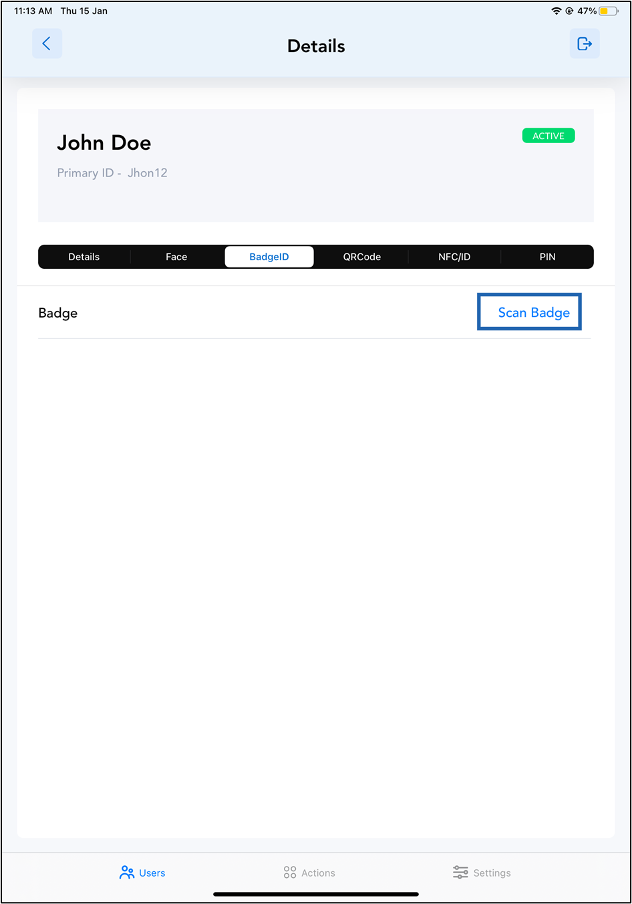
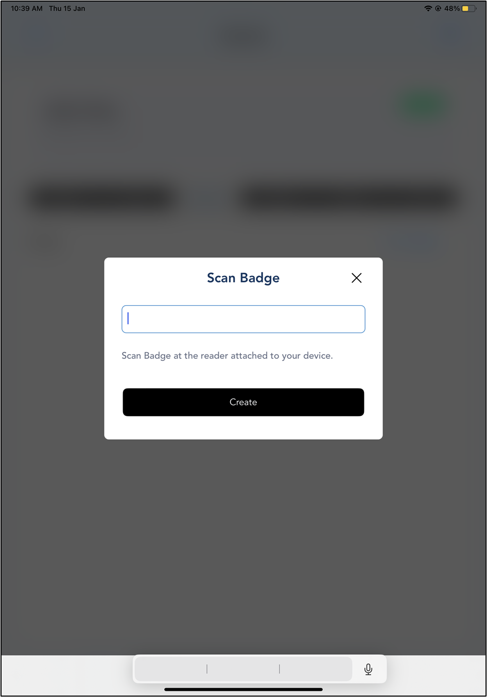
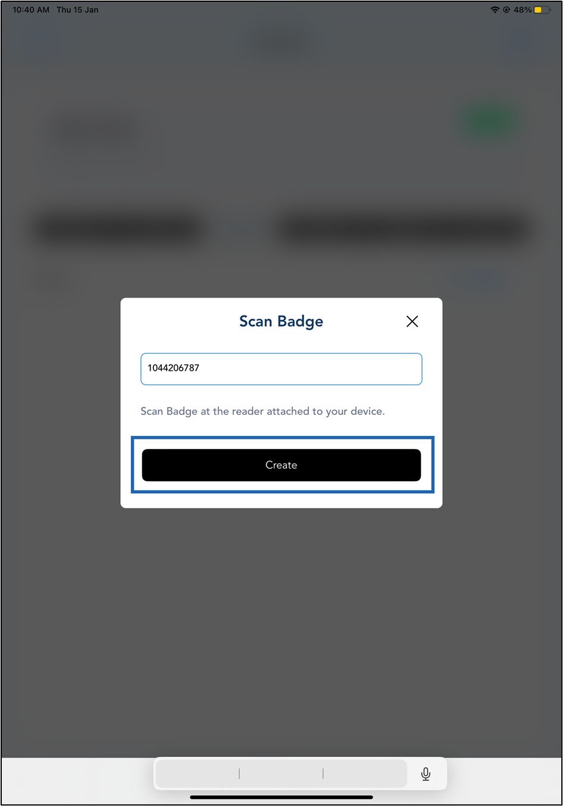
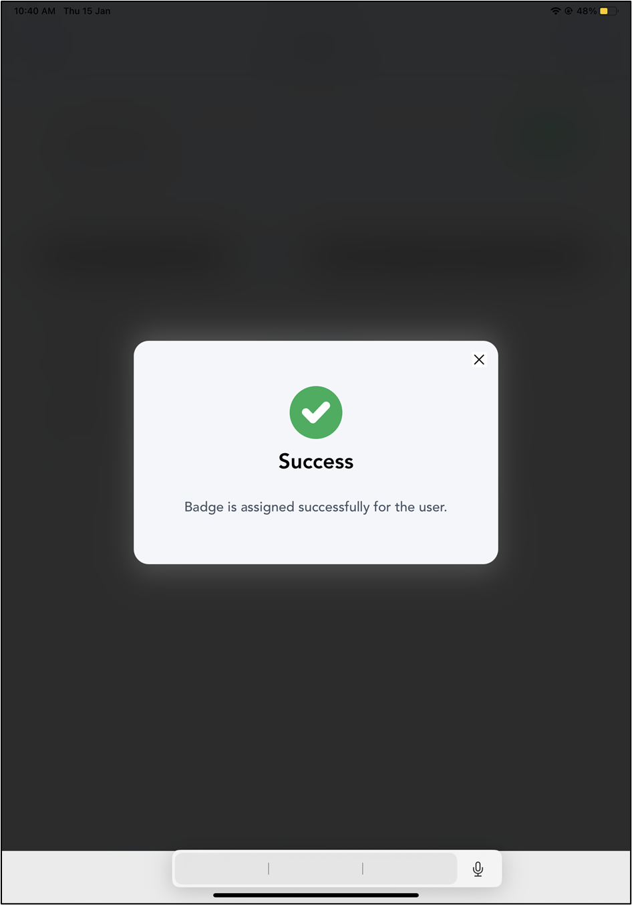
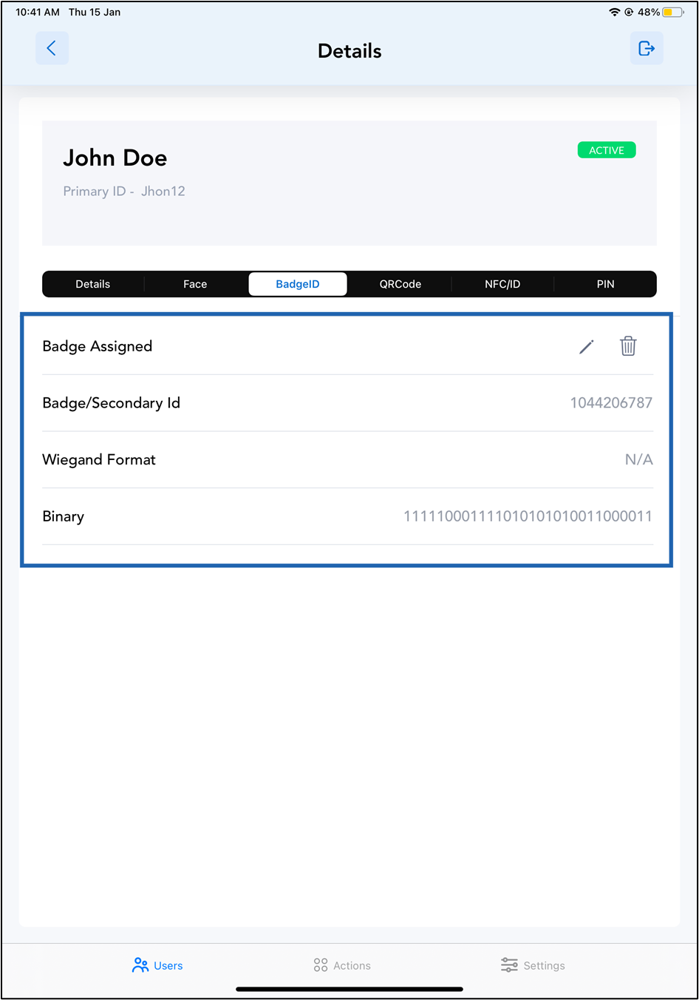

{/* Source: Intercom article 13395774 - https://oloid.help/en/articles/13395774-oloid-connect-assign-badge */}
{/* Generated by intercom_to_mintlify.py - re-running overwrites this file. */}

## Introduction

This document explains how to assign a badge to a user using the Oloid Connect iPad app. Admin can scan a physical badge using a connected badge reader to enroll it for a user.

## Prerequisites

- User should be added to the connection paired with the application.
- The badge reader must be connected to the iPad.

## Steps to assign Badge

1. Launch the **Oloid Connect** app.

   <Note>
     **Note:** For more information about how to log in to the Oloid Connect, refer to [How to log in to the Admin mode in Oloid Connect App.](/platforms/ios/time-clock/oloid-connect/how-to-log-in-to-admin-mode-in-the-oloid-connect-app)
   </Note>

   The **Settings** page is displayed.

   

2. Tap **Users** on the menu at the bottom of the screen.

   

   The **Users** page is displayed.
3. Select **user** from the list, or search for a user using the search bar at the top to assign the badge.

   

   The user **details** screen is displayed.
4. Go to **BadgeID**.

   

   The **BadgeID** screen is displayed.
5. Tap **Scan Badge.**

   

   The **Scan Badge** pop up is displayed.
6. Scan the **Badge** on the **Badge reader**.

   <Note>
     **Note:** The badge reader must be connected to the iPad.
   </Note>

   

   The Badge is scanned Successfully.

Tap **Create.**

The **Badge** is assigned successfully to the user.

The assigned badge ID details are displayed on the **BadgeID** screen.

